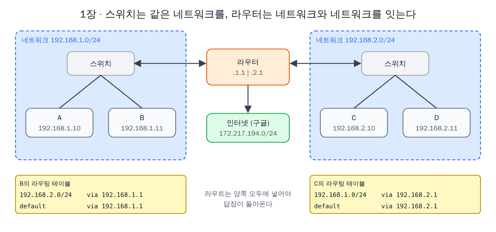
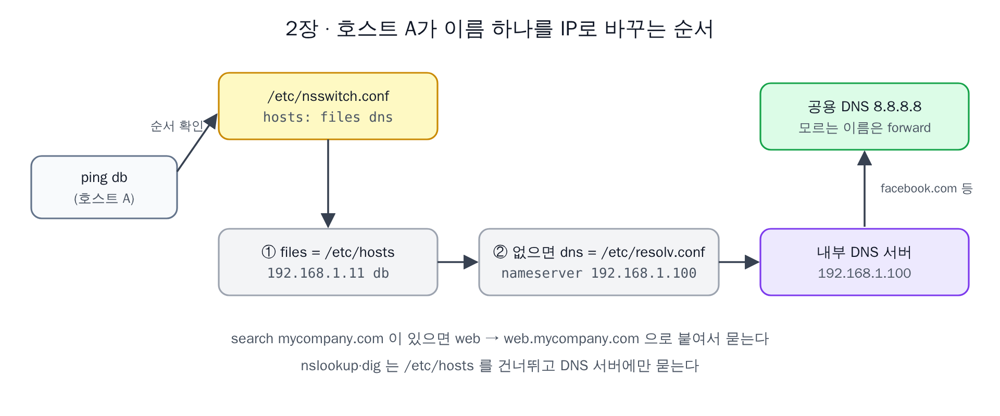
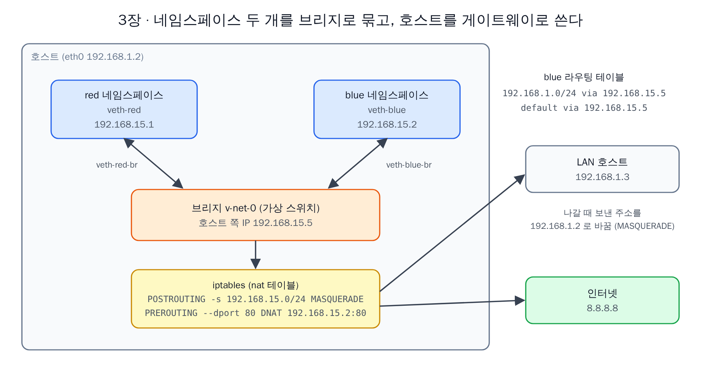
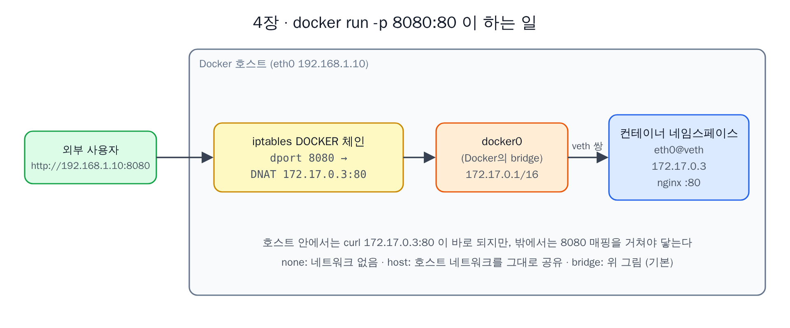
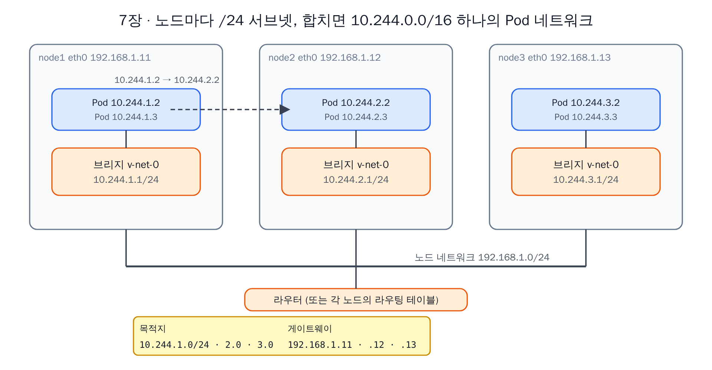
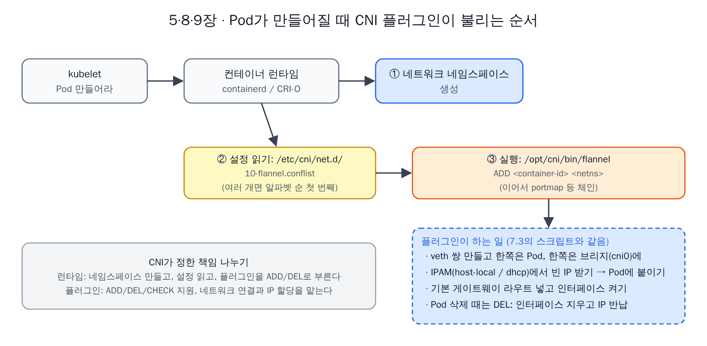
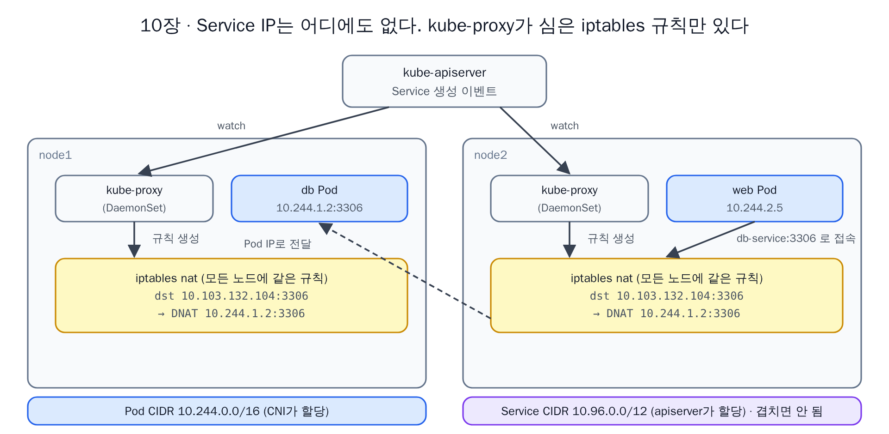
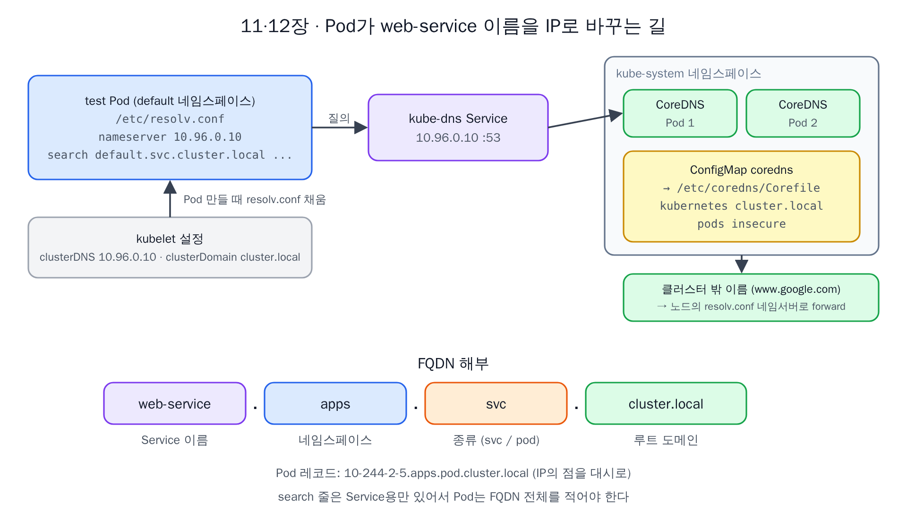
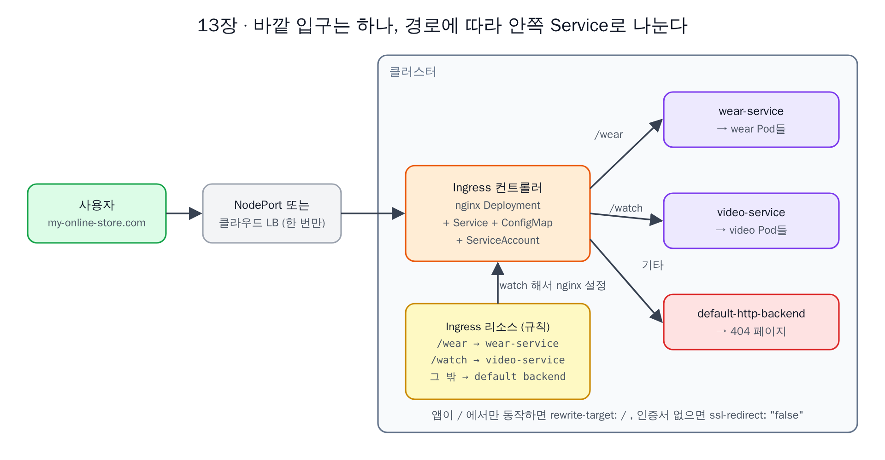
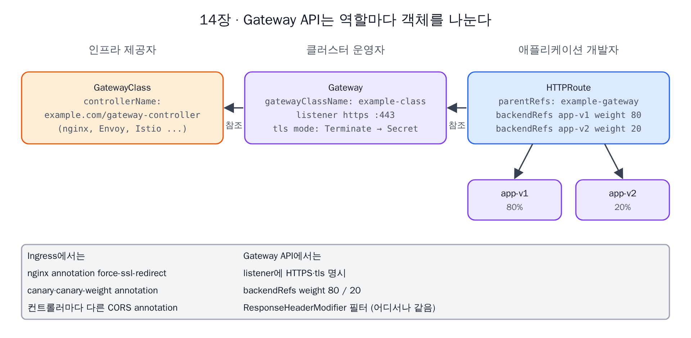

로드맵 위치: W4(10/26~11/1) / CKA Networking (KodeKloud) / 본선 연결점: 서비스 노출(NodePort·Ingress·Gateway API), 클러스터 DNS, CNI 장애 진단

# CKA 네트워킹 섹션, 한 권으로 읽기

KodeKloud CKA 과정의 Networking 섹션 강의 스크립트 21개(강의 15개, 실습 해설 6개)를 원래 순서대로 한 문서로 묶은 정리본이다. 위에서 아래로 한 번 읽으면 섹션 전체 내용을 다 알 수 있게 만들었다.

**읽는 법**

- 본문은 강의 내용이다 【사실, Notion "스크립트" 페이지 하위 21개, 2026-10-28 기준】. 빠진 내용은 없게 하고, 인사말·같은 말 반복·잡담만 뺐다.
- 📎 **용어**: 그 부(1~4부)에서 처음 나오는 말을 문단 바로 아래에서 설명한다. 본문 문장은 이 설명 없이도 읽히게 썼다.
- ✏️ **스크립트 보정**: 자동 자막이 잘못 받아 적은 곳(예: "Etsy hosts" → `/etc/hosts`)을 고친 것이다. 숫자를 문맥으로 맞춘 곳은 【추정】으로 표시했다.
- 💬 **덧붙임**: 강의에는 없지만 이해에 필요해서 내가 붙인 설명이다. 강의 내용과 섞이지 않게 따로 뺐다.
- 명령 블록: 스크립트는 명령을 말로만 읽는 경우가 많다. 그래서 명령은 강의가 말한 내용을 리눅스·kubectl 문법으로 옮겨 적었다. 강의 슬라이드를 직접 보지 못했으니 IP·이름 같은 값은 스크립트에 나온 값을 따랐다.
- 그림 1~10: 강의 슬라이드가 아니라 내가 본문 내용을 보고 다시 그린 구조도다. 각 절 끝에 두었고, 값(IP·이름)은 본문과 같다. 원본은 `img/networking/gen.py`로 다시 만들 수 있다.

**원본에 대해 알아 둘 것** 【미확인】: 0장 소개에서 예고한 사전 강의 중 "CoreDNS 시작하기"(실제 DNS 서버를 직접 띄우는 강의)는 21개 페이지에 없다. 11장·12장이 이 강의를 참조하지만 내용은 스크립트에 없다.

---

## 0장. 이 섹션에서 배우는 것

쿠버네티스 네트워킹을 다루는 섹션이다. 이 섹션을 따라가려면 네트워크 기초가 조금 필요하다. 어떤 시스템에서 IP 주소를 설정하고 확인하는 법, 게이트웨이와 라우트, DNS와 DNS 서버 설정 같은 것들이다.

그래서 수강생 설문을 바탕으로 짧은 사전 강의를 만들었다. 인터페이스와 IP 주소 설정, 게이트웨이와 라우트 설정, 이름 해석의 기초, 리눅스의 DNS 설정, DNS 서버 중 하나인 CoreDNS 시작하기가 들어 있다. 그 밖에 네트워크 네임스페이스와, Docker가 그걸 내부에서 어떻게 쓰는지도 알아 두면 좋다. 사전 강의는 초보자용이고 선택이다. 아는 만큼 건너뛰어도 되지만, 강사는 네트워크 네임스페이스와 Docker 네트워킹 강의는 꼭 보라고 권한다.

사전 강의가 끝나면 쿠버네티스 네트워킹으로 들어간다. 흐름을 좋게 하려고 주제 순서를 조금 바꿨다. 클러스터 네트워킹에 무엇이 필요한지 → Pod 네트워킹 개념 → 쿠버네티스의 CNI와, CNI가 Pod 네트워킹 문제를 어떻게 푸는지(네트워크 네임스페이스 사전 강의에서 이어지는 부분) → 클러스터 DNS와 쿠버네티스가 DNS를 내부에서 어떻게 구현하는지 → Ingress 순서다.

> 📎 **용어**
> - **쿠버네티스(Kubernetes)**: 여러 대의 서버를 묶어 컨테이너를 알아서 배치·실행·재시작해 주는 시스템. 묶인 서버 무리를 **클러스터**, 그 안의 서버 한 대를 **노드**라고 한다.
> - **컨테이너**: 프로그램과 그 실행에 필요한 파일을 한 덩어리로 묶어, 호스트의 다른 프로세스와 격리된 채 실행하는 단위.
> - **Pod**: 쿠버네티스가 컨테이너를 배치하는 최소 단위. 컨테이너 1개 이상을 담고, Pod 하나가 IP 주소 하나를 받는다.
> - **CNI(Container Network Interface)**: 컨테이너를 네트워크에 붙이는 프로그램을 어떻게 만들고 어떻게 불러야 하는지 정한 표준.
> - **Ingress**: 클러스터 바깥에서 들어오는 HTTP 요청을 URL·도메인에 따라 안쪽 서비스로 나눠 보내는 쿠버네티스 기능.

💬 **덧붙임**: 0장 소개에는 없지만, 원본 페이지 맨 끝에 Gateway API 소개 강의(14장)가 하나 더 있다.

---

# 1부. 리눅스 네트워크 기초 (사전 강의)

## 1장. 스위칭, 라우팅, 게이트웨이

이 사전 강의 묶음에서는 스위칭·라우팅·게이트웨이 같은 기본 개념을 보고, 이어서 DNS, CoreDNS 소개, 리눅스의 DNS 설정, 리눅스 네트워크 네임스페이스 순서로 간다. OSI 모델이나 네트워크 계층 이론은 하지 않는다. 섹션의 나머지를 이해할 만큼만 복습한다.

개념만 보는 게 아니라 리눅스에서 실제로 어떻게 설정하는지 본다. 그래서 명령이 많다. 네트워크 엔지니어가 아니라 시스템 관리자와 애플리케이션 개발자 관점이다. 나중에 쿠버네티스에서 이 내용이 나올 때 정보를 어디서 찾고, 어디에 설정돼 있고, 문제를 어떻게 진단하는지 알 수 있게 하는 게 목적이다. 리눅스 네트워킹을 이미 잘 알면 쿠버네티스 강의로 바로 가도 된다.

> 📎 **용어**
> - **리눅스**: 서버에서 가장 많이 쓰는 운영체제. 쿠버네티스 노드도 거의 리눅스다.
> - **OSI 모델**: 네트워크 통신을 7개 계층으로 나눠 설명하는 이론 틀. 이 강의는 다루지 않는다.

### 1.1 네트워크와 스위치

네트워크란 무엇일까. 컴퓨터 A와 B가 있다. 노트북이든 데스크톱이든 클라우드의 VM이든 상관없다. A는 B에 어떻게 닿을까?

둘을 **스위치**에 연결한다. 스위치는 두 시스템을 담은 네트워크를 만든다. 스위치에 연결하려면 각 호스트에 **인터페이스**가 있어야 한다. 호스트에 따라 물리 인터페이스일 수도, 가상 인터페이스일 수도 있다. 호스트의 인터페이스는 `ip link` 명령으로 본다. 여기서는 스위치에 연결할 `eth0`이라는 인터페이스를 쓴다.

```bash
ip link                      # 이 호스트의 인터페이스 목록
```

> 📎 **용어**
> - **VM(가상 머신)**: 물리 서버 한 대 위에 소프트웨어로 만든 가상의 컴퓨터. 클라우드의 서버는 대부분 VM이다.
> - **호스트**: 네트워크에 연결된 컴퓨터 한 대. 여기서는 시스템·서버와 같은 뜻.
> - **스위치**: 같은 네트워크에 연결된 장치끼리 데이터를 주고받게 해 주는 장비.
> - **인터페이스**: 호스트가 네트워크에 연결되는 접점. 랜카드 같은 물리 장치일 수도, 소프트웨어로 만든 가상 장치일 수도 있다.
> - **eth0**: 리눅스에서 첫 번째 이더넷 인터페이스에 흔히 붙는 이름. 두 번째는 eth1.

네트워크 주소가 `192.168.1.0`이라고 하자. 두 시스템에 이 네트워크의 IP 주소를 준다. 이때 `ip addr` 명령을 쓴다.

```bash
# A에서
ip addr add 192.168.1.10/24 dev eth0
# B에서
ip addr add 192.168.1.11/24 dev eth0
```

✏️ **스크립트 보정**: 스크립트는 "ip addr 명령을 쓴다"고만 한다. A=`192.168.1.10`, B=`192.168.1.11`은 2장에서 "B의 IP는 192.168.1.11"이라고 나오는 것과 맞춘 값이다 【추정】.

링크가 켜지고 IP가 할당되면 두 컴퓨터는 스위치를 통해 서로 통신할 수 있다. 다만 스위치는 **한 네트워크 안의 통신만** 가능하게 한다. 같은 네트워크의 호스트가 보낸 패킷을 받아 같은 네트워크의 다른 시스템에 전달할 뿐이다.

> 📎 **용어**
> - **IP 주소**: 네트워크에서 장치를 가리키는 번호. `192.168.1.10`처럼 점으로 나눈 숫자 4개다.
> - **`/24`**: 앞 24비트(앞의 숫자 3개)가 네트워크 번호라는 뜻. `192.168.1.10/24`는 "192.168.1.x 네트워크의 10번"이고, 같은 네트워크에 .0~.255까지 들어간다. 이렇게 네트워크 하나를 묶은 범위를 **서브넷**이라고 한다.
> - **패킷**: 네트워크로 보내는 데이터를 잘게 나눈 조각. 보내는 쪽·받는 쪽 주소가 붙어 있다.
> - **링크가 켜진다(up)**: 인터페이스가 활성 상태가 되어 데이터를 주고받을 수 있게 된 것.

### 1.2 라우터: 네트워크와 네트워크를 잇는다

`192.168.2.0` 주소의 다른 네트워크에 시스템 C와 D가 있다고 하자. 한 네트워크의 시스템이 다른 네트워크의 시스템에 어떻게 닿을까? 예를 들어 IP가 `192.168.1.11`인 B가 다른 네트워크의 C에 어떻게 닿을까?

여기서 **라우터**가 필요하다. 라우터는 두 네트워크를 연결해 준다. 똑똑한 장치라서, 네트워크 포트가 많은 또 하나의 서버라고 생각하면 된다. 두 네트워크에 동시에 연결되므로 IP를 두 개 받는다. 첫 번째 네트워크에서 `192.168.1.1`, 두 번째 네트워크에서 `192.168.2.1`이다. 이제 두 네트워크 사이 통신을 가능하게 하는 라우터가 생겼다.

✏️ **스크립트 보정**: 스크립트는 C·D의 IP를 "192.1682.1 and 2.11", C를 "IP 2.1"이라고 읽는다. 그런데 바로 뒤에서 라우터가 `192.168.2.1`을 받으므로 C가 같은 주소일 수는 없다. C=`192.168.2.10`, D=`192.168.2.11`로 보는 게 맞다 【추정】.

> 📎 **용어**
> - **라우터**: 서로 다른 네트워크를 연결하고, 패킷을 목적지 네트워크 쪽으로 넘겨 주는 장비.
> - **포트(네트워크 포트)**: 여기서는 케이블을 꽂는 물리 구멍. 뒤에서 나오는 "포트 80" 같은 번호 포트와는 다른 뜻이다.

### 1.3 게이트웨이와 라우팅 테이블

B가 C에 패킷을 보내려 할 때, 라우터가 네트워크 어디에 있는지 B는 어떻게 알까? 라우터도 네트워크에 붙은 장치 중 하나일 뿐이고, 그런 장치는 많을 수 있다. 그래서 각 시스템에 **게이트웨이**(라우트)를 설정한다. 네트워크가 방이라면 게이트웨이는 바깥 세상, 즉 다른 네트워크나 인터넷으로 나가는 문이다. 시스템은 그 문이 어디 있는지 알아야 나갈 수 있다.

시스템의 현재 라우팅 설정은 `route` 명령으로 본다. 커널의 라우팅 테이블을 보여 준다. 지금은 라우팅 설정이 하나도 없다. 이 상태에서 B는 C에 닿을 수 없고, 같은 네트워크인 `192.168.1.0` 대역의 시스템에만 닿을 수 있다.

```bash
route                        # 커널 라우팅 테이블 보기 (ip route 와 같은 정보)
```

> 📎 **용어**
> - **게이트웨이**: 자기 네트워크 밖으로 나갈 때 패킷을 넘겨 줄 장치(보통 라우터)의 주소.
> - **라우트 / 라우팅 테이블**: "어느 네트워크로 가려면 어디로 보내라"는 규칙 한 줄이 라우트, 그 목록이 라우팅 테이블이다.
> - **커널**: 운영체제의 중심부. 네트워크 패킷 처리도 커널이 한다.

B에서 `192.168.2.0` 네트워크의 시스템에 닿게 게이트웨이를 설정하려면 `ip route add`를 실행한다. "`192.168.2.0` 네트워크는 문(게이트웨이) `192.168.1.1`을 통해 갈 수 있다"고 적는 것이다. 다시 `route`를 실행하면 라우터를 거쳐 `192.168.2.0` 대역으로 가는 라우트가 추가된 게 보인다.

```bash
# B에서
ip route add 192.168.2.0/24 via 192.168.1.1
```

✏️ **스크립트 보정**: 스크립트의 "182.168.2.0"은 `192.168.2.0`의 오독이다.

이 설정은 **모든 시스템에** 해야 한다. 예를 들어 C가 B에 패킷을 보내려면, C의 라우팅 테이블에도 "`192.168.1.0` 네트워크는 `192.168.2.1` 라우터를 통해 간다"는 라우트를 추가해야 한다.

```bash
# C에서
ip route add 192.168.1.0/24 via 192.168.2.1
```

### 1.4 인터넷과 기본 게이트웨이

이 시스템들이 인터넷, 예를 들어 인터넷의 `172.217.194.0` 네트워크에 있는 구글에 접속해야 한다고 하자. 라우터를 인터넷에 연결하고, 라우팅 테이블에 "`172.217.194.0` 네트워크로 가는 트래픽은 모두 라우터로"라는 라우트를 추가한다.

```bash
ip route add 172.217.194.0/24 via 192.168.2.1
```

✏️ **스크립트 보정**: 스크립트는 "172.27.194.0"이라고 읽는다. 구글이 쓰는 대역 표기로는 `172.217.194.0`이 맞을 가능성이 높다 【추정】. 어느 쪽이든 개념에는 영향이 없다.

그런데 인터넷에는 서로 다른 네트워크에 사이트가 아주 많다. 네트워크마다 같은 라우터 IP로 가는 항목을 일일이 추가하는 대신, "라우트를 모르는 네트워크는 전부 이 라우터를 **기본 게이트웨이**로 써라"고 하면 된다. 그러면 자기 네트워크 밖으로 가는 요청은 모두 이 라우터로 간다. 이런 간단한 구성에서는 기본 게이트웨이를 라우터 IP로 정한 라우팅 항목 하나면 충분하다.

```bash
ip route add default via 192.168.2.1
# default 대신 0.0.0.0 으로 써도 같은 뜻 (모든 목적지)
```

`default` 대신 `0.0.0.0`이라고 써도 된다. 어떤 IP 목적지든 다 해당한다는 뜻이고, 두 줄은 같은 의미다. 반대로 라우팅 테이블의 **게이트웨이 칸**에 `0.0.0.0`이 적혀 있으면 "게이트웨이가 필요 없다"는 뜻이다. 예를 들어 C가 `192.168.2.0` 네트워크의 장치에 접근할 때는 자기 네트워크 안이라 게이트웨이가 필요 없다.

> 📎 **용어**
> - **트래픽**: 네트워크를 오가는 데이터 흐름.
> - **기본 게이트웨이(default gateway)**: 라우팅 테이블에 맞는 규칙이 없을 때 패킷을 보내는 마지막 출구.

네트워크에 라우터가 여러 대라면, 예를 들어 하나는 인터넷용, 하나는 내부 사설망용이라면, 항목이 두 개 필요하다. 내부 사설망으로 가는 항목 하나, 그리고 공용 네트워크를 포함한 나머지 모든 네트워크로 가는 기본 게이트웨이 항목 하나다. 그래서 시스템에서 인터넷이 안 될 때는 라우팅 테이블과 기본 게이트웨이 설정부터 보는 게 좋다.

> 📎 **용어**
> - **사설 네트워크(사설망)**: 회사·집 안에서만 쓰는 네트워크. `192.168.x.x`, `10.x.x.x` 같은 대역은 인터넷에서 직접 닿지 않는 사설 주소다.



*그림 1. 두 네트워크, 라우터, 라우팅 테이블 (1.1–1.4)*

### 1.5 리눅스 호스트를 라우터로 만들기

간단한 구성에서 시작한다. 호스트 A, B, C가 있다. A와 B는 `192.168.1` 네트워크, B와 C는 `192.168.2` 네트워크에 연결돼 있다. 즉 B는 `eth0`과 `eth1` 두 인터페이스로 두 네트워크에 다 연결된다. A는 `192.168.1.5`, C는 `192.168.2.5`, B는 양쪽에 `192.168.1.6`과 `192.168.2.6`을 가진다.

A가 C와 통신하게 하려면 어떻게 해야 할까? A에서 `192.168.2.5`로 `ping`을 보내면 "Network is unreachable"이 나온다. 이유는 이제 안다. A는 `192.168.2` 네트워크에 가는 법을 모른다. 그래서 A에게 "네트워크 2로 가는 문은 B다"라고 알려 줘야 하고, 이건 라우팅 항목으로 한다.

```bash
# A에서
ip route add 192.168.2.0/24 via 192.168.1.6
```

> 📎 **용어**
> - **ping**: 상대 IP에 작은 확인 패킷을 보내고 응답이 오는지 보는 명령. 연결 확인용으로 가장 먼저 쓴다.

패킷이 C에 도착했다면 C는 A에게 응답을 돌려보내야 한다. C가 `192.168.1` 네트워크의 A에 닿으려 하면 같은 문제가 생긴다. 그래서 C에게도 "라우터 역할을 하는 B를 통해 A에 갈 수 있다"고 알려 준다. 이번에는 "`192.168.1.0` 네트워크로 가려면 `192.168.2.6`의 B에게 말하라"는 항목이다.

```bash
# C에서
ip route add 192.168.1.0/24 via 192.168.2.6
```

이제 `ping`을 보내면 "Network is unreachable" 에러는 더 안 나온다. 라우팅 항목은 맞다는 뜻이다. 그런데 여전히 응답이 오지 않는다.

리눅스는 기본적으로 **한 인터페이스로 받은 패킷을 다른 인터페이스로 넘기지 않는다**. 예를 들어 B의 `eth0`으로 받은 패킷은 `eth1`을 통해 다른 곳으로 전달되지 않는다. 보안 때문이다. `eth0`이 사설 네트워크, `eth1`이 공용 네트워크에 연결돼 있다면, 명시적으로 허용하지 않는 한 공용 네트워크의 누군가가 사설 네트워크로 쉽게 메시지를 보내면 안 된다. 하지만 이 예에서는 두 네트워크 모두 사설이라 안전하므로, B가 한 네트워크에서 다른 네트워크로 패킷을 넘기도록 허용할 수 있다.

호스트가 인터페이스 사이에 패킷을 넘길 수 있는지는 `/proc/sys/net/ipv4/ip_forward` 파일의 값으로 정해진다. 기본값은 0(넘기지 않음)이다. 1로 바꾸면 `ping`이 통과한다.

```bash
cat /proc/sys/net/ipv4/ip_forward      # 0 이면 전달 안 함
echo 1 > /proc/sys/net/ipv4/ip_forward
```

이렇게 값만 바꾸면 재부팅하면 원래대로 돌아간다. 유지하려면 `/etc/sysctl.conf` 파일에서 같은 값을 바꿔야 한다.

```
# /etc/sysctl.conf
net.ipv4.ip_forward = 1
```

✏️ **스크립트 보정**: "proc sys net IPv4 IP underscore forward" → `/proc/sys/net/ipv4/ip_forward`, "Etsy Sis control dot conf" → `/etc/sysctl.conf`. 앞으로 나오는 "Etsy"는 전부 `/etc`(리눅스 설정 파일 폴더)의 자막 오독이다.

> 📎 **용어**
> - **`/proc`**: 커널의 현재 설정·상태를 파일처럼 보여 주는 특수 폴더. 여기 값을 바꾸면 즉시 반영되지만 재부팅하면 사라진다.
> - **`/etc`**: 리눅스의 설정 파일이 모여 있는 폴더.
> - **IP 포워딩(IP forwarding)**: 한 인터페이스로 들어온 패킷을 다른 인터페이스로 넘겨 주는 기능. 라우터가 하는 일이다.

### 1.6 이 강의의 핵심 명령

앞으로 강의에서 계속 쓸 명령들이다.

| 명령 | 하는 일 |
|---|---|
| `ip link` | 호스트의 인터페이스 목록 보기·수정 |
| `ip addr` | 인터페이스에 할당된 IP 보기 |
| `ip addr add` | 인터페이스에 IP 설정 |
| `ip route` 또는 `route` | 라우팅 테이블 보기 |
| `ip route add` | 라우팅 테이블에 항목 추가 |
| `cat /proc/sys/net/ipv4/ip_forward` | 라우터 역할 호스트에서 IP 포워딩이 켜져 있는지 확인 |

이 명령으로 바꾼 설정은 재시작하면 사라진다. 유지하려면 네트워크 인터페이스 설정 파일(`/etc/network/interfaces`)에 적어야 한다.

---

## 2장. 리눅스의 DNS

완전 초보자를 위한 리눅스 DNS 소개다. 기본 개념과, 리눅스 호스트에서 DNS 설정을 살펴볼 때 쓰는 명령을 본다.

### 2.1 이름 붙이기: /etc/hosts

같은 네트워크에 컴퓨터 A와 B가 있고 IP는 `192.168.1.10`과 `192.168.1.11`이다. A에서 B의 IP로 `ping`을 보낼 수 있다. B에는 데이터베이스 서비스가 있다. 그래서 B의 IP를 외우는 대신 `db`라는 이름을 붙이기로 한다. 앞으로는 IP 대신 `db`라는 이름으로 B에 `ping`을 보내고 싶다.

지금 `ping db`를 하면 A는 `db`라는 호스트를 모른다고 한다. 어떻게 고칠까? A에게 "`192.168.1.11`의 시스템 B는 이름이 `db`다", 즉 "내가 db라고 하면 `192.168.1.11`을 말하는 거다"라고 알려 주면 된다. A의 `/etc/hosts` 파일에 IP와, 호스트가 보게 할 이름을 적는다.

```
# A의 /etc/hosts
192.168.1.11    db
```

이제 `ping db`는 올바른 IP로 가서 성공한다.

> 📎 **용어**
> - **DNS(Domain Name System)**: `google.com` 같은 이름을 IP 주소로 바꿔 주는 체계.
> - **`/etc/hosts`**: 호스트 자기 안에 둔 "이름 = IP" 메모장 파일.

여기서 중요한 점이 있다. A는 `/etc/hosts`에 적힌 걸 그대로 믿는다. 이 파일은 A에게 진실의 원천이지만 실제로 사실일 필요는 없다. A는 B의 진짜 이름이 `db`인지 확인하지 않는다. 예를 들어 B에서 `hostname` 명령을 실행하면 이름이 `host-2`라고 나오지만 A는 상관하지 않는다. hosts 파일에 적힌 대로 갈 뿐이다.

A를 속여 B가 구글이라고 믿게 할 수도 있다. hosts 파일에 B의 IP를 `www.google.com`에 매핑하는 항목을 넣고 구글에 `ping`하면 B가 응답한다. 이제 한 시스템을 가리키는 이름이 `db`와 `www.google.com` 두 개가 됐고, 어느 이름으로든 B에 닿는다. hosts 파일에는 서버를 원하는 만큼, 이름도 원하는 만큼 넣을 수 있다.

A에서 다른 호스트를 이름으로 부를 때마다, `ping`이든 `ssh`든 시스템 안의 어떤 애플리케이션·도구든, A는 `/etc/hosts`를 보고 그 호스트의 IP를 알아낸다. 이렇게 호스트 이름을 IP 주소로 바꾸는 것을 **이름 해석(name resolution)**이라고 한다.

> 📎 **용어**
> - **`hostname` 명령**: 그 시스템이 스스로 알고 있는 자기 이름을 출력한다.
> - **ssh**: 다른 서버에 원격으로 접속해 명령을 실행하는 도구.

### 2.2 DNS 서버로 한곳에 모으기

시스템이 몇 대인 작은 네트워크에서는 `/etc/hosts`로 충분하다. 예전에는 시스템마다 환경 안의 다른 시스템을 적어 두는 식으로 했다. 그러다 환경이 커지고 파일 항목이 너무 많아지자 관리가 너무 어려워졌다. 서버 하나의 IP가 바뀌면 모든 호스트의 항목을 고쳐야 했다.

그래서 이 항목들을 전부 서버 한 대에 모아 중앙에서 관리하기로 했다. 이걸 **DNS 서버**라고 부르고, 모든 호스트가 이름을 IP로 바꿔야 할 때 자기 `/etc/hosts` 대신 그 서버에 물어보게 한다.

호스트가 DNS 서버를 보게 하려면 어떻게 할까? DNS 서버의 IP가 `192.168.1.100`이라고 하자. 모든 호스트에는 `/etc/resolv.conf`라는 DNS 해석 설정 파일이 있다. 여기에 DNS 서버 주소를 적는 항목을 추가하면 된다.

```
# /etc/resolv.conf
nameserver 192.168.1.100
```

✏️ **스크립트 보정**: 스크립트는 DNS 서버 IP를 처음엔 "192.1681.100", 바로 다음 문장에서 "192.168.1.10"이라고 한다. 첫 값인 `192.168.1.100`으로 통일했다 【추정】.

모든 호스트에 이렇게 설정하면, 호스트는 모르는 이름을 만날 때마다 DNS 서버에서 찾는다. 어떤 호스트의 IP가 바뀌면 DNS 서버만 고치면 모든 호스트가 새 IP로 해석한다. 이제 어느 호스트에도 `/etc/hosts` 항목이 필요 없다.

> 📎 **용어**
> - **DNS 서버(네임서버)**: 이름 → IP 대응표를 갖고 있다가 질문을 받으면 답해 주는 서버.
> - **`/etc/resolv.conf`**: "이름을 모르면 이 DNS 서버에 물어봐라"를 적는 파일.

그렇다고 hosts 파일을 못 쓰는 건 아니다. 예를 들어 나 혼자 쓸 테스트 서버를 만들었다고 하자. 다른 사람이 이 서버를 이름으로 찾을 일은 없으니 DNS 서버에 넣을 필요가 없다. 이럴 땐 내 호스트의 `/etc/hosts`에 항목을 넣으면 된다. 나는 이 서버를 이름으로 찾을 수 있고, 다른 시스템은 못 찾는다. 즉 시스템은 로컬 `/etc/hosts`와 원격 DNS 서버 둘 다에서 이름-IP 대응을 가져다 쓸 수 있다.

### 2.3 둘 다 있으면 무엇이 먼저인가: /etc/nsswitch.conf

같은 이름이 양쪽에 다 있으면? 내 로컬 파일에는 `test`가 `192.168.1.115`로, 누군가 DNS 서버에는 같은 호스트를 `192.168.1.116`으로 넣었다. 이 경우 호스트는 먼저 로컬 `/etc/hosts`를 보고, 그다음 네임서버를 본다. hosts 파일에서 찾으면 그걸 쓰고, 없으면 DNS 서버에서 찾는다.

이 순서는 바꿀 수 있다. 순서는 `/etc/nsswitch.conf` 파일의 `hosts` 줄이 정한다. 순서는 `files` 다음 `dns`다. `files`는 `/etc/hosts`, `dns`는 DNS 서버를 뜻한다. 이 줄을 고치면 순서가 바뀐다. 기본 순서대로라면 우리 호스트는 `test`를 `192.168.1.115`로 해석한다.

```
# /etc/nsswitch.conf
hosts:    files dns
```

> 📎 **용어**
> - **`/etc/nsswitch.conf`**: 이름을 찾을 때 어떤 출처(files, dns 등)를 어떤 순서로 볼지 정하는 파일.

### 2.4 목록에 없는 이름: 포워딩

양쪽 다에 없는 서버에 `ping`하면? 예를 들어 `www.facebook.com`은 내 `/etc/hosts`에도 DNS 서버에도 없다. 그러면 실패한다.

`resolv.conf`에 Facebook을 아는 네임서버를 하나 더 적을 수 있다. 예를 들어 `8.8.8.8`은 구글이 운영하는, 인터넷의 거의 모든 웹사이트를 아는 유명한 공용 네임서버다. 이렇게 네임서버를 여러 개 적을 수 있지만, 그러면 네트워크의 모든 호스트에 다 적어야 한다. 이미 모든 호스트가 우리 내부 네임서버를 보고 있으니, 대신 **DNS 서버 자체가 모르는 이름을 인터넷의 공용 네임서버로 넘기게(forward)** 설정할 수 있다. 그러면 `facebook.com` 같은 외부 사이트에도 `ping`이 된다.

```
# 내부 DNS 서버 설정 쪽 (개념)
Forward All to 8.8.8.8
```

> 📎 **용어**
> - **포워딩(DNS forwarding)**: DNS 서버가 자기가 모르는 이름 질문을 다른 DNS 서버에 대신 물어보는 것.



*그림 2. 이름 해석 순서: nsswitch → hosts → resolv.conf → DNS 서버 → forward (2.1–2.4, 2.7)*

### 2.5 도메인 이름의 구조

지금까지는 `web`, `db`, `nfs` 같은 이름으로만 시스템에 닿았다. 그런데 `www.facebook.com`처럼 점이 들어간 이름은 뭘까? 이게 **도메인 이름**이다. 우리가 호스트에 이름을 붙인 것처럼, 공용 인터넷에서 IP를 외우기 쉬운 이름으로 바꾸는 방식이다.

점으로 나누는 이유는 비슷한 것끼리 묶기 위해서다. 맨 끝 부분인 `.com`, `.net`, `.edu`, `.org` 등은 **최상위 도메인(TLD)**이고 사이트의 성격을 나타낸다. `.com`은 상업·일반, `.net`은 네트워크, `.edu`는 교육 기관, `.org`는 비영리 단체용이다.

구글을 예로 보자. 맨 끝의 점 `.`이 **루트**다. 모든 게 여기서 시작한다. `.com`이 최상위 도메인, `google`이 구글에 할당된 도메인 이름, `www`는 **서브도메인**이다. 서브도메인은 구글 아래에서 다시 묶는 데 쓴다. 지도 서비스는 `maps.google.com`, 저장소는 `drive.google.com`, 앱은 `apps.google.com`, 메일은 `mail.google.com`이다. 필요하면 각각을 더 많은 서브도메인으로 나눌 수 있다. 그래서 나무(트리) 구조가 생긴다.

✏️ **스크립트 보정**: 스크립트는 "Mobile apps are available at maps.google.com"이라고 읽지만 앞에서 지도가 이미 maps라서, 앱은 `apps.google.com`일 가능성이 높다 【추정】.

> 📎 **용어**
> - **도메인 이름**: `www.google.com`처럼 점으로 나뉜 사람이 읽는 주소. 오른쪽으로 갈수록 큰 묶음이다.
> - **루트(root)**: 도메인 트리의 맨 꼭대기. 보통 생략되는 마지막 점 `.`이다.
> - **최상위 도메인(TLD, Top-Level Domain)**: `.com`, `.org`처럼 맨 오른쪽 부분.
> - **서브도메인**: 어떤 도메인 아래에 다시 만든 이름. `maps.google.com`의 `maps`.

### 2.6 이름이 해석되는 길과 캐시

조직 안에서 `apps.google.com`에 접속하면, 요청은 먼저 조직 내부 DNS 서버로 간다. 내부 DNS 서버는 apps나 google을 모르니 인터넷으로 넘긴다. 인터넷에서는 여러 DNS 서버의 도움으로 해석된다. 루트 DNS 서버가 요청을 보고 `.com` DNS 서버를 알려 주고, `.com` DNS 서버가 구글로 넘기고, 구글의 DNS 서버가 apps 애플리케이션을 서비스하는 서버의 IP를 알려 준다.

이후 결과를 빠르게 하려고, 조직의 DNS 서버는 이 IP를 일정 시간, 보통 몇 초에서 몇 분 동안 **캐시**해 둘 수 있다. 그러면 매번 전체 과정을 다시 거치지 않아도 된다.

✏️ **스크립트 보정**: 이 단락의 스크립트는 "A DNS server looks at your request and points you to a DNS server. Serving as a DNS server…"처럼 뭉개져 있다. 루트 → `.com` → 구글 DNS 순으로 넘어가는 흐름으로 복원했다 【추정】.

> 📎 **용어**
> - **캐시**: 한 번 얻은 답을 잠시 저장해 두고, 같은 질문에 바로 답하는 것.

### 2.7 조직 안의 도메인과 search

이건 공용 인터넷 이야기였다. 조직도 비슷한 구조를 가질 수 있다. 예를 들어 조직 도메인이 `mycompany.com`이고, 용도마다 서브도메인을 둔다. 외부용 웹사이트는 `www.mycompany.com`, 메일은 `mail.mycompany.com`, 저장소는 `drive.mycompany.com`, 급여 앱은 `pay.mycompany.com`, 인사 앱은 `hr.mycompany.com` 등이다. 이건 모두 조직 내부 DNS 서버에 설정된다.

이 이야기를 한 이유는 `/etc/resolv.conf`의 다른 항목을 이해하기 위해서다. 이 파일은 우리 호스트가 쓸 DNS 서버를 적는 곳이었다. 그 덕분에 조직 안 서버를 `web` 같은 이름만으로 찾을 수 있었다. 그런데 이제 `web.mycompany.com` 같은 표준 도메인 이름을 쓰기 시작하자, `ping web`을 하면 응답이 없다. DNS 서버에 `web`이라는 이름의 기록이 없고 `web.mycompany.com`만 있기 때문이다.

회사 밖 사람이 우리 웹 서버에 접근하려면 `web.mycompany.com`을 써야 하는 건 이해된다. 하지만 회사 안에서는 그냥 이름 첫 부분 `web`으로 부르고 싶다. 가족끼리는 이름만 부르고, 바깥 사람은 성까지 붙인 전체 이름으로 부르는 것과 같다.

"내가 `web`이라고 하면 `web.mycompany.com`을 말하는 거다"라고 하려면, `/etc/resolv.conf`에 `search` 항목을 만들고 뒤에 붙일 도메인 이름을 적는다. 다음에 `ping web`을 하면 실제로는 `web.mycompany.com`을 시도한다. 호스트는 똑똑해서, 질의에 이미 도메인을 붙였으면 search 도메인을 또 붙이지 않는다. search 도메인은 여러 개 줄 수 있다. 그러면 "`web`은 `web.mycompany.com` 또는 `web.prod.mycompany.com`"이라는 뜻이 되고, 호스트는 이름을 찾을 때 이 도메인들을 모두 붙여 본다.

```
# /etc/resolv.conf
nameserver 192.168.1.100
search     mycompany.com prod.mycompany.com
```

> 📎 **용어**
> - **`search` 항목**: 짧은 이름을 찾을 때 뒤에 자동으로 붙여 볼 도메인 목록.

### 2.8 레코드 종류

DNS 서버에는 기록(레코드)이 어떻게 저장될까? 호스트 이름과 IP의 대응은 **A 레코드**, 호스트 이름과 IPv6 주소의 대응은 **AAAA(쿼드 A) 레코드**다. 이름을 다른 이름에 대응시키는 건 **CNAME 레코드**다. 예를 들어 음식 배달 서비스를 `eat`이나 `hungry`라는 이름으로도 접속하게 하고 싶을 때 CNAME을 쓴다. 이름 → 이름 대응이다. 다른 종류도 많지만 지금은 여기까지만 본다.

| 레코드 | 대응 | 예 |
|---|---|---|
| A | 이름 → IPv4 | `web-server → 192.168.1.1` |
| AAAA | 이름 → IPv6 | `web-server → 2001:0db8:…` |
| CNAME | 이름 → 이름 | `food.web-server → eat.web-server, hungry.web-server` |

✏️ **스크립트 보정**: "quad records" → AAAA(쿼드 A) 레코드. 표의 예시 값은 형식만 보여 주려고 내가 넣은 것이다 【추정】.

> 📎 **용어**
> - **IPv6**: 주소가 모자라서 새로 만든, 더 긴 형식의 IP 주소(`2001:db8::1` 같은 모양). 지금까지 본 점 4개짜리는 IPv4.

### 2.9 DNS를 시험하는 도구: nslookup, dig

DNS 해석을 시험할 때 `ping`이 항상 맞는 도구는 아니다. `nslookup` 같은 도구가 있다. `nslookup`으로 DNS 서버에 호스트 이름을 질의할 수 있다. 단, `nslookup`은 로컬 `/etc/hosts` 항목을 **보지 않는다**. 웹 앱 항목을 로컬 hosts 파일에만 넣고 `nslookup`을 하면 못 찾는다. 항목이 DNS 서버에 있어야 한다. `nslookup`은 DNS 서버에만 묻는다.

`dig`도 마찬가지다. `dig`는 DNS 이름 해석을 시험하는 또 하나의 유용한 도구로, 서버에 저장된 형식과 비슷한 모양으로 더 자세한 정보를 돌려준다.

```bash
nslookup www.google.com      # DNS 서버에만 질의 (/etc/hosts 무시)
dig www.google.com           # 더 자세한 응답
```

다음 실습에서는 실제 시스템에서 DNS를 설정하고 문제를 고쳐 본다. 다음 강의(원본에 스크립트 없음)는 실제 DNS 서버를 직접 띄우는 내용이다.

---

## 3장. 리눅스 네트워크 네임스페이스

네트워크 네임스페이스는 Docker 같은 컨테이너가 네트워크를 격리할 때 쓰는 기능이다. 간단한 호스트 하나에서 시작한다.

> 📎 **용어**
> - **Docker**: 컨테이너를 만들고 실행하는 대표적인 도구.
> - **네임스페이스(namespace)**: 리눅스 커널이 프로세스마다 "보이는 범위"를 따로 나눠 주는 기능. 프로세스 목록, 네트워크 등 종류별로 있다.

### 3.1 네임스페이스란

컨테이너는 네임스페이스로 호스트와 분리된다. 그럼 네임스페이스는 뭘까? 호스트가 집이라면, 네임스페이스는 집 안에서 아이들에게 하나씩 준 방이다. 방은 아이마다 사생활을 지켜 준다. 아이는 자기 방 안만 보고 방 밖에서 일어나는 일은 못 본다. 아이 입장에서는 집에 자기 혼자 사는 것 같다. 하지만 부모는 집의 모든 방과 다른 공간을 다 볼 수 있다. 원하면 두 방 사이를 연결해 줄 수도 있다.

컨테이너를 만들 때는 컨테이너가 격리돼서 호스트나 다른 컨테이너의 프로세스를 보지 못하게 하고 싶다. 그래서 네임스페이스로 호스트 안에 컨테이너 전용 방을 만든다. 컨테이너는 자기가 실행한 프로세스만 보고, 자기만의 호스트에 있다고 생각한다. 하지만 호스트는 컨테이너 안에서 도는 것까지 포함해 모든 프로세스를 볼 수 있다.

컨테이너 안에서 프로세스 목록을 보면 프로세스 ID가 1인 프로세스 하나만 보인다. 호스트에서 root 사용자로 같은 목록을 보면, 다른 모든 프로세스와 함께 컨테이너 안의 그 프로세스도 보이는데 이번엔 다른 프로세스 ID다. 같은 프로세스가 컨테이너 안과 밖에서 다른 ID로 돌고 있다. 네임스페이스는 이렇게 동작한다.

```bash
# 컨테이너 안
ps aux        # PID 1 하나만 보임
# 호스트에서 (root)
ps aux        # 모든 프로세스 + 컨테이너 안 프로세스 (다른 PID)
```

> 📎 **용어**
> - **프로세스 / 프로세스 ID(PID)**: 실행 중인 프로그램 하나가 프로세스, 그걸 구분하는 번호가 PID.
> - **root**: 리눅스의 최고 권한 사용자.

### 3.2 네트워크 네임스페이스

네트워킹으로 보면, 호스트에는 로컬 네트워크(LAN)에 연결되는 자기 인터페이스가 있고, 나머지 네트워크 정보를 담은 자기 라우팅 테이블과 ARP 테이블이 있다. 우리는 이 정보를 컨테이너에게서 감추고 싶다. 그래서 컨테이너를 만들 때 네트워크 네임스페이스를 만들어 준다. 그러면 컨테이너는 호스트의 네트워크 정보를 전혀 못 본다. 네임스페이스 안에서 컨테이너는 자기만의 가상 인터페이스, 라우팅 테이블, ARP 테이블을 가질 수 있다.

> 📎 **용어**
> - **LAN(Local Area Network)**: 한 건물·사무실처럼 가까운 범위의 네트워크.
> - **ARP / ARP 테이블**: 같은 네트워크 안에서 "이 IP를 가진 장치의 MAC 주소가 뭐냐"를 알아내는 규칙이 ARP, 알아낸 결과를 적어 둔 표가 ARP 테이블.
> - **MAC 주소**: 인터페이스마다 붙은 하드웨어 고유 번호(`02:42:ac:11:00:03` 같은 모양). 같은 네트워크 안에서 실제로 데이터를 전달할 때 쓴다.

리눅스 호스트에 새 네트워크 네임스페이스를 만들려면 `ip netns add`를 실행한다. 여기서는 `red`와 `blue` 두 개를 만든다. 목록은 `ip netns`로 본다.

```bash
ip netns add red
ip netns add blue
ip netns                     # 네임스페이스 목록
```

호스트의 인터페이스 목록은 `ip link`로 본다. 호스트에는 루프백 인터페이스와 `eth0` 인터페이스가 있다. 같은 걸 네임스페이스 안에서 보려면, 명령 앞에 `ip netns exec`와 네임스페이스 이름을 붙인다. 그러면 `ip link`가 `red` 네임스페이스 안에서 실행된다. 다른 방법은 원래 `ip link` 명령에 `-n` 옵션을 붙이는 것이다. 둘은 같다. 단, 두 번째 방법은 네임스페이스 안에서 `ip` 명령을 실행할 때만 쓸 수 있다.

```bash
ip link                          # 호스트: lo, eth0
ip netns exec red ip link        # red 안: lo 만 보임
ip -n red link                   # 위와 같음 (ip 명령 전용 단축형)
```

보다시피 루프백 인터페이스만 나오고 호스트의 `eth0`은 안 보인다. 네임스페이스로 컨테이너가 호스트 인터페이스를 못 보게 막는 데 성공한 것이다. ARP 테이블도 마찬가지다. 호스트에서 `arp`를 실행하면 항목 목록이 보이지만 컨테이너 안에서 실행하면 하나도 없다. 라우팅 테이블도 같다.

```bash
arp                              # 호스트: 항목 여러 개
ip netns exec red arp            # red: 비어 있음
route                            # 호스트 라우팅 테이블
ip netns exec red route          # red: 비어 있음
```

✏️ **스크립트 보정**: "eat zero", "eight zero interface" → `eth0`.

> 📎 **용어**
> - **루프백(loopback, lo)**: 자기 자신에게 보내는 가상 인터페이스. 주소는 `127.0.0.1`.

### 3.3 두 네임스페이스를 가상 케이블로 잇기

지금 이 네임스페이스들은 네트워크 연결이 전혀 없다. 자기 인터페이스도 없고 호스트 네트워크도 못 본다. 먼저 네임스페이스끼리 연결해 보자.

물리 컴퓨터 두 대를 각자의 이더넷 인터페이스에 케이블로 잇는 것처럼, 두 네임스페이스는 **가상 이더넷 쌍(veth pair)**, 즉 가상 케이블로 이을 수 있다. 흔히 파이프라고도 하는데 강사는 양 끝에 인터페이스가 하나씩 달린 가상 케이블이라고 부르는 걸 좋아한다.

케이블은 `ip link add`에 타입을 `veth`로 주고 두 끝 이름을 `veth-red`, `veth-blue`로 정해 만든다. 다음엔 각 끝을 알맞은 네임스페이스에 붙인다. `ip link set veth-red netns red`로 red에, 마찬가지로 blue 끝을 blue에 붙인다.

```bash
ip link add veth-red type veth peer name veth-blue
ip link set veth-red  netns red
ip link set veth-blue netns blue
```

각 네임스페이스에 IP를 준다. 평소처럼 `ip addr`을 쓰되 네임스페이스 안에서 실행한다. red에 `192.168.15.1`, blue에 `192.168.15.2`를 준다. 그다음 각 네임스페이스 안에서 `ip link set ... up`으로 인터페이스를 켠다. 링크가 켜지면 두 네임스페이스는 서로 닿는다. red에서 blue의 IP로 `ping`해 보자.

```bash
ip -n red  addr add 192.168.15.1 dev veth-red
ip -n blue addr add 192.168.15.2 dev veth-blue
ip -n red  link set veth-red  up
ip -n blue link set veth-blue up
ip netns exec red ping 192.168.15.2
```

✏️ **스크립트 보정**: "IP LEDR command" → `ip addr`.

red의 ARP 테이블을 보면 이웃인 blue를 `192.168.15.2`와 그 MAC 주소로 알아본 게 보인다. blue의 ARP 테이블에도 red가 보인다. 이걸 호스트의 ARP 테이블과 비교하면, 호스트는 새로 만든 네임스페이스도, 그 안의 인터페이스도 전혀 모른다.

```bash
ip netns exec red  arp       # 192.168.15.2 (blue) 보임
ip netns exec blue arp       # 192.168.15.1 (red) 보임
arp                          # 호스트: 둘 다 모름
```

> 📎 **용어**
> - **이더넷**: 유선 네트워크에서 가장 흔한 통신 방식. eth0의 "eth"가 이것이다.
> - **veth(virtual ethernet) 쌍**: 항상 둘이 한 묶음으로 만들어지는 가상 인터페이스. 한쪽에 넣은 패킷이 다른 쪽에서 나온다.

### 3.4 여러 네임스페이스: 가상 스위치(브리지)

네임스페이스가 둘일 때는 이걸로 됐다. 더 많으면 어떻게 모두를 서로 통신하게 할까? 물리 세계처럼 호스트 안에 가상 네트워크를 만든다. 네트워크를 만들려면 스위치가 필요했으니, 가상 네트워크를 만들려면 **가상 스위치**가 필요하다. 호스트 안에 가상 스위치를 만들고 네임스페이스들을 거기 연결한다.

호스트 안에 가상 스위치를 만드는 방법은 여러 가지다. 리눅스 기본 기능인 **Linux Bridge**, **Open vSwitch** 등이 있다. 여기서는 Linux Bridge를 쓴다.

내부 브리지 네트워크를 만들려면 호스트에 새 인터페이스를 `ip link add`로 추가하고 타입을 `bridge`로 준다. 이름은 `v-net-0`이다. 호스트 입장에서는 `eth0`과 같은 그냥 또 하나의 인터페이스라서, `ip link` 출력에 다른 인터페이스와 함께 나온다. 지금은 꺼져 있으니 `ip link set dev v-net-0 up`으로 켠다.

```bash
ip link add v-net-0 type bridge
ip link set dev v-net-0 up
```

네임스페이스 입장에서 이 인터페이스는 연결할 수 있는 스위치다. 즉 **호스트에게는 인터페이스, 네임스페이스에게는 스위치**라고 생각하면 된다.

> 📎 **용어**
> - **브리지(bridge)**: 리눅스 커널 안에 만드는 가상 스위치. 여기에 연결된 인터페이스끼리 같은 네트워크처럼 통신한다.
> - **Open vSwitch**: 리눅스 브리지보다 기능이 많은 오픈소스 가상 스위치.

다음은 네임스페이스들을 이 새 가상 스위치에 연결하는 일이다. 아까는 두 네임스페이스를 직접 이으려고 한쪽 끝은 `veth-red`, 다른 쪽 끝은 `veth-blue`인 케이블을 만들었다. 이제는 모든 네임스페이스를 브리지에 연결할 거라 새 케이블이 필요하다. 아까 케이블은 더 이상 의미가 없으니 지운다. `ip link delete`로 한쪽 끝을 지우면, 쌍이라서 다른 쪽 끝도 자동으로 지워진다.

```bash
ip -n red link del veth-red     # 쌍이라 veth-blue 도 같이 사라짐
```

네임스페이스를 브리지에 연결할 새 케이블을 만든다. `ip link add`로 쌍을 만들되 한쪽 끝은 아까처럼 `veth-red`, 다른 쪽 끝은 브리지에 연결되니 `veth-red-br`로 이름 짓는다. 이 이름 규칙 덕에 red 네임스페이스에 딸린 인터페이스를 쉽게 알아볼 수 있다. blue도 똑같이 만든다.

```bash
ip link add veth-red  type veth peer name veth-red-br
ip link add veth-blue type veth peer name veth-blue-br
```

케이블이 준비됐으니 연결한다. 한쪽 끝은 `ip link set veth-red netns red`로 red 네임스페이스에, 다른 쪽 끝은 `veth-red-br`에 `ip link set`을 실행하면서 `master`를 `v-net-0`으로 지정해 브리지에 붙인다. blue도 같은 절차로 blue 네임스페이스와 브리지에 붙인다.

```bash
ip link set veth-red  netns red
ip link set veth-red-br  master v-net-0
ip link set veth-blue netns blue
ip link set veth-blue-br master v-net-0
```

이제 이 링크들에 IP를 주고 켠다. 아까와 같은 `192.168.15.1`, `192.168.15.2`를 쓴다. 마지막으로 장치를 켠다. 이제 컨테이너(네임스페이스)들은 네트워크로 서로 닿는다.

```bash
ip -n red  addr add 192.168.15.1 dev veth-red
ip -n blue addr add 192.168.15.2 dev veth-blue
ip -n red  link set veth-red  up
ip -n blue link set veth-blue up
```

나머지 네임스페이스도 같은 절차로 같은 네트워크에 연결한다. 이제 네임스페이스 네 개가 내부 브리지 네트워크에 연결돼 서로 통신한다. IP는 `192.168.15.1`, `.2`, `.3`, `.4`다.

### 3.5 호스트에서 네임스페이스로

우리 호스트의 IP는 `192.168.1.2`였다. 호스트에서 이 네임스페이스 안의 인터페이스에 닿으려 하면 될까? 안 된다. 호스트는 한 네트워크에, 네임스페이스들은 다른 네트워크에 있다.

호스트와 네임스페이스 사이를 정말 잇고 싶다면? 브리지 스위치는 사실 호스트의 네트워크 인터페이스라고 했다. 즉 호스트에는 이미 `192.168.15` 네트워크에 붙은 인터페이스가 있다. 그냥 인터페이스이니 IP만 주면 이걸 통해 네임스페이스에 닿을 수 있다. `ip addr`로 이 인터페이스에 `192.168.15.5`를 준다. 이제 로컬 호스트에서 red 네임스페이스에 `ping`이 된다.

```bash
ip addr add 192.168.15.5/24 dev v-net-0
ping 192.168.15.1
```

### 3.6 네임스페이스에서 바깥(LAN)으로: 라우트 + NAT

다만 이 네트워크 전체는 여전히 호스트 안에 갇힌 사설망이다. 네임스페이스 안에서는 바깥 세상에 닿을 수 없고, 바깥에서도 안에 있는 서비스·애플리케이션에 닿을 수 없다. 바깥으로 나가는 유일한 문은 호스트의 이더넷 포트다. 이 브리지가 이더넷 포트를 통해 LAN에 닿게 하려면 어떻게 할까?

LAN에 `192.168.1.3` 주소의 다른 호스트가 있다고 하자. blue 네임스페이스에서 이 호스트에 `ping`하면? blue는 `192.168.1` 네트워크로 가려는 걸 알고, 이건 자기 네트워크 `192.168.15`와 다르다. 그래서 라우팅 테이블에서 그 네트워크로 가는 법을 찾는데, 다른 네트워크 정보가 없다. 그래서 "network is unreachable"을 돌려준다. 바깥으로 나가는 문(게이트웨이)을 라우팅 테이블에 추가해야 한다.

그 게이트웨이는 어떻게 찾을까? 앞에서 말했듯이 문(게이트웨이)은 로컬 네트워크에 있으면서 다른 네트워크에도 연결된 시스템이다. 그럼 blue에게 로컬인 `192.168.15` 네트워크에 인터페이스가 하나 있고, 바깥 LAN에도 연결된 시스템은 무엇일까? 논리적으로 보면, 이 모든 네임스페이스를 품고 있는 로컬 호스트다. 호스트에는 사설망에 붙은 인터페이스가 있어서 네임스페이스에 `ping`이 됐다. 즉 우리 로컬 호스트가 두 네트워크를 잇는 게이트웨이다.

그래서 blue 네임스페이스에 "`192.168.1` 네트워크로 가는 트래픽은 모두 `192.168.15.5` 게이트웨이로"라는 라우트를 추가한다.

```bash
ip netns exec blue ip route add 192.168.1.0/24 via 192.168.15.5
```

호스트에는 IP가 둘 있다. 브리지 네트워크의 `192.168.15.5`와 바깥 네트워크의 `192.168.1.2`다. 라우트에 아무거나 써도 될까? 안 된다. blue 네임스페이스는 자기 로컬 네트워크의 게이트웨이 `192.168.15.5`에만 닿을 수 있다. 라우트에 넣는 기본 게이트웨이는 그 네임스페이스에서 닿을 수 있는 주소여야 한다.

이제 `ping`하면 "network unreachable"은 안 나오지만 응답이 여전히 없다. 뭐가 문제일까? 앞 강의에서 비슷한 상황을 봤다. 집 네트워크에서 라우터를 거쳐 인터넷에 가려 할 때, 집 네트워크는 사설 IP를 쓰고 목적지 네트워크는 그 주소를 모르니 답장을 돌려보낼 수 없다. 이럴 땐 게이트웨이 역할을 하는 호스트에 **NAT**를 켜서, 호스트가 자기 이름과 자기 주소로 LAN에 메시지를 보내게 해야 한다.

호스트에 NAT 기능을 어떻게 넣을까? `iptables`로 한다. `nat` 테이블의 `POSTROUTING` 체인에 규칙을 추가해, 출발 네트워크가 `192.168.15.0`인 모든 패킷의 보낸 사람 주소를 호스트 자기 IP로 **바꿔치기(MASQUERADE)**한다. 그러면 네트워크 밖에서 이 패킷을 받는 쪽은 네임스페이스가 아니라 호스트가 보낸 것으로 안다. 이제 `ping`하면 바깥 세상에 닿는다.

```bash
iptables -t nat -A POSTROUTING -s 192.168.15.0/24 -j MASQUERADE
```

> 📎 **용어**
> - **NAT(Network Address Translation)**: 패킷의 주소를 바꿔 쓰는 기술. 여기서는 "보낸 사람" 주소를 호스트 주소로 바꿔서, 바깥에서 답장을 호스트로 보내게 한다.
> - **iptables**: 리눅스 커널의 패킷 처리 규칙(방화벽·NAT 등)을 넣고 빼는 명령.
> - **테이블·체인**: iptables 규칙의 분류. `nat` 테이블은 주소 바꾸기용이고, `POSTROUTING`은 "패킷이 나가기 직전", `PREROUTING`은 "패킷이 들어오자마자" 단계다.
> - **MASQUERADE**: 보낸 사람 주소를 나가는 인터페이스의 IP로 바꾸는 NAT 규칙.

### 3.7 인터넷으로: 기본 게이트웨이

마지막으로 LAN이 인터넷에 연결돼 있고, 네임스페이스가 인터넷에 닿게 하고 싶다. blue에서 인터넷의 `8.8.8.8` 서버에 `ping`하면 익숙한 "network is unreachable"이 나온다. 이유는 이제 안다. 라우팅 테이블을 보면 `192.168.1` 네트워크로 가는 라우트는 있지만 그 밖에는 없다. 이 네임스페이스들은 호스트가 닿는 곳이면 어디든 닿을 수 있으니, "바깥 네트워크로 가려면 호스트에게 말하라"고 하면 된다. 호스트를 가리키는 기본 게이트웨이를 추가하면 네임스페이스 안에서 바깥 세상에 닿는다.

```bash
ip netns exec blue ip route add default via 192.168.15.5
```

### 3.8 바깥에서 네임스페이스 안으로: 포트 포워딩

반대로 바깥에서 네임스페이스 안으로는? 예를 들어 blue 네임스페이스가 포트 80에서 웹 애플리케이션을 서비스한다고 하자. 지금 네임스페이스는 내부 사설망에 있고 바깥에서는 아무도 모른다. 호스트 자신에서만 접근할 수 있다. 다른 네트워크의 다른 호스트에서 네임스페이스의 사설 IP로 `ping`하면 닿지 않는다. 그 호스트가 이 사설망을 모르기 때문이다.

통신을 가능하게 하는 방법은 두 가지다. 첫째는 사설망의 존재를 두 번째 호스트에게 알려 주는 것이다. 두 번째 호스트에 "`192.168.15` 네트워크는 `192.168.1.2` 호스트를 통해 간다"는 IP 라우트를 추가하는 것인데, 이렇게는 하고 싶지 않다. 둘째는 `iptables`로 **포트 포워딩** 규칙을 넣는 것이다. "로컬 호스트의 포트 80으로 오는 트래픽은 blue 네임스페이스 IP의 포트 80으로 넘겨라"라고 적는다.

```bash
iptables -t nat -A PREROUTING --dport 80 --to-destination 192.168.15.2:80 -j DNAT
```

> 📎 **용어**
> - **포트(번호)**: 한 IP 안에서 어떤 프로그램에 갈지 정하는 번호. 웹은 보통 80(HTTP), 443(HTTPS)이다.
> - **포트 포워딩 / DNAT**: 들어온 패킷의 "받는 사람" 주소·포트를 다른 곳으로 바꿔 보내는 것. DNAT는 Destination NAT.

✏️ **스크립트 보정**: 이 장의 명령들은 스크립트가 말로만 설명한 걸 표준 `ip`·`iptables` 문법으로 적은 것이다. 값(이름·IP)은 스크립트를 따랐다.



*그림 3. 네임스페이스, veth, 브리지, NAT, 포트 포워딩 (3.2–3.8)*

---

## 4장. Docker 네트워킹

Docker의 기본 네트워킹 옵션부터 보고, 그걸 네트워크 네임스페이스 개념과 연결해 본다. Docker가 설치된 서버, 즉 Docker 호스트 하나에서 시작한다. 이 호스트는 `eth0` 인터페이스로 로컬 네트워크에 연결돼 있고 IP는 `192.168.1.10`이다.

✏️ **스크립트 보정**: 스크립트는 호스트 IP를 "192.168.1.1"이라고 읽지만, 뒤의 포트 매핑 예에서 호스트 주소로 `192.168.1.10:8080`을 쓰는 게 자연스러워 `192.168.1.10`으로 적었다 【추정】.

### 4.1 세 가지 네트워크 옵션

컨테이너를 실행할 때 고를 수 있는 네트워킹 옵션이 여러 가지 있다.

**none**: 컨테이너가 어떤 네트워크에도 붙지 않는다. 컨테이너는 바깥에 닿을 수 없고 바깥에서도 컨테이너에 닿을 수 없다. 컨테이너를 여러 개 실행해도 전부 네트워크 없이 만들어져서 서로도, 바깥과도 통신하지 못한다.

**host**: 컨테이너가 호스트의 네트워크에 붙는다. 호스트와 컨테이너 사이에 네트워크 격리가 없다. 컨테이너 안에서 포트 80을 듣는 웹 앱을 띄우면, 추가 포트 매핑 없이 호스트의 포트 80에서 바로 쓸 수 있다. 같은 포트를 듣는 같은 컨테이너를 하나 더 띄우면 안 된다. 호스트 네트워크를 같이 쓰는데, 두 프로세스가 같은 포트를 동시에 들을 수는 없기 때문이다.

**bridge**: 내부 사설망이 하나 만들어지고, Docker 호스트와 컨테이너들이 거기 붙는다. 이 네트워크 주소는 기본으로 `172.17.0.0`이고, 붙는 장치마다 이 네트워크의 내부 사설 주소를 받는다. 가장 관심 있는 건 이 네트워크다.

```bash
docker run --network none nginx
docker run --network host nginx
docker run nginx                  # 기본: bridge
```

> 📎 **용어**
> - **nginx**: 가장 많이 쓰는 웹 서버 프로그램 중 하나. 실습용 컨테이너로 자주 쓴다.
> - **듣는다(listen)**: 프로그램이 특정 포트를 열어 놓고 들어오는 연결을 기다리는 것.

### 4.2 bridge 네트워크의 정체: docker0

Docker를 호스트에 설치하면 기본으로 `bridge`라는 내부 사설망을 만든다. `docker network ls`로 보인다. Docker는 이 네트워크를 `bridge`라고 부르지만 호스트에서는 `docker0`이라는 이름으로 만들어진다. `ip link` 출력에서 보인다. Docker는 내부적으로 네임스페이스 강의에서 본 것과 같은 방법, 즉 `ip link add`에 타입 `bridge`를 주는 방식을 쓴다. 그러니 `docker network ls`의 `bridge`는 호스트의 `docker0`을 가리킨다. 이 인터페이스(네트워크)가 지금은 꺼져(DOWN) 있다는 것도 봐 두자.

```bash
docker network ls       # NAME: bridge
ip link                 # docker0 ... state DOWN
```

브리지 네트워크는 호스트에게는 인터페이스, 호스트 안 네임스페이스·컨테이너에게는 스위치라고 했다. 그래서 호스트의 `docker0` 인터페이스는 IP `172.17.0.1`을 받는다. `ip addr` 출력에서 보인다.

```bash
ip addr                 # docker0: inet 172.17.0.1/16
```

### 4.3 컨테이너가 브리지에 붙는 과정

컨테이너가 만들어질 때마다 Docker는 그 컨테이너의 네트워크 네임스페이스를 만든다. 앞 강의에서 우리가 만든 것과 똑같다. `ip netns`로 네임스페이스 목록을 보면 `b3165`로 시작하는 이름이 있다. 단, Docker가 만든 네임스페이스를 `ip netns`에 보이게 하려면 작은 꼼수가 필요하다(강의 자료 섹션 참고, 원본 스크립트엔 내용 없음). 각 컨테이너에 딸린 네임스페이스는 `docker inspect` 출력에서도 보인다.

```bash
ip netns                          # b3165c10a92b
docker inspect <컨테이너ID>       # NetworkSettings.SandboxKey 에 네임스페이스 경로
```

💬 **덧붙임**: `SandboxKey`라는 필드 이름과 "꼼수"의 내용(보통 `/var/run/docker/netns`를 `/var/run/netns`로 링크하는 것)은 스크립트에 없다. 내가 알고 있는 일반적인 방법이다 【추정】.

이 강의의 나머지에서 "컨테이너"와 "네트워크 네임스페이스"는 같은 뜻이다. 컨테이너라고 하면 Docker가 그 컨테이너를 위해 만든 네트워크 네임스페이스를 말한다.

Docker는 컨테이너를 브리지에 어떻게 붙일까? 앞에서 한 것처럼 양 끝에 인터페이스가 달린 가상 케이블을 만든다. Docker 호스트에서 `ip link`를 실행하면, 로컬 브리지 `docker0`에 붙은 케이블의 한쪽 끝이 보인다. 같은 명령을 `-n` 옵션과 네임스페이스 이름으로 다시 실행하면, 컨테이너 네임스페이스 안의 다른 쪽 끝이 보인다. 이 인터페이스는 네트워크 안의 IP도 받는다. 컨테이너 네임스페이스 안에서 `ip addr`을 실행하면 보이는데, 컨테이너는 `172.17.0.3`을 받았다. 컨테이너에 직접 들어가서 IP를 봐도 된다.

```bash
ip link                               # vethbb1c343@if7 ... master docker0
ip -n b3165c10a92b link               # eth0@if8
ip -n b3165c10a92b addr               # inet 172.17.0.3/16
```

새 컨테이너가 만들어질 때마다 같은 절차를 밟는다. Docker는 네임스페이스를 만들고, 인터페이스 쌍을 만들고, 한쪽 끝을 컨테이너에, 다른 쪽 끝을 브리지 네트워크에 붙인다. 인터페이스 쌍은 번호로 알아볼 수 있다. 홀수와 짝수가 짝을 이룬다. 9와 10이 한 쌍, 7과 8이 또 한 쌍, 11과 12가 한 쌍이다. 컨테이너들은 모두 이 네트워크의 일부라서 서로 통신할 수 있다.

### 4.4 포트 매핑

만든 컨테이너는 nginx이고, 포트 80에서 웹 페이지를 내주는 웹 앱이다. 이 컨테이너는 호스트 안의 사설망에 있어서, 같은 네트워크의 다른 컨테이너와 호스트 자신만 이 웹 페이지에 접근할 수 있다. Docker 호스트 안에서 컨테이너 IP와 포트 80으로 `curl`하면 웹 페이지가 보인다. 호스트 밖에서 같은 걸 하면 안 보인다.

```bash
curl http://172.17.0.3:80         # 호스트 안: 성공
```

외부 사용자가 컨테이너의 앱에 접근하게 하려고, Docker는 컨테이너를 실행할 때 **포트 퍼블리싱(포트 매핑)** 옵션을 준다. Docker 호스트의 포트 8080을 컨테이너의 포트 80에 매핑하라고 지시한다. 그러면 Docker 호스트의 IP와 포트 8080으로 웹 앱에 접근할 수 있다. 호스트의 포트 8080으로 오는 트래픽은 모두 컨테이너의 포트 80으로 넘어간다. 이제 외부 사용자, 다른 앱·서비스 모두 이 URL로 앱에 접근한다.

```bash
docker run -p 8080:80 nginx
curl http://192.168.1.10:8080     # 호스트 밖에서도 성공
```

> 📎 **용어**
> - **curl**: 명령줄에서 URL에 요청을 보내고 응답을 출력하는 도구.
> - **URL**: `http://주소:포트/경로` 형태로 웹 자원을 가리키는 문자열.

### 4.5 Docker는 포트 매핑을 어떻게 하나

Docker는 한 포트의 트래픽을 다른 포트로 어떻게 넘길까? Docker는 잠시 잊고, 요구사항만 보자. 서버의 한 포트로 들어온 트래픽을 다른 포트로 넘기는 것이다. 사전 강의에서 이미 봤다. `iptables`로 NAT 규칙을 만든다. `nat` 테이블의 `PREROUTING` 체인에 규칙을 붙여 목적지 포트를 8080에서 80으로 바꾼다.

Docker도 같은 방식이다. Docker는 `DOCKER` 체인에 규칙을 추가하고, 목적지에 컨테이너 IP까지 넣는다. `iptables`의 규칙 목록을 보면 Docker가 만든 규칙이 보인다.

```bash
# 개념상의 규칙
iptables -t nat -A PREROUTING -j DNAT --dport 8080 --to-destination 80
# Docker가 실제로 넣는 모양
iptables -t nat -A DOCKER -j DNAT --dport 8080 --to-destination 172.17.0.3:80
# 확인
iptables -nvL -t nat
```

✏️ **스크립트 보정**: "port from 1880 to 80" → 8080에서 80으로.

> 📎 **용어**
> - **`DOCKER` 체인**: Docker가 자기 규칙을 모아 두려고 `nat` 테이블 안에 만든 사용자 정의 체인.

다음 강의는 CNI, 즉 컨테이너 네트워킹 인터페이스다.



*그림 4. Docker bridge(docker0)와 포트 매핑 (4.1–4.5)*

---

## 5장. CNI (Container Network Interface)

지금까지 네트워크 네임스페이스가 어떻게 동작하는지, 즉 시스템 안에 격리된 네트워크 환경을 만드는 법을 봤다. 여러 네임스페이스를 브리지 네트워크로 잇는 법, 양 끝에 가상 인터페이스가 달린 가상 케이블(파이프)을 만드는 법, 각 끝을 네임스페이스와 브리지에 붙이는 법, IP를 주고 켜는 법, 마지막으로 외부 통신을 위해 NAT(IP masquerade)를 켜는 법을 봤다. 그다음 Docker가 bridge 옵션에서 같은 걸 어떻게 하는지 봤다. 이름 붙이는 규칙만 다를 뿐 거의 같았다.

다른 컨테이너 솔루션들도 네트워킹 문제를 비슷하게 푼다. rkt(Rocket), Mesos Containerizer, 그리고 쿠버네티스처럼 컨테이너를 다루면서 컨테이너 사이 네트워킹을 설정해야 하는 모든 솔루션이 그렇다.

> 📎 **용어**
> - **rkt(Rocket), Mesos**: Docker와 비슷한 일을 하던 다른 컨테이너 실행·관리 도구들.
> - **컨테이너 런타임**: 컨테이너를 실제로 만들고 실행하는 프로그램.

모두가 같은 네트워킹 문제를 연구해서, 자잘한 차이만 있는 비슷한 방법에 도달한다면, 왜 같은 걸 여러 번 만들까? 모두가 따를 표준 방법 하나를 만들면 되지 않을까? 그래서 여러 솔루션의 아이디어를 모아 네트워킹 부분을 프로그램(코드) 하나로 옮긴다. 브리지 네트워크용이니 이름을 `bridge`라고 하자. 컨테이너를 브리지 네트워크에 붙이는 데 필요한 모든 작업을 하는 프로그램(스크립트)이다.

예를 들어 이 프로그램을 `bridge`라는 이름으로 실행하면서 "이 컨테이너를 이 네트워크 네임스페이스에 추가하라"고 지정할 수 있다. 나머지는 `bridge` 프로그램이 처리하므로 컨테이너 런타임은 그 일에서 벗어난다. rkt나 쿠버네티스가 새 컨테이너를 만들 때 `bridge` 프로그램을 부르면서 컨테이너 ID와 네임스페이스를 넘겨 네트워킹을 설정하게 하는 식이다.

```bash
bridge add 2e34dcf34 /var/run/netns/2e34dcf34
```

✏️ **스크립트 보정**: 명령 인자 값(컨테이너 ID, 경로)은 형태만 보여 주려고 넣은 예시다 【추정】.

그런데 이런 프로그램을 새 네트워크 종류용으로 직접 만들고 싶다면? 어떤 인자와 명령을 지원해야 할까? 내가 만든 프로그램이 이 런타임들과 제대로 동작한다는 걸 어떻게 확신할까? 쿠버네티스나 rkt가 내 프로그램을 올바르게 호출할지 어떻게 알까? 그래서 표준이 필요하다. 프로그램이 어떤 모양이어야 하고, 컨테이너 런타임이 그걸 어떻게 호출하는지 정의하는 표준이 있으면, 모두 그 하나를 지켜 어느 런타임에서나 동작하는 솔루션을 만들 수 있다.

그게 **CNI(Container Network Interface)**다. CNI는 컨테이너 런타임 환경에서 네트워킹 문제를 푸는 프로그램을 어떻게 만들어야 하는지 정의한 표준이다. 이 프로그램들을 **플러그인**이라고 부른다. 지금까지 말한 `bridge` 프로그램은 CNI 플러그인 중 하나다. CNI는 플러그인을 어떻게 만들어야 하는지, 컨테이너 런타임이 그걸 어떻게 호출해야 하는지를 정의한다.

> 📎 **용어**
> - **플러그인**: 정해진 규칙에 맞춰 만들어서 끼워 넣는 프로그램. 본체(런타임)는 규칙만 알면 어떤 플러그인이든 부를 수 있다.

### 5.1 CNI가 정한 양쪽의 책임

CNI는 컨테이너 런타임과 플러그인 각각의 책임을 정한다.

**컨테이너 런타임 쪽**
- 컨테이너마다 네트워크 네임스페이스를 만든다.
- 컨테이너가 붙어야 할 네트워크를 알아낸다.
- 컨테이너를 만들 때 `ADD` 명령으로 플러그인을 부른다.
- 컨테이너를 지울 때 `DEL` 명령으로 플러그인을 부른다.
- 네트워크 플러그인 설정은 JSON 파일로 한다.

**플러그인 쪽**
- `ADD`, `DEL`, `CHECK` 명령줄 인자를 지원한다.
- 이 명령은 컨테이너, 네트워크 네임스페이스 같은 파라미터를 받는다.
- Pod(컨테이너)에 IP를 할당하고, 컨테이너가 네트워크의 다른 컨테이너에 닿는 데 필요한 라우트를 만든다.
- 결과는 정해진 형식으로 돌려준다.

컨테이너 런타임과 플러그인이 이 표준을 지키는 한, 어떤 런타임이든 어떤 플러그인과도 함께 동작할 수 있다.

> 📎 **용어**
> - **JSON**: `{"이름": "값"}` 모양의 텍스트 데이터 형식. 설정 파일에 많이 쓴다.
> - **명령줄 인자**: 프로그램을 실행할 때 이름 뒤에 붙여 넘기는 값.

### 5.2 기본 플러그인과 서드파티 플러그인

CNI에는 이미 지원 플러그인이 딸려 온다. `bridge`, `VLAN`, `IPVLAN`, `MACVLAN`, Windows용 플러그인, 그리고 `host-local`, `dhcp` 같은 IPAM 플러그인이다. 서드파티 조직이 만든 플러그인도 있다. Weave, Flannel, Cilium, VMware NSX, Calico, Infoblox 등이다. 이 컨테이너 런타임들은 모두 CNI 표준을 구현하니, 어느 것이든 이 플러그인들과 함께 동작한다.

> 📎 **용어**
> - **IPAM(IP Address Management)**: IP 주소를 겹치지 않게 나눠 주고 관리하는 일.
> - **서드파티**: 원래 만든 곳(여기선 CNI 프로젝트)이 아닌 다른 회사·단체.

### 5.3 Docker는 CNI가 아니다

그런데 이 목록에 없는 게 하나 있다. Docker다. Docker는 CNI를 구현하지 않는다. Docker에는 **CNM(Container Network Model)**이라는 자기 표준이 있다. CNI처럼 컨테이너 네트워킹 문제를 풀려는 또 하나의 표준이지만 몇 가지가 다르다. 그 차이 때문에 이 플러그인들은 Docker와 바로 통합되지 않는다. 즉 Docker 컨테이너를 실행하면서 "네트워크 플러그인은 CNI, 그중 이 플러그인을 써라"고 지정할 수 없다.

그렇다고 Docker와 CNI를 아예 못 쓰는 건 아니다. 직접 우회하면 된다. 예를 들어 네트워크 설정 없이(`none`) Docker 컨테이너를 만든 뒤, `bridge` 플러그인을 직접 부르면 된다. 쿠버네티스가 대체로 이렇게 한다. 쿠버네티스는 Docker 컨테이너를 만들 때 `none` 네트워크로 만들고, 그다음 설정된 CNI 플러그인을 불러 나머지 설정을 맡긴다.

```bash
docker run --network=none nginx
bridge add 2e34dcf34 /var/run/netns/2e34dcf34
```

✏️ **스크립트 보정**: "When Kubernetes creates Docker containers, it creates them on the network"는 문맥상 "none 네트워크에 만든다"의 오독이다 【추정】.

쿠버네티스에서의 CNI는 8장에서 본다.

---

# 2부. 클러스터와 Pod 네트워크

## 6장. 클러스터 노드의 네트워크 설정

쿠버네티스 클러스터의 마스터 노드와 워커 노드에 필요한 네트워크 설정을 본다.

쿠버네티스 클러스터는 마스터 노드와 워커 노드로 이뤄진다. 각 노드는 네트워크에 연결된 인터페이스가 적어도 하나 있어야 하고, 각 인터페이스에는 주소가 설정돼 있어야 한다. 호스트마다 **호스트 이름과 MAC 주소가 고유**해야 한다. 기존 VM을 복제해서 VM을 만들었다면 특히 주의해야 한다.

> 📎 **용어**
> - **클러스터 / 노드**: 쿠버네티스가 하나로 묶어 관리하는 서버 무리가 클러스터, 그 안의 서버 한 대가 노드.
> - **마스터 노드(컨트롤 플레인 노드)**: 클러스터 전체를 관리하는 구성 요소들이 도는 노드.
> - **워커 노드**: 실제 애플리케이션 Pod가 도는 노드.
> - **Pod**: 쿠버네티스가 컨테이너를 배치하는 최소 단위. Pod 하나가 IP 하나를 받는다.
> - **MAC 주소**: 인터페이스마다 붙은 하드웨어 고유 번호. VM을 복제하면 같은 값이 복사될 수 있어 충돌한다.

### 6.1 열어야 하는 포트

컨트롤 플레인의 여러 구성 요소가 쓰는 포트를 열어야 한다.

| 포트 | 누가 듣나 | 누가 접속하나 / 메모 |
|---|---|---|
| 6443 | kube-apiserver (마스터) | 워커 노드, `kubectl`, 외부 사용자, 다른 모든 컨트롤 플레인 구성 요소 |
| 10250 | kubelet (마스터·워커) | kubelet은 마스터 노드에도 있을 수 있다 |
| 10259 | kube-scheduler (마스터) | |
| 10257 | kube-controller-manager (마스터) | |
| 30000–32767 | 워커 노드 | 외부 접근용 서비스(NodePort)를 여는 범위 |
| 2379 | etcd (마스터) | etcd 서버가 듣는 포트 |
| 2380 | etcd (마스터) | 마스터 노드가 여러 대일 때 etcd끼리 통신하는 포트 |

마스터 노드가 여러 대면 이 포트들을 그 노드들에서도 다 열어야 하고, etcd끼리 통신하도록 2380도 추가로 열어야 한다. 열어야 할 포트 목록은 쿠버네티스 공식 문서 페이지에도 있다.

✏️ **스크립트 보정**: 스크립트는 2380을 "etcd clients can communicate with each other"라고 하지만, 7장 실습 해설에서 "2380은 피어끼리(peer-to-peer) 연결용"이라고 바로잡는다. 표는 실습 해설 쪽을 따랐다.

> 📎 **용어**
> - **kube-apiserver**: 클러스터의 모든 요청을 받는 중앙 API 서버. 다른 구성 요소는 전부 이 서버를 통해 일한다.
> - **kubectl**: 쿠버네티스에 명령을 보내는 명령줄 도구. 강의에서는 "kube control"이라고 읽는다.
> - **kubelet**: 각 노드에서 도는 에이전트. API 서버의 지시를 받아 그 노드에 Pod를 실제로 띄운다.
> - **kube-scheduler**: 새 Pod를 어느 노드에 둘지 정하는 구성 요소.
> - **kube-controller-manager**: "원하는 상태"와 "실제 상태"를 계속 맞추는 여러 컨트롤러를 묶어 돌리는 구성 요소.
> - **etcd**: 클러스터의 모든 상태 정보를 저장하는 키-값 데이터베이스.
> - **컨트롤 플레인**: API 서버, 스케줄러, 컨트롤러 매니저, etcd처럼 클러스터를 관리하는 구성 요소 묶음.

노드 네트워크를 설정할 때, 그리고 방화벽, `iptables` 규칙, GCP·Azure·AWS 같은 클라우드의 네트워크 보안 그룹을 설정할 때 이 포트를 고려해야 한다. 뭔가 안 될 때 조사하면서 봐야 할 곳 중 하나다.

> 📎 **용어**
> - **방화벽**: 정해진 규칙에 따라 패킷을 통과시키거나 막는 장치·소프트웨어.
> - **보안 그룹(Security Group)**: 클라우드에서 VM 단위로 거는 방화벽 규칙 묶음.
> - **GCP·Azure·AWS**: 구글, 마이크로소프트, 아마존의 클라우드 서비스.

이제 실습으로 가서 기존 환경의 네트워크 구성을 살펴본다. 처음엔 기존 클러스터의 인터페이스, IP, 호스트 이름, 포트 같은 정보를 보는 쉬운 문제부터 시작한다. 환경에 익숙해지고, 이후 장에서 정보를 찾는 데 도움이 된다.

### 6.2 실습 해설: 기존 클러스터 네트워크 살펴보기

**Q1. 클러스터의 노드는 몇 개인가?** `kubectl get nodes`를 실행하면 `controlplane`과 `node01` 두 개가 보인다. 답은 2.

**Q2. controlplane 노드의 내부 IP는?** 같은 명령에 `-o wide`를 붙이면 정보가 더 나온다. 필요한 건 `INTERNAL-IP` 열이다. controlplane은 `192.5.114.3`이다(실습 환경마다 값이 다르다).

```bash
kubectl get nodes
kubectl get nodes -o wide        # INTERNAL-IP 열 확인
```

**Q3. controlplane 노드에서 클러스터 연결에 쓰는 인터페이스는?** `ip address`나 `ip link` 중 아무거나 써도 같은 정보가 나온다. `ip address`를 실행하고, 방금 본 IP(`…114.3`)가 붙은 인터페이스를 찾는다. 인터페이스를 내려가며 보면 `eth0`에 그 IP가 붙어 있다. 이 IP가 이 인터페이스에 묶여 있으니 클러스터 연결에는 `eth0`을 쓴다. 답은 `eth0`.

**Q4. controlplane 인터페이스의 MAC 주소는?** `eth0`의 MAC 주소다. 이미 출력을 띄워 놨으니 거기서 읽으면 된다(`…72:03`으로 끝나는 값). 화면이 지저분하지 않게 보고 싶으면 `ip address show eth0`처럼 인터페이스 이름을 붙이면 그 인터페이스 정보만 나온다.

```bash
ip address                       # 또는 ip link
ip address show eth0             # eth0 만
```

**Q5. node01에 할당된 IP는?** `kubectl get nodes -o wide`에서 node01의 `INTERNAL-IP`를 본다. `192.5.114.6`.

**Q6. node01의 MAC 주소는?** 같은 절차를 node01에서 한다. 먼저 `ssh node01`로 접속하고 `ip address`를 실행한다. `…114.6`을 찾으면 node01도 `eth0`이고, MAC 주소는 `…72:06`으로 끝난다.

```bash
ssh node01
ip address
```

**Q7. 컨테이너 런타임으로 containerd를 쓴다. 이 호스트에 만들어진 인터페이스/브리지는?** controlplane으로 돌아와 `ip address`나 `ip link`를 보면, containerd가 쓸 브리지는 `cni0`이다. 리눅스 호스트에서 어느 게 브리지 인터페이스인지 모르겠다면 `ip address show type bridge`를 실행한다. 이 기계의 브리지 인터페이스만 보여 준다. 유일한 브리지가 `cni0`이다. 답은 `cni0`.

```bash
ip address show type bridge      # cni0 만 나옴
```

> 📎 **용어**
> - **containerd**: 쿠버네티스가 많이 쓰는 컨테이너 런타임. 원래 Docker 안에 있던 부분을 떼어 낸 것이다.

**Q8. `cni0` 인터페이스의 상태는?** 같은 출력에서 오른쪽으로 보면 `state UP`이다.

**Q9. controlplane 노드에서 구글에 `ping`하면 어느 경로로 나가나?** 즉 기본 게이트웨이의 IP를 묻는 것이다. `ip route`로 이 호스트의 모든 라우트를 보면, 기본 라우트는 `eth1` 인터페이스의 `172.25.0.1`을 통한다. 기본 게이트웨이는 `172.25.0.1`. 이미 라우트가 있는 네트워크들이 아닌 곳으로 보내는 요청은 기본으로 이 IP로 간다.

```bash
ip route                         # default via 172.25.0.1 dev eth1
```

**Q10. controlplane에서 kube-scheduler가 듣는 포트는?** `netstat` 명령을 쓴다. 플래그를 살펴보고 필요한 걸 고른다.
- `-l`: 듣고 있는(listening) 서버 소켓만 보여 준다. 무슨 포트를 듣는지 알고 싶으니 필요하다.
- `-p`: 프로그램 이름을 보여 준다. 그래야 `grep`으로 scheduler를 골라낼 수 있다.
- `-n`: 포트 번호와 IP 주소를 이름으로 바꾸지 않는다. 숫자를 그대로 보고 싶어서다. 안 붙이면 그 포트를 쓰는 프로토콜 이름으로 바꾸려 한다.

`grep -i`의 `-i`는 대소문자를 구분하지 않는다는 뜻이다. 실행하면 scheduler는 `10259`를 듣고 있다.

```bash
netstat -npl | grep -i scheduler     # 10259
```

> 📎 **용어**
> - **netstat**: 지금 열려 있는 네트워크 연결과 듣고 있는 포트를 보여 주는 명령.
> - **소켓**: 프로그램이 네트워크로 통신할 때 쓰는 끝점. "IP + 포트" 하나에 해당한다.
> - **grep**: 출력에서 특정 글자가 들어간 줄만 골라내는 명령. `|`(파이프)는 앞 명령의 출력을 뒤 명령의 입력으로 넘긴다.
> - **프로토콜**: 통신할 때 지키는 약속(HTTP, TCP 등).

**Q11. ETCD는 포트 두 개를 듣는다. 어느 쪽에 클라이언트 연결이 더 많은가?** 같은 명령으로 etcd를 `grep`하면 `2379`와 `2381`을 듣고 있다. 이제 "맺어진(established) 연결"이 몇 개인지 알아야 하므로 듣는 소켓만 보는 `-l` 대신 모든 소켓을 보여 주는 `-a`를 쓴다. `-p`, `-n`은 그대로다. `netstat -npa | grep -i etcd`를 보면 대부분이 2379이고 2380은 거의 없다. 정확히 세려면 `grep -i 2379`를 한 번 더 걸고 `wc -l`(줄 수 세기)를 붙인다. 2379는 67개, 2380으로 바꾸면 1개다. 답은 2379.

```bash
netstat -npl | grep -i etcd                       # 2379, 2381 listening
netstat -npa | grep -i etcd | grep -i 2379 | wc -l   # 67
netstat -npa | grep -i etcd | grep -i 2380 | wc -l   # 1
```

이유는 2379가 모든 컨트롤 플레인 구성 요소가 접속하는 ETCD 포트이기 때문이다. 2380은 피어끼리 연결용이라 컨트롤 플레인 노드가 여러 대일 때만 쓰는데, 이 환경은 한 대다.

> 📎 **용어**
> - **피어(peer)**: 같은 역할을 하는 동료 노드. 여기서는 etcd 서버끼리.
> - **`wc -l`**: 입력의 줄 수를 세는 명령.

💬 **덧붙임**: 2381은 etcd가 상태 확인·메트릭용으로 따로 여는 포트인 경우가 많다 【추정, 스크립트에 설명 없음】.

---

## 7장. Pod 네트워킹

### 7.1 쿠버네티스가 Pod 네트워크에 요구하는 것

지금까지 쿠버네티스 마스터·워커 노드 여러 대를 세우고 노드 사이 네트워크를 설정했다. 모두 서로 닿는 네트워크에 있다. 방화벽과 네트워크 보안 그룹도 컨트롤 플레인 구성 요소끼리 닿도록 맞게 설정했다. kube-apiserver, etcd 서버, kubelet 등 컨트롤 플레인 구성 요소도 다 세웠다고 하자. 이제 애플리케이션을 배포할 준비가 끝났다.

그 전에 해결할 게 있다. 노드끼리 잇는 네트워크는 이야기했지만, 클러스터가 동작하려면 꼭 필요한 또 하나의 네트워크 층이 있다. **Pod 층의 네트워킹**이다. 클러스터에는 곧 많은 Pod와 서비스가 돌 것이다. Pod에는 주소를 어떻게 줄까? Pod끼리 어떻게 통신할까? Pod에서 도는 서비스에 클러스터 안에서, 그리고 바깥에서 어떻게 접근할까?

이건 쿠버네티스가 **우리에게 풀라고 맡기는 문제**다. 현재 쿠버네티스에는 이걸 푸는 내장 솔루션이 없다. 이 문제를 푸는 네트워킹 솔루션을 직접 넣으라고 한다. 대신 Pod 네트워킹의 요구사항은 분명히 정해 뒀다.

- 모든 Pod는 **자기만의 고유한 IP**를 가진다.
- 모든 Pod는 **같은 노드**의 다른 모든 Pod에 그 IP로 닿을 수 있다.
- 모든 Pod는 **다른 노드**의 다른 모든 Pod에도 같은 IP로 닿을 수 있다(NAT 없이).

IP가 무엇인지, 어느 대역·서브넷에 속하는지는 상관없다. IP를 자동으로 할당하고, 한 노드 안의 Pod끼리와 다른 노드의 Pod끼리 연결을 만들어 주는 솔루션이면, NAT 규칙을 따로 설정할 필요 없이 된다.

> 📎 **용어**
> - **서비스(Service)**: 여러 Pod 앞에 붙는 고정된 접속 지점. 10장에서 자세히 다룬다.
> - **서브넷**: 하나로 묶인 IP 범위. `10.244.1.0/24`는 `10.244.1.0`~`10.244.1.255`.

### 7.2 직접 만들어 보기: 노드마다 브리지

이걸 해 주는 네트워킹 솔루션은 많다. 하지만 우리는 이미 라우팅, IP 주소 관리, 네임스페이스, CNI를 배웠다. 먼저 그 지식으로 직접 풀어 보면, 다른 솔루션이 어떻게 동작하는지 이해하는 데 도움이 된다. 반복이 좀 있지만, 리눅스의 평범한 네트워크 네임스페이스에서 쿠버네티스까지 같은 개념과 방법으로 이어 보려는 것이다.

노드 세 대짜리 클러스터가 있다. 어느 게 마스터고 워커인지는 상관없다. 모두 관리용이든 업무용이든 Pod를 돌린다. 네트워킹 관점에서는 셋을 똑같이 본다.

먼저 계획부터 세운다. 노드들은 바깥 네트워크에 속해 있고 IP는 `192.168.1.x` 대역이다. node1은 `.11`, node2는 `.12`, node3은 `.13`이다.

다음, 컨테이너가 만들어지면 쿠버네티스가 그 컨테이너의 네트워크 네임스페이스를 만든다. 서로 통신하게 하려면 이 네임스페이스를 네트워크에 붙여야 한다. 어떤 네트워크에? 노드 안에 만들어 네임스페이스를 붙이는 네트워크, 즉 브리지를 배웠다. 그래서 노드마다 브리지 네트워크를 만들고 켠다.

```bash
# 각 노드에서
ip link add v-net-0 type bridge
ip link set dev v-net-0 up
```

브리지 인터페이스(네트워크)에 IP를 줄 차례다. 어떤 IP를? 노드마다 브리지 네트워크가 자기 서브넷을 갖기로 한다. 아무 사설 대역이나 고르면 된다. `10.244.1`, `10.244.2`, `10.244.3`으로 하자. 그리고 브리지 인터페이스의 IP를 설정한다.

```bash
ip addr add 10.244.1.1/24 dev v-net-0    # node1
ip addr add 10.244.2.1/24 dev v-net-0    # node2
ip addr add 10.244.3.1/24 dev v-net-0    # node3
```

✏️ **스크립트 보정**: "ten 244.11244.2 and ten 244.3" → `10.244.1`, `10.244.2`, `10.244.3` 서브넷. 브리지 주소 `.1`은 아래에서 기본 게이트웨이로 쓰는 값과 맞춘 것이다 【추정】.

기반은 다 만들었다.

### 7.3 컨테이너마다 실행할 스크립트

나머지 단계는 컨테이너마다, 그리고 새 컨테이너가 만들어질 때마다 해야 한다. 그래서 스크립트로 만든다. 복잡한 스크립트 지식은 필요 없다. 앞으로 쓸 명령을 전부 담은 파일일 뿐이고, 컨테이너마다 여러 번 실행할 수 있다.

컨테이너를 네트워크에 붙이려면 파이프(가상 네트워크 케이블)가 필요하다. `ip link add`로 만든다. 옵션은 앞 강의에서 본 것과 비슷하니 신경 쓰지 말자. 입력에 따라 달라진다고 보면 된다. 한쪽 끝은 컨테이너에, 다른 쪽 끝은 브리지에 `ip link set`으로 붙인다. `ip addr`로 IP를 주고, 기본 게이트웨이로 가는 라우트를 추가한다.

어떤 IP를 줄까? 직접 관리하거나, 그 정보를 어떤 데이터베이스에 저장한다. 지금은 서브넷의 빈 IP인 `10.244.1.2`라고 하자. IP 주소 관리는 9장에서 자세히 다룬다. 마지막으로 인터페이스를 켠다.

```bash
# net-script.sh (개념)
# 케이블 만들기
ip link add ...
# 한쪽은 컨테이너, 한쪽은 브리지에
ip link set ... netns ...
ip link set ... master v-net-0
# IP 주고 기본 게이트웨이 라우트
ip -n <namespace> addr add 10.244.1.2/24 dev ...
ip -n <namespace> route add default via 10.244.1.1
# 켜기
ip -n <namespace> link set ... up
```

같은 스크립트를 두 번째 컨테이너의 정보로 다시 실행하면 그 컨테이너도 네트워크에 붙는다. 두 컨테이너는 이제 서로 통신한다. 스크립트를 다른 노드에 복사해 실행하면, 그 노드의 컨테이너들도 IP를 받고 자기 노드의 내부 네트워크에 붙는다.

이걸로 첫 번째 과제는 풀었다. Pod는 모두 고유한 IP를 받고, 자기 노드 안에서는 서로 통신한다.

### 7.4 다른 노드의 Pod에 닿기: 라우트

다음은 다른 노드의 Pod에 닿게 하는 것이다. 예를 들어 node1의 `10.244.1.2` Pod가 node2의 `10.244.2.2` Pod에 `ping`하려 한다. 지금 첫 번째 Pod는 `10.244.2.2`가 어디 있는지 모른다. 자기와 다른 네트워크라서, 기본 게이트웨이로 설정된 node1의 IP로 보낸다. node1도 모른다. `10.244.2.2`는 node2 안의 사설망이기 때문이다.

node1의 라우팅 테이블에 "`10.244.2.2`로 가는 트래픽은 두 번째 노드 IP `192.168.1.12`를 거쳐라"는 라우트를 넣는다. 라우트가 들어가면 파란 Pod는 건너편에 `ping`이 된다. 마찬가지로 모든 호스트에, 다른 모든 호스트 안의 네트워크로 가는 라우트를 설정한다.

```bash
# node1에서
ip route add 10.244.2.2 via 192.168.1.12
# 일반화: 노드마다 다른 노드의 Pod 서브넷 라우트
ip route add 10.244.2.0/24 via 192.168.1.12
ip route add 10.244.3.0/24 via 192.168.1.13
```

이 간단한 구성에서는 잘 되지만, 밑바닥 네트워크 구조가 복잡해질수록 설정이 훨씬 많아진다. 서버마다 라우트를 설정하는 대신, 네트워크에 라우터가 있다면 라우터에 하고 모든 호스트가 그 라우터를 기본 게이트웨이로 쓰게 하는 게 낫다. 그러면 라우터의 라우팅 테이블 하나에서 모든 네트워크의 라우트를 쉽게 관리한다. 이렇게 하면 노드마다 만든 `10.244.1.0/24` 같은 가상 네트워크들이 합쳐져, 주소가 `10.244.0.0/16`인 하나의 큰 네트워크가 된다.

| 라우터의 라우팅 테이블 | |
|---|---|
| 10.244.1.0/24 | 192.168.1.11 |
| 10.244.2.0/24 | 192.168.1.12 |
| 10.244.3.0/24 | 192.168.1.13 |

✏️ **스크립트 보정**: 스크립트는 "pod 10 to 4 4.2.2"처럼 읽는다. `10.244.2.2`다. 일반화한 `/24` 라우트 두 줄과 표의 값은 "모든 호스트에 다른 호스트의 네트워크 라우트를 설정한다"는 문장을 명령으로 옮긴 것이다 【추정】.

> 📎 **용어**
> - **`/16`**: 앞 16비트(숫자 2개)가 네트워크 번호. `10.244.0.0/16`은 `10.244.0.0`~`10.244.255.255` 전체.



*그림 5. 노드마다 브리지와 서브넷, 노드 사이 라우트 (7.2–7.4)*

### 7.5 자동으로 실행하기: CNI가 중개한다

이제 하나로 묶을 차례다. 브리지 네트워크와 라우팅 테이블로 환경을 준비하는 수동 단계를 여러 번 했다. 그다음 컨테이너마다 네트워크에 붙이는 데 필요한 단계를 하는 스크립트를 썼고, 손으로 실행했다. 물론 이렇게 하고 싶지는 않다. 큰 환경에서는 매분 Pod가 수천 개씩 만들어진다. 쿠버네티스에서 Pod가 만들어질 때 이 스크립트를 자동으로 실행하려면?

여기서 CNI가 중개자로 나선다. CNI는 쿠버네티스에게 "컨테이너를 만들면 바로 이런 식으로 스크립트를 불러라"라고 알려 주고, 우리에게는 "스크립트는 이런 모양이어야 한다"고 알려 준다. 그래서 스크립트를 CNI 표준에 맞게 조금 고친다. 컨테이너를 네트워크에 추가하는 **ADD 부분**과, 컨테이너 인터페이스를 네트워크에서 빼고 IP를 반납하는 **DEL 부분**이 있어야 한다.

```bash
# net-script.sh (CNI 모양)
ADD)
  # 케이블 만들기, 붙이기, IP·라우트, 켜기
DEL)
  # 인터페이스 삭제, IP 반납
```

스크립트가 준비됐다. 각 노드의 컨테이너 런타임이 컨테이너 생성을 맡는다. 컨테이너가 만들어질 때마다 런타임은 자기가 실행될 때 명령줄 인자로 받은 CNI 설정을 보고 우리 스크립트의 이름을 알아낸다. 그다음 CNI bin 폴더에서 스크립트를 찾아, `add` 명령과 컨테이너의 이름·네임스페이스 ID를 넘겨 실행한다. 나머지는 스크립트가 처리한다.

```bash
# kubelet 실행 옵션 (강의 시점 방식)
--cni-conf-dir=/etc/cni/net.d
--cni-bin-dir=/opt/cni/bin
# 런타임이 실제로 하는 호출
./net-script.sh add <container> <namespace>
```

💬 **덧붙임**: 위 kubelet 옵션은 이 강의가 만들어질 당시 방식이다. 지금은 containerd 같은 런타임이 자기 설정으로 CNI 폴더 위치를 갖고 있고, kubelet의 이 옵션은 없어졌다 【추정, 8장 실습 해설에서 kubelet에 `--container-runtime-endpoint`만 보이는 것과 맞는다】.

쿠버네티스에서 CNI를 어디에 어떻게 설정하는지는 다음 강의와 실습에서 본다. 이번 Pod 네트워킹 개념 강의로 쿠버네티스 클러스터에서 Pod 네트워킹을 들여다볼 만한 지식은 생겼을 것이다. 다른 솔루션들이 우리와 같은 일을 어떻게 하는지는 이후 강의에서 본다.

---

## 8장. 쿠버네티스의 CNI

사전 강의에서 네트워크 네임스페이스의 절대 기초부터 시작해, Docker에서 어떻게 하는지, 컨테이너 네트워킹에 왜 표준이 필요한지, CNI가 어떻게 생겨났는지, CNI의 지원 플러그인 목록까지 봤다. 이번에는 쿠버네티스가 이 네트워크 플러그인을 쓰도록 어떻게 설정되는지 본다.

### 8.1 플러그인은 누가 부르나

CNI는 컨테이너 런타임의 책임을 정한다고 했다. 우리 경우 쿠버네티스가 컨테이너 네트워크 네임스페이스를 만들고, 알맞은 네트워크 플러그인을 불러 그 네임스페이스를 맞는 네트워크에 붙이는 일을 맡는다.

그럼 쿠버네티스가 쓸 CNI 플러그인은 어디에 지정할까? CNI 플러그인은 쿠버네티스 안에서 **컨테이너를 만드는 구성 요소**가 불러야 한다. 컨테이너를 만든 직후 알맞은 플러그인을 불러야 하기 때문이다. 컨테이너를 만드는 구성 요소는 컨테이너 런타임이다. 좋은 예가 **containerd**와 **CRI-O**다. 원래 컨테이너 런타임은 Docker였고, 나중에 containerd라는 추상화로 바뀌었다(과정 초반에서 설명한 내용).

> 📎 **용어**
> - **CRI-O**: 쿠버네티스 전용으로 만든 가벼운 컨테이너 런타임.

### 8.2 플러그인이 있는 곳, 설정이 있는 곳

오늘날 네트워크 플러그인은 많다. 컨테이너 런타임이 특정 플러그인을 쓰게 하려면? 먼저 네트워크 플러그인은 모두 `/opt/cni/bin` 폴더에 설치된다. 런타임은 여기서 플러그인을 찾는다. 어떤 플러그인을 어떻게 쓸지는 `/etc/cni/net.d` 폴더에서 설정한다. 이 폴더에는 플러그인마다 설정 파일이 여러 개 있을 수 있다.

CNI bin 폴더를 보면 `bridge`, `dhcp`, `flannel` 등 지원 플러그인이 전부 실행 파일로 들어 있다. CNI 설정 폴더에는 설정 파일들이 있다. 런타임은 여기서 어떤 플러그인을 쓸지 알아낸다. 이 경우 `bridge` 설정 파일을 찾는다. 파일이 여러 개면 **알파벳 순으로 첫 번째**를 고른다.

```bash
ls /opt/cni/bin          # bridge dhcp flannel host-local ipvlan loopback macvlan portmap ...
ls /etc/cni/net.d        # 10-bridge.conf
```

✏️ **스크립트 보정**: "op cni bin" → `/opt/cni/bin`, "forward slash forward slash CNI forward slash net d" → `/etc/cni/net.d`. `ls` 출력 예시와 파일 이름 `10-bridge.conf`는 형태를 보여 주려고 넣은 것이다 【추정】.

> 📎 **용어**
> - **실행 파일(바이너리)**: 바로 실행할 수 있게 컴파일된 프로그램 파일.
> - **Flannel**: 많이 쓰는 서드파티 CNI 플러그인. 노드 사이 Pod 네트워크를 만들어 준다.

### 8.3 설정 파일 읽기

bridge 설정 파일은 이렇게 생겼다. CNI 표준이 정한 플러그인 설정 파일 형식이다.

```json
{
  "cniVersion": "0.2.0",
  "name": "mynet",
  "type": "bridge",
  "bridge": "cni0",
  "isGateway": true,
  "ipMasq": true,
  "ipam": {
    "type": "host-local",
    "subnet": "10.22.0.0/16",
    "routes": [
      { "dst": "0.0.0.0/0" }
    ]
  }
}
```

- `name`: 네트워크 이름(`mynet`). `type`: 플러그인 종류(`bridge`).
- 나머지 설정은 사전 강의의 브리징·라우팅·NAT 마스커레이딩 개념과 연결된다.
- `isGateway`: 브리지 인터페이스가 IP를 받아 게이트웨이 역할을 할지.
- `ipMasq`: IP 마스커레이딩용 NAT 규칙을 추가할지.
- `ipam`: IPAM 설정. Pod에 할당할 서브넷(IP 범위)과 필요한 라우트를 적는다.
- `ipam.type: host-local`: IP를 이 호스트 안에서 로컬로 관리한다는 뜻. 원격의 DHCP 서버가 관리하는 것과 다르다. `dhcp`로 바꾸면 외부 DHCP 서버를 쓴다.

✏️ **스크립트 보정**: "Its name is minute" → `mynet`, "D is gateway" → `isGateway`. 파일의 구체 값(`cniVersion`, `cni0`, `10.22.0.0/16`)은 스크립트에 없다. 키 이름은 스크립트를 따랐고, 값은 CNI bridge 플러그인의 흔한 예시로 채웠다 【추정】.

> 📎 **용어**
> - **DHCP**: 네트워크에 붙은 장치에 IP를 자동으로 나눠 주는 서버·프로토콜.
> - **마스커레이딩**: 3장에서 본 MASQUERADE, 즉 보낸 사람 주소를 바꿔치기하는 NAT.



*그림 6. 런타임이 CNI 플러그인을 부르는 순서 (5.1, 7.5, 8.1–8.3, 9장)*

### 8.4 실습 해설: 쿠버네티스의 CNI 살펴보기

**Q1. kubelet 서비스를 보고, 이 클러스터에 설정된 컨테이너 런타임 엔드포인트를 찾아라.** `ps -aux | grep -i kubelet`을 하면 정보가 많다. 더 좁히려고 `container-runtime`으로 다시 `grep`하면 `--container-runtime-endpoint` 플래그가 `unix:///var/run/containerd/containerd.sock`으로 설정돼 있다.

```bash
ps -aux | grep -i kubelet | grep -i container-runtime
# --container-runtime-endpoint=unix:///var/run/containerd/containerd.sock
```

> 📎 **용어**
> - **ps**: 실행 중인 프로세스 목록과 그 실행 옵션을 보여 주는 명령.
> - **엔드포인트 / `.sock`**: 접속할 지점. `unix://…sock`은 같은 서버 안의 프로그램끼리 쓰는 소켓 파일 경로다.

**Q2. CNI 지원 플러그인의 바이너리가 모두 있는 경로는?** `/opt/cni/bin`. `ls`하면 바이너리가 다 보인다.

**Q3. 다음 중 호스트의 CNI 플러그인 목록에 없는 것은?** `vlan` 있음, `bridge` 있음, `dhcp` 있음, `cisco`는 없다. 답은 `cisco`.

**Q4. 이 클러스터에 설정된 CNI 플러그인은?** `ls /etc/cni/net.d`를 보면 어떤 플러그인이 설정됐는지 알 수 있다. `flannel`이다.

**Q5. 컨테이너와 그 네임스페이스가 만들어진 뒤 kubelet이 실행할 바이너리는?** 그 설정 파일을 `cat`하면 실행할 바이너리가 `flannel`이고, 그다음 `portmap`을 실행한다. 답은 `flannel`이고, 아까 본 `/opt/cni/bin`의 바이너리와 맞는다.

```bash
ls /etc/cni/net.d                 # 10-flannel.conflist
cat /etc/cni/net.d/10-flannel.conflist   # plugins: flannel → portmap
```

💬 **덧붙임**: 파일 이름 `10-flannel.conflist`는 Flannel의 흔한 기본값이다. 여러 플러그인을 차례로 부르는 설정은 `.conflist`(목록) 형식을 쓴다 【추정】.

> 📎 **용어**
> - **cat**: 파일 내용을 화면에 출력하는 명령.
> - **portmap**: 컨테이너 포트를 호스트 포트에 연결해 주는 CNI 플러그인.

---

## 9장. IP 주소 관리 (IPAM)

쿠버네티스에서 IP 주소 관리는 어떻게 될까. 이 장은 **노드**에 할당하는 IP는 다루지 않는다. 그건 직접 관리하거나 외부 IPAM 솔루션으로 관리하면 된다. 이 장이 다루는 건 다음이다.
- 노드 안의 가상 브리지 네트워크에 IP 서브넷을 어떻게 할당하나?
- Pod에 IP를 어떻게 할당하나?
- 이 정보는 어디에 저장되고, IP가 중복 할당되지 않게 누가 책임지나?

**누가?** 표준을 정한 CNI에게 물어보자. CNI는 컨테이너에 IP를 할당하는 건 **CNI 플러그인, 즉 네트워크 솔루션 제공자의 책임**이라고 한다. 앞에서 만든 기본 플러그인을 떠올려 보면, 실제로 그 플러그인 안에서 IP 할당을 했다. 컨테이너 네트워크 네임스페이스에 IP를 주는 부분이 있었다.

**어떻게 관리하나?** 쿠버네티스는 방법은 상관하지 않는다. IP를 중복으로 주지 않고 제대로 관리하기만 하면 된다. 쉬운 방법은 IP 목록을 파일에 저장하고, 스크립트에 이 파일을 제대로 관리하는 코드를 넣는 것이다. 이 파일은 각 호스트에 놓여 그 노드의 Pod IP를 관리한다.

```bash
# net-script.sh 안 (개념)
ip = get_free_ip_from_host_local()      # 호스트의 IP 목록 파일에서 빈 IP 꺼내기
ip -n <namespace> addr add ...
```

그 코드를 스크립트에 직접 짜는 대신, CNI에는 이 일을 맡길 수 있는 **내장 플러그인 두 개**가 있다(`host-local`, `dhcp`). 우리가 한 방식, 즉 각 호스트에서 로컬로 IP를 관리하는 방식을 구현한 플러그인이 `host-local`이다. 그래도 스크립트에서 이 플러그인을 부르는 건 여전히 우리 책임이다.

아니면 스크립트를 동적으로 만들어 여러 종류의 플러그인을 지원하게 할 수 있다. CNI 설정 파일에는 `ipam`이라는 섹션이 있어서, 쓸 플러그인 종류, 서브넷, 라우트를 적을 수 있다. 스크립트는 매번 `host-local`로 고정하는 대신 이 값을 읽어서 알맞은 플러그인을 부르면 된다.

```json
"ipam": {
  "type": "host-local",
  "subnet": "10.244.0.0/16",
  "routes": [ { "dst": "0.0.0.0/0" } ]
}
```

✏️ **스크립트 보정**: 스크립트는 "two built in plugins"라고만 하고 이름은 `host-local`만 말한다. 두 번째가 `dhcp`라는 건 5장 플러그인 목록(IPAM: host-local, DHCP)과 8장 설정 설명에서 가져왔다. 코드·JSON 블록은 개념 예시다 【추정】.

이제 실습으로 가서 CNI 플러그인의 IPAM을 살펴본다(원본에 이 실습 해설 스크립트는 없음).

---

# 3부. Service와 클러스터 DNS

## 10장. Service 네트워킹

### 10.1 Service 다시 보기: ClusterIP와 NodePort

앞 강의들에서 Pod 네트워킹을 봤다. 노드마다 브리지 네트워크가 만들어지고, Pod마다 네임스페이스가 만들어지고, 그 네임스페이스에 인터페이스가 붙고, Pod가 그 노드에 할당된 서브넷 안에서 IP를 받는 과정이었다. 그리고 라우트나 다른 오버레이 기법으로 서로 다른 노드의 Pod가 통신하게 해서, 모든 Pod가 서로 닿는 커다란 가상 네트워크를 만드는 것도 봤다.

> 📎 **용어**
> - **Pod**: 쿠버네티스가 컨테이너를 배치하는 최소 단위. Pod 하나가 IP 하나를 받는다.
> - **노드**: 클러스터를 이루는 서버 한 대.
> - **오버레이(overlay)**: 실제 네트워크 위에 가상 네트워크를 한 겹 덮어서, 노드가 달라도 같은 네트워크처럼 통신하게 하는 기법.

그런데 실제로 Pod끼리 직접 통신하게 설정하는 일은 거의 없다. 한 Pod가 다른 Pod의 서비스에 접근하게 하려면 항상 **Service**를 쓴다.

여러 종류의 Service를 빠르게 복습하자. 주황 Pod를 파란 Pod가 접근하게 하려고 주황 Service를 만든다. 주황 Service는 IP와 이름을 받는다. 이제 파란 Pod는 주황 Service의 IP나 이름으로 주황 Pod에 접근한다. 이름 해석은 다음 강의에서 하고 지금은 IP만 보자.

파란 Pod와 주황 Pod는 같은 노드에 있다. 다른 노드의 Pod에서는? Service가 만들어지면 Pod가 어느 노드에 있든 **클러스터의 모든 Pod**에서 접근할 수 있다. Pod는 노드에 올라가지만, Service는 클러스터 전체에 걸쳐 있다. 특정 노드에 묶이지 않는다. 다만 이 Service는 **클러스터 안에서만** 접근할 수 있다. 이 종류를 **ClusterIP**라고 한다. 주황 Pod가 클러스터 안에서만 쓰는 데이터베이스라면 이 종류로 충분하다.

보라 Pod가 웹 앱을 서비스한다고 하자. 이 앱을 클러스터 밖에서도 접근하게 하려고 **NodePort** 종류의 Service를 하나 더 만든다. 이 Service도 IP를 받고 ClusterIP처럼 동작한다. 다른 모든 Pod가 이 IP로 접근할 수 있다. 여기에 더해, 클러스터의 **모든 노드의 포트 하나**에 앱을 연다. 그래서 외부 사용자나 앱이 이 Service에 접근할 수 있다.

> 📎 **용어**
> - **Service**: Pod 묶음 앞에 붙는 고정 접속 지점. Pod는 죽고 새로 뜨면서 IP가 바뀌지만 Service의 IP·이름은 그대로라서, 다른 쪽은 Service만 보면 된다.
> - **ClusterIP**: 클러스터 안에서만 닿는 IP를 받는 Service 종류. 기본값.
> - **NodePort**: ClusterIP에 더해 모든 노드의 특정 포트(30000–32767 중 하나)로도 열어 주는 Service 종류.

이 강의의 주제는 이거다. Pod보다 Service에 초점을 둔다. Service는 IP를 어떻게 받고, 클러스터의 모든 노드에서 어떻게 쓸 수 있게 되나? 각 노드의 포트로 외부 사용자에게 어떻게 열리나? 누가 어떻게 하고, 어디서 볼 수 있나?

### 10.2 kube-proxy: 존재하지 않는 Service를 존재하게 만드는 것

깨끗한 상태에서 시작한다. 노드 세 대짜리 클러스터, Pod도 Service도 아직 없다.

모든 쿠버네티스 노드에는 Pod를 만드는 **kubelet** 프로세스가 돈다는 걸 안다. 각 노드의 kubelet은 kube-apiserver를 통해 클러스터의 변화를 지켜보다가, 새 Pod를 만들어야 하면 그 노드에 Pod를 만든다. 그다음 CNI 플러그인을 불러 그 Pod의 네트워킹을 설정한다.

마찬가지로 각 노드에는 **kube-proxy**라는 구성 요소가 하나 더 돈다. kube-proxy도 kube-apiserver를 통해 클러스터 변화를 지켜보다가, 새 Service를 만들어야 할 때마다 움직인다.

> 📎 **용어**
> - **kubelet**: 각 노드에서 도는 에이전트. API 서버의 지시를 받아 그 노드에 Pod를 띄운다.
> - **kube-apiserver**: 클러스터의 모든 요청을 받는 중앙 API 서버.
> - **CNI 플러그인**: 컨테이너를 네트워크에 붙여 주는 프로그램. 컨테이너가 만들어질 때 불린다.
> - **kube-proxy**: 각 노드에서 돌면서 "Service IP로 온 트래픽을 실제 Pod로 보내라"는 규칙을 노드에 심는 구성 요소.

Pod와 달리 Service는 노드마다 만들어지거나 노드에 할당되지 않는다. Service는 **클러스터 전체에 걸친 개념**이다. 클러스터의 모든 노드에 걸쳐 존재한다. 사실은 아예 **존재하지 않는다**. Service의 IP를 실제로 듣고 있는 서버나 서비스는 없다. Pod에는 컨테이너가 있고, 컨테이너에는 인터페이스와 IP가 붙은 네임스페이스가 있었다. Service에는 그런 게 없다. 프로세스도, 네임스페이스도, 인터페이스도 없는 그냥 **가상 객체**다.

그러면 IP는 어떻게 받고, Service를 통해 Pod의 앱에 어떻게 접근했을까? 쿠버네티스에서 Service 객체를 만들면 **미리 정한 범위**에서 IP가 할당된다. 각 노드에서 도는 kube-proxy가 그 IP를 받아서, 클러스터의 각 노드에 **포워딩 규칙**을 만든다. "이 IP, 즉 Service의 IP로 오는 트래픽은 Pod의 IP로 가라"는 규칙이다. 이 규칙이 생기면, Pod가 Service IP에 닿으려 할 때마다 Pod IP로 넘어가고, Pod IP는 클러스터 어느 노드에서나 닿는다. 그리고 이건 IP만이 아니라 **IP와 포트의 조합**이라는 걸 기억하자. Service가 만들어지거나 지워질 때마다 kube-proxy가 이 규칙을 만들거나 지운다.

> 📎 **용어**
> - **포워딩 규칙**: "이 주소로 온 패킷은 저 주소로 넘겨라"는 규칙.

### 10.3 규칙을 만드는 방식: proxy mode

이 규칙은 어떻게 만들까? kube-proxy는 여러 방식을 지원한다.
- **userspace**: kube-proxy가 Service마다 포트를 하나씩 듣고, 연결을 Pod로 대신 전달(proxy)한다.
- **ipvs**: IPVS 규칙을 만든다.
- **iptables**: 세 번째이자 기본값이고, 우리가 익숙한 방식이다.

proxy mode는 kube-proxy를 설정할 때 `--proxy-mode` 옵션으로 정한다. 설정하지 않으면 iptables가 기본이다.

```bash
kube-proxy --proxy-mode [userspace | iptables | ipvs] ...
```

✏️ **스크립트 보정**: 스크립트는 "user space, where kube proxy listens on a port for each service, and proxies connections to the pods by creating ipvs rules"처럼 userspace와 ipvs를 한 문장으로 뭉갰다. 이어서 "Or the third and the default option"이라고 하니 세 가지를 나열한 문장이다. userspace / ipvs / iptables로 나눠 적었다 【추정】.

> 📎 **용어**
> - **IPVS(IP Virtual Server)**: 리눅스 커널에 들어 있는 부하 분산 기능. 규칙이 많을 때 iptables보다 빠르다.
> - **iptables**: 리눅스 커널의 패킷 처리 규칙(방화벽·NAT)을 넣고 빼는 명령.

### 10.4 iptables 규칙 직접 보기

kube-proxy가 iptables를 어떻게 설정하고, 노드에서 어떻게 볼 수 있는지 보자.

node1에 `db`라는 Pod가 있고 IP는 `10.244.1.2`다. 이 Pod를 클러스터 안에서 쓰게 하려고 ClusterIP Service를 만든다. Service가 만들어지면 쿠버네티스가 IP를 할당한다. `10.103.132.104`가 됐다.

이 범위는 kube-apiserver의 `--service-cluster-ip-range` 옵션에 정해져 있고, 기본값은 `10.0.0.0/24`다. 강사 환경에서 kube-apiserver 옵션을 보면 `10.96.0.0/12`로 돼 있다. 그러면 Service IP는 `10.96.0.0`부터 `10.111.255.255`까지 중에서 나온다.

```bash
kube-apiserver --service-cluster-ip-range ipNet   # 기본: 10.0.0.0/24
ps aux | grep kube-apiserver                       # --service-cluster-ip-range=10.96.0.0/12
```

여기서 하나 짚고 넘어갈 게 있다. 강사는 Pod 네트워킹을 설정할 때 Pod 네트워크 CIDR로 `10.244.0.0/16`을 줬다. 그러면 Pod IP는 `10.244.0.0`부터 `10.244.255.255`까지다. 이 얘기를 꺼낸 이유는, 각 네트워크에 어떤 범위를 주든 **서로 겹치면 안 되기** 때문이다. 이 경우는 안 겹친다. 둘은 각자 전용 IP 범위를 가져야 한다. Pod와 Service가 같은 IP를 받는 일이 있어서는 안 된다.

✏️ **스크립트 보정**: "from 10 to 40 40. 0 to 1 244.255.255" → `10.244.0.0`~`10.244.255.255`.

> 📎 **용어**
> - **CIDR**: `10.244.0.0/16`처럼 "시작 주소/네트워크 비트 수"로 IP 범위를 적는 방식.
> - **`/12`**: 앞 12비트가 네트워크 번호. `10.96.0.0/12`는 `10.96.0.0`~`10.111.255.255`로, 약 100만 개 주소다.

다시 Service로 돌아오면, 이렇게 해서 Service가 `10.103.132.104`를 받았다. kube-proxy가 만든 규칙은 iptables의 `nat` 테이블 출력에서 볼 수 있다. kube-proxy가 만든 규칙에는 모두 Service 이름이 주석으로 붙어 있으니, Service 이름으로 검색하면 된다.

```bash
iptables -L -t nat | grep db-service
# KUBE-SVC-...  tcp -- anywhere  10.103.132.104  /* default/db-service: */ tcp dpt:3306
# DNAT          tcp -- anywhere  anywhere        /* default/db-service: */ tcp to:10.244.1.2:3306
```

이 규칙의 뜻은 이렇다. Service의 IP인 `10.103.132.104`의 포트 3306으로 가는 트래픽은, 목적지 주소를 Pod의 IP인 `10.244.1.2`의 포트 3306으로 바꿔라. iptables에 DNAT 규칙을 추가해서 한다.

✏️ **스크립트 보정**: 명령과 출력 모양은 스크립트 설명("nat 테이블 출력에서 Service 이름으로 검색", "목적지를 10.244.1.2:3306으로 바꾼다")을 옮긴 것이다. Service 이름 `db-service`는 Pod 이름 `db`에서 맞춘 값이다 【추정】.

> 📎 **용어**
> - **DNAT**: 들어온 패킷의 "받는 사람" 주소·포트를 바꾸는 NAT. Service IP → Pod IP 변환이 이것이다.
> - **3306**: MySQL 데이터베이스가 쓰는 기본 포트.

마찬가지로 NodePort Service를 만들면, kube-proxy는 모든 노드의 그 포트로 오는 트래픽을 해당 백엔드 포트로 넘기는 iptables 규칙을 만든다.

kube-proxy가 이 항목을 만드는 건 kube-proxy 로그에서도 볼 수 있다. 로그에는 어떤 proxy를 쓰는지(이 경우 iptables)와, 데이터베이스용 새 Service를 추가하면서 항목을 넣은 기록이 있다. 이 로그 파일 위치는 설치 방식에 따라 다를 수 있다. 이런 항목이 안 보이면 프로세스의 로그 상세 수준(verbosity)도 확인해야 한다.

```bash
cat /var/log/kube-proxy.log
# Using iptables Proxier.
# Adding new service port "default/db-service:" at 10.103.132.104:3306/TCP
```

✏️ **스크립트 보정**: 로그 경로와 로그 문구는 스크립트에 없다. 스크립트가 말한 두 가지 기록(proxy 종류, 새 Service 추가)을 예시로 적었다 【추정】.

> 📎 **용어**
> - **백엔드**: 요청을 실제로 처리하는 뒤쪽 서버. 여기서는 Service 뒤의 Pod.
> - **verbosity(로그 상세 수준)**: 로그를 얼마나 자세히 남길지 정하는 값.



*그림 7. kube-proxy가 모든 노드에 심는 DNAT 규칙 (10.2–10.4)*

### 10.5 실습 해설: Service 네트워킹 살펴보기

**Q1. 클러스터의 노드들은 어떤 네트워크 대역에 속하나?** Pod나 Service가 아니라 노드 자체의 IP 대역을 묻는다. `kubectl get nodes -o wide`로 내부 IP를 보면 controlplane은 `192.6.10.10`이다. 이 노드에서 `ip addr`로 인터페이스를 보고 이 IP가 붙은 인터페이스를 찾으면 `eth0`이다. 서브넷은 `/24`다. `/24`는 마지막 8비트, 즉 마지막 옥텟을 호스트 주소용으로 남긴다는 뜻이다. 그래서 답은 `192.6.10.0/24`이고, 모든 노드가 이 대역을 쓴다.

```bash
kubectl get nodes -o wide
ip addr                          # eth0: inet 192.6.10.10/24
```

✏️ **스크립트 보정**: 해설자가 "192.168.10.0/24"라고 했다가 "Sorry, 192.6.10.0/24"라고 정정한다. 정정된 값을 적었다.

> 📎 **용어**
> - **옥텟**: IP 주소의 점으로 나뉜 숫자 하나(8비트).

**Q2. 이 클러스터에서 Pod에 설정된 IP 범위는?** 먼저 네트워킹을 무엇으로 하는지 본다. `kubectl get all --all-namespaces`로 배포된 걸 다 보면, `kube-system` 네임스페이스에 weave Pod가 있다. 네트워킹에 Weave를 쓴다. weave Pod 하나의 로그를 위에서부터 훑어 Pod 서브넷을 알려 주는 메시지를 찾는다. IP 할당이라는 뜻의 `ipalloc` 같은 걸 찾으면 `ipalloc-range: 10.244.0.0/16`이 보인다. 배포하는 Pod는 모두 이 서브넷에 들어간다.

```bash
kubectl get all --all-namespaces
kubectl logs <weave-pod> -n kube-system | grep ipalloc    # ipalloc-range: 10.244.0.0/16
```

> 📎 **용어**
> - **네임스페이스(쿠버네티스)**: 클러스터 안의 객체를 팀·용도별로 나누는 이름 공간. 3장의 리눅스 네트워크 네임스페이스와는 다른 개념이다. `kube-system`은 쿠버네티스 자체 구성 요소가 사는 곳이다.
> - **Weave**: 서드파티 CNI 플러그인 중 하나.
> - **kubectl logs**: Pod의 로그를 보는 명령.

**Q3. 클러스터 안 Service에 설정된 IP 범위는?** API 서버 설정을 봐야 한다. API 서버의 매니페스트는 `/etc/kubernetes/manifests/`에 있다. `kube-apiserver.yaml`을 열어 Service IP 범위를 정하는 플래그를 찾으면 `--service-cluster-ip-range=10.96.0.0/12`다.

```bash
cat /etc/kubernetes/manifests/kube-apiserver.yaml | grep service-cluster-ip-range
```

> 📎 **용어**
> - **매니페스트**: 쿠버네티스 객체를 정의한 YAML 파일. `/etc/kubernetes/manifests/`에 둔 매니페스트는 kubelet이 직접 띄운다(컨트롤 플레인 구성 요소가 이렇게 뜬다).
> - **YAML**: 들여쓰기로 구조를 나타내는 설정 파일 형식.

**Q4. kube-proxy Pod는 몇 개 배포돼 있나?** `kubectl get pods -n kube-system`을 보면 kube-proxy Pod가 2개다.

**Q5. kube-proxy는 어떤 종류의 proxy를 쓰나?** kube-proxy Pod 하나의 로그를 보면 "Using iptables Proxier"라고 나온다. 답은 iptables.

```bash
kubectl get pods -n kube-system
kubectl logs <kube-proxy-pod> -n kube-system      # Using iptables Proxier
```

**Q6. 클러스터는 kube-proxy Pod가 모든 노드에서 돌게 어떻게 보장하나?** 모든 노드에 하나씩 배포할 때 보통 쓰는 방법은 **DaemonSet**이다. 확인하려고 `kubectl get all --all-namespaces`에서 kube-proxy를 찾으면, Pod 아래에 kube-proxy가 있고, Service에는 없고, DaemonSet 아래에 kube-proxy가 있다. Deployment, ReplicaSet에는 없다. 그러니 DaemonSet으로 모든 노드에 kube-proxy Pod를 하나씩 배포한다.

```bash
kubectl get all --all-namespaces | grep kube-proxy
kubectl get daemonset -n kube-system
```

> 📎 **용어**
> - **DaemonSet**: 모든 노드(또는 지정한 노드)에 Pod를 정확히 하나씩 띄우는 쿠버네티스 객체.
> - **Deployment / ReplicaSet**: 같은 Pod를 정해진 개수만큼 유지하는 객체. Deployment가 ReplicaSet을 만들어 관리한다.

---

## 11장. 쿠버네티스 클러스터의 DNS

DNS가 처음이라면 사전 강의의 DNS 장을 먼저 봐야 한다. 거기서 DNS가 무엇인지, `host`·`nslookup`·`dig` 같은 DNS 도구, A·CNAME 같은 레코드 종류, 그리고 CoreDNS로 직접 DNS 서버를 세우는 법을 다뤘다.

이 장에서는 어떤 객체에 어떤 이름이 붙는지, Service DNS 레코드와 Pod DNS 레코드는 무엇인지, 한 Pod에서 다른 Pod에 닿는 여러 방법을 본다. 쿠버네티스가 클러스터에서 DNS를 어떻게 구현하는지는 다음 장에서 본다.

> 📎 **용어**
> - **DNS**: 이름을 IP 주소로 바꿔 주는 체계.
> - **A / CNAME 레코드**: DNS에 저장되는 기록 종류. A는 이름 → IP, CNAME은 이름 → 다른 이름.
> - **`host`·`nslookup`·`dig`**: DNS 서버에 이름을 물어보는 명령줄 도구들.
> - **CoreDNS**: 쿠버네티스가 기본으로 쓰는 DNS 서버 프로그램.

### 11.1 범위: 노드가 아니라 Pod와 Service

노드 세 대짜리 클러스터에 Pod와 Service가 몇 개 있다. 노드마다 노드 이름과 IP가 있다. 노드 이름과 IP는 아마 조직의 DNS 서버에 등록돼 있을 텐데, 그걸 어떻게 관리하고 누가 접근하는지는 이 강의의 관심이 아니다. 이 강의는 Pod와 Service처럼 **클러스터 안의 구성 요소끼리의 DNS 해석**을 다룬다.

쿠버네티스는 클러스터를 세울 때 기본으로 **내장 DNS 서버**를 배포한다. 쿠버네티스를 손으로 설치한다면 직접 해야 한다. 그 방법과 설정은 다음 장에서 본다. 이 장에서는 그 DNS 서버가 클러스터 안에서 Pod가 다른 Pod와 Service를 해석하는 데 어떻게 도움이 되는지 본다. 노드는 신경 쓰지 않고 클러스터 안의 Pod와 Service에만 집중한다. 지금까지 배운 모범 사례대로 클러스터 네트워킹이 제대로 설정돼서, 모든 Pod와 Service가 IP를 받고 서로 닿는다면 된다.

### 11.2 Service 이름

Pod 두 개와 Service 하나로 시작한다. 왼쪽에 IP가 `10.244.1.5`인 `test` Pod, 오른쪽에 IP가 `10.244.2.5`인 `web` Pod가 있다. IP를 보면 아마 서로 다른 노드에 있겠지만, DNS 입장에서는 상관없다. 모든 Pod와 Service가 IP로 서로 닿는다고 가정한다.

✏️ **스크립트 보정**: "1234.1.5", "1244.2.5" → `10.244.1.5`, `10.244.2.5`.

`web` 서버를 `test` Pod에서 접근하게 하려고 Service를 만들고 이름을 `web-service`로 한다. Service는 IP `10.107.37.188`을 받는다. Service가 만들어질 때마다 **쿠버네티스 DNS 서비스는 그 Service의 레코드를 만든다**. Service 이름을 IP에 대응시킨다. 그래서 클러스터 안의 어느 Pod든 이제 Service 이름으로 이 Service에 닿는다.

```bash
# test Pod 안에서
curl http://web-service
```

✏️ **스크립트 보정**: "ten 10737.188" → `10.107.37.188` 【추정】.

앞에서 네임스페이스를 이야기했다. 한 네임스페이스 안에서는 서로 이름만 부르고, 다른 네임스페이스 사람은 전체 이름으로 부른다. 이 경우 `test` Pod, `web` Pod, 그 Service가 모두 같은 `default` 네임스페이스에 있으니, `test` Pod에서 Service 이름 `web-service`만으로 닿는다.

`web-service`가 `apps`라는 다른 네임스페이스에 있다고 하자. 그러면 `default` 네임스페이스에서 부를 때는 `web-service.apps`라고 해야 한다. Service의 성(姓)이 이제 네임스페이스 이름이다. `web-service`는 Service 이름, `apps`는 네임스페이스 이름이다.

```bash
curl http://web-service.apps
```

> 📎 **용어**
> - **`default` 네임스페이스**: 따로 지정하지 않으면 객체가 들어가는 기본 네임스페이스.

### 11.3 이름이 묶이는 구조: FQDN

자세히 보자. DNS 서버는 **네임스페이스마다 그 이름으로 서브도메인**을 만든다. 그래서 한 네임스페이스의 모든 Pod와 Service는 그 네임스페이스 이름의 서브도메인 아래로 묶인다. 모든 Service는 다시 `svc`라는 서브도메인 아래로 묶인다. 그래서 `web-service.apps.svc`라는 이름으로도 앱에 닿는다. 마지막으로 모든 Service와 Pod는 클러스터의 **루트 도메인** 아래로 묶이는데, 기본값은 `cluster.local`이다. 그래서 `web-service.apps.svc.cluster.local`로도 Service에 접근할 수 있다. 이게 Service의 **FQDN(완전한 도메인 이름)**이다. 클러스터 안에서 Service는 이렇게 해석된다.

| 호스트 이름 | 네임스페이스 | 종류 | 루트 | IP |
|---|---|---|---|---|
| web-service | apps | svc | cluster.local | 10.107.37.188 |

```bash
curl http://web-service.apps.svc.cluster.local
```

> 📎 **용어**
> - **서브도메인**: 어떤 도메인 아래에 다시 만든 이름. `apps.svc.cluster.local`에서 `apps`는 `svc.cluster.local`의 서브도메인이다.
> - **FQDN(Fully Qualified Domain Name)**: 생략 없이 루트까지 다 적은 이름.

### 11.4 Pod 레코드

Pod는 어떨까? Pod 레코드는 **기본으로는 만들어지지 않는다**. 명시적으로 켤 수 있고, 다음 장에서 본다. 켜면 Pod에도 레코드가 만들어진다. 다만 Pod 이름을 쓰지 않는다. 쿠버네티스는 Pod마다 **IP의 점을 대시로 바꾼 이름**을 만든다. 네임스페이스는 그대로, 종류는 `pod`, 루트 도메인은 늘 `cluster.local`이다. 예를 들어 `apps` 네임스페이스의 `web` Pod(`10.244.2.5`)는 `10-244-2-5.apps.pod.cluster.local`이 된다. 마찬가지로 `default` 네임스페이스의 `test` Pod(`10.244.1.5`)는 `10-244-1-5.default.pod.cluster.local`이 된다. 이 이름은 그 Pod의 IP로 해석된다.

| 호스트 이름 | 네임스페이스 | 종류 | 루트 | IP |
|---|---|---|---|---|
| 10-244-2-5 | apps | pod | cluster.local | 10.244.2.5 |
| 10-244-1-5 | default | pod | cluster.local | 10.244.1.5 |

✏️ **스크립트 보정**: 스크립트는 web Pod 예를 건너뛰고 test Pod를 "Ten 240 415"로 읽는다. `10-244-1-5`다. web Pod 행은 앞 문장("For each pod … namespace remains the same and type is set to pod")을 표로 옮긴 것이다 【추정】.

---

## 12장. 쿠버네티스는 DNS를 어떻게 구현하나 (CoreDNS)

앞 장에서는 한 Pod에서 Service나 다른 Pod를 이름으로 부르는 법을 봤다. 이 장에서는 쿠버네티스가 그걸 어떻게 가능하게 하는지 본다.

### 12.1 직접 한다면

IP가 다른 Pod 두 개가 있다면 어떻게 할까? DNS 사전 강의에서 배운 대로라면, 가장 쉬운 방법은 각 Pod의 `/etc/hosts`에 항목을 넣는 것이다. 첫 번째 Pod에는 "두 번째 Pod `web`은 `10.244.2.5`", 두 번째 Pod에는 "첫 번째 Pod `test`는 `10.244.1.5`"라고 적는다. 하지만 클러스터에 Pod가 수천 개이고 매분 수백 개가 만들어지고 지워진다면 맞는 방법이 아니다.

그래서 이 항목들을 중앙 DNS 서버로 옮긴다. 그리고 각 Pod의 `/etc/resolv.conf`에 "네임서버는 DNS 서버 IP(이 경우 `10.96.0.10`)"라는 항목을 넣어 Pod들이 DNS 서버를 보게 한다. 새 Pod가 만들어질 때마다 DNS 서버에 그 Pod 레코드를 추가해 다른 Pod가 새 Pod에 접근하게 하고, 새 Pod의 `resolv.conf`가 DNS 서버를 가리키게 해서 새 Pod도 클러스터의 다른 Pod를 해석하게 한다.

```
# 각 Pod의 /etc/resolv.conf
nameserver 10.96.0.10
```

✏️ **스크립트 보정**: "1.96.0.1" → `10.96.0.10`. 같은 값이 실습 해설(kube-dns Service IP)에 나온다.

> 📎 **용어**
> - **`/etc/hosts`**: 호스트 안에 둔 "이름 = IP" 메모장 파일.
> - **`/etc/resolv.conf`**: "이름을 모르면 이 DNS 서버에 물어봐라", "짧은 이름엔 이 도메인을 붙여 봐라"를 적는 파일.
> - **네임서버**: DNS 서버와 같은 말.

쿠버네티스도 대체로 이렇게 한다. 다만 앞 장에서 봤듯이 Pod에는 Pod 이름 → IP 항목을 만들지 않는다. 그건 Service에 한다. Pod는 IP의 점을 대시로 바꿔 호스트 이름을 만든다.

### 12.2 CoreDNS 배포 구조

쿠버네티스는 같은 방식으로 DNS를 구현한다. 클러스터 안에 DNS 서버를 배포한다. 1.12 버전 이전에는 쿠버네티스가 구현한 DNS 서버를 **kube-dns**라고 불렀다. 1.12부터 권장 DNS 서버는 **CoreDNS**다. CoreDNS는 사전 강의 중 하나에서 잠깐 봤다(원본에 스크립트 없음).

✏️ **스크립트 보정**: "the DNS server is called DNS" → CoreDNS.

클러스터에서 CoreDNS는 어떻게 설정될까? CoreDNS 서버는 클러스터의 `kube-system` 네임스페이스에 **Pod로 배포**된다. 정확히는 이중화를 위해 ReplicaSet으로 Pod 두 개가 배포된다. 실제로는 Deployment 안의 ReplicaSet이지만 크게 중요하지 않다. 이 장에서는 CoreDNS를 그냥 Pod로 본다. 이 Pod는 `coredns` 실행 파일을 돌린다. 사전 강의에서 CoreDNS를 직접 띄울 때 실행한 바로 그 파일이다.

> 📎 **용어**
> - **이중화(redundancy)**: 하나가 죽어도 서비스가 계속되게 같은 걸 둘 이상 두는 것.
> - **ReplicaSet / Deployment**: 같은 Pod를 정해진 개수만큼 유지하는 객체. Deployment가 ReplicaSet을 만들어 관리한다.

### 12.3 Corefile과 kubernetes 플러그인

CoreDNS는 설정 파일이 필요하다. 사전 강의에서는 `Corefile`이라는 파일을 썼다. 쿠버네티스도 같은 이름의 파일을 `/etc/coredns/Corefile`에 둔다. 이 파일에는 여러 플러그인이 설정돼 있다. 에러 처리, 상태 보고, 헬스 체크, 메트릭, 캐시 등을 맡는 플러그인들이다.

CoreDNS가 쿠버네티스와 함께 동작하게 하는 건 **`kubernetes` 플러그인**이다. 여기서 클러스터의 최상위 도메인 이름을 정한다. 이 경우 `cluster.local`이다. 그래서 CoreDNS의 모든 레코드는 이 도메인 아래에 들어간다. `kubernetes` 플러그인에는 옵션이 여러 개 있다. 여기 보이는 `pods` 옵션이 클러스터의 Pod 레코드를 만드는 일을 맡는다. 앞 장에서 IP를 대시 형식으로 바꿔 Pod마다 레코드를 만든다고 했던 것, 기본으로 꺼져 있다고 했던 게 이 항목으로 켜진다.

DNS 서버가 해석하지 못하는 이름, 예를 들어 Pod가 `www.google.com`에 닿으려 하면, CoreDNS Pod의 `/etc/resolv.conf`에 적힌 네임서버로 넘긴다(forward). 이 `resolv.conf`는 쿠버네티스 노드의 네임서버를 쓰게 돼 있다.

```
# /etc/coredns/Corefile
.:53 {
    errors
    health
    kubernetes cluster.local in-addr.arpa ip6.arpa {
        pods insecure
        upstream
        fallthrough in-addr.arpa ip6.arpa
    }
    prometheus :9153
    proxy . /etc/resolv.conf
    cache 30
    reload
}
```

✏️ **스크립트 보정**: "Any record that the DNS server console" → "DNS 서버가 해석하지 못하는(can't solve) 레코드". Corefile 내용은 스크립트에 없다. 스크립트가 말한 요소(에러·헬스·메트릭·캐시 플러그인, `kubernetes` 플러그인과 `cluster.local`, `pods` 옵션, `resolv.conf`로 넘기기)를 강의 당시 기본 Corefile 모양으로 적었다. 최신 버전은 `proxy` 대신 `forward`를 쓴다 【추정】.

> 📎 **용어**
> - **헬스 체크**: 프로그램이 살아 있는지 주기적으로 확인하는 것.
> - **메트릭**: 처리량·지연 시간처럼 숫자로 모으는 동작 지표.

이 Corefile은 **ConfigMap 객체**로 Pod에 전달된다. 그래서 설정을 바꿔야 하면 ConfigMap 객체를 고치면 된다.

```bash
kubectl get configmap -n kube-system      # coredns
```

> 📎 **용어**
> - **ConfigMap**: 설정 값을 Pod 밖에 따로 저장해 두는 쿠버네티스 객체. Pod 안에 파일로 꽂아 넣을 수 있다.

### 12.4 Pod는 CoreDNS를 어떻게 찾나: kube-dns Service와 kubelet

이제 CoreDNS Pod가 알맞은 `kubernetes` 플러그인과 함께 떠 있다. CoreDNS는 클러스터를 지켜보다가 Pod나 Service가 만들어질 때마다 자기 데이터베이스에 레코드를 추가한다.

다음 단계는 Pod들이 CoreDNS 서버를 가리키게 하는 것이다. Pod는 DNS 서버에 어떤 주소로 닿을까? DNS 솔루션을 배포하면, 클러스터의 다른 구성 요소가 쓸 수 있게 **Service도 하나 만든다**. 이름은 `kube-dns`다. 기본으로 이 Service의 IP가 Pod의 네임서버로 설정된다.

```bash
kubectl get service -n kube-system
# NAME       TYPE        CLUSTER-IP   PORT(S)
# kube-dns   ClusterIP   10.96.0.10   53/UDP,53/TCP
```

이건 직접 설정할 필요가 없다. Pod가 만들어질 때 쿠버네티스가 Pod의 DNS 설정을 자동으로 한다. 어느 구성 요소가 할까? **kubelet**이다. kubelet 설정 파일을 보면 DNS 서버 IP와 도메인이 들어 있다.

```yaml
# /var/lib/kubelet/config.yaml
clusterDNS:
- 10.96.0.10
clusterDomain: cluster.local
```

✏️ **스크립트 보정**: kubelet 설정 파일 경로와 키 이름(`clusterDNS`, `clusterDomain`)은 스크립트에 없다. 스크립트의 "kubelet 설정 파일에 DNS 서버 IP와 도메인이 있다"를 kubeadm 기본 경로·키로 적었다 【추정】.

### 12.5 짧은 이름이 되는 이유: search

Pod에 올바른 네임서버가 설정되면 다른 Pod와 Service를 해석할 수 있다. `web-service`로도, `web-service.default`로도, `web-service.default.svc`로도, `web-service.default.svc.cluster.local`로도 접근한다.

`nslookup`이나 `host web-service`로 직접 찾아보면 FQDN인 `web-service.default.svc.cluster.local`을 돌려준다. 그런데 나는 `web-service`만 물었다. 어떻게 전체 이름을 찾았을까? `resolv.conf`에 `search` 항목이 있어서다. `default.svc.cluster.local`, `svc.cluster.local`, `cluster.local`이 들어 있다. 그래서 `web-service`, `web-service.default`, `web-service.default.svc` 같은 어떤 이름으로도 Service를 찾는다.

```
# Pod의 /etc/resolv.conf
nameserver 10.96.0.10
search default.svc.cluster.local svc.cluster.local cluster.local
```

```bash
host web-service
# web-service.default.svc.cluster.local has address 10.107.37.188
```

다만 `search` 항목은 **Service용만** 있다. 그래서 Pod는 같은 방식으로 닿을 수 없다. Pod는 FQDN을 전부 적어야 한다.

```bash
host 10-244-2-5                               # 실패
host 10-244-2-5.default.pod.cluster.local     # 성공
```

✏️ **스크립트 보정**: 스크립트는 search 값을 "default cluster local as well as SVC local and cluster dot local"로 읽는다. `default.svc.cluster.local svc.cluster.local cluster.local`이다.

> 📎 **용어**
> - **`search` 항목**: 짧은 이름을 찾을 때 뒤에 자동으로 붙여 볼 도메인 목록.



*그림 8. Pod → kube-dns → CoreDNS 해석 경로와 FQDN 구조 (11–12장)*

### 12.6 실습 해설: CoreDNS 살펴보기

해설자는 먼저 `alias k=kubectl`로 별칭을 만들어 `kubectl`을 `k`로 줄여 쓴다.

> 📎 **용어**
> - **alias(별칭)**: 긴 명령을 짧은 이름으로 부르게 하는 셸 기능.

**Q1. 이 클러스터의 DNS 솔루션은?** `k get pods -n kube-system`을 보면 CoreDNS Pod가 있다. 답은 CoreDNS.

**Q2. DNS 서버 Pod는 몇 개 배포돼 있나?** 2개.

**Q3. CoreDNS 접근용으로 만든 Service 이름은?** `kube-system` 네임스페이스의 Service를 보면 `kube-dns` 하나뿐이다. 답은 `kube-dns`.

**Q4. Service를 해석하려고 Pod에 설정돼야 하는 CoreDNS 서버 IP는?** 모든 Pod는 CoreDNS Service의 IP를 가져야 한다. 그 IP는 `10.96.0.10`이다.

```bash
k get pods -n kube-system
k get svc -n kube-system          # kube-dns  10.96.0.10
```

**Q5. CoreDNS 설정 파일은 어디에 있나?** `k describe pod <coredns-pod> -n kube-system`으로 CoreDNS Pod를 자세히 본다. CoreDNS를 돌리는 컨테이너, 이미지(CoreDNS 1.7.0), 열린 포트가 보인다. 여기서 컨테이너에 넘기는 인자(Args)를 보면 설정 파일이 `/etc/coredns/Corefile`이다.

```bash
k describe pod <coredns-pod> -n kube-system
# Args: -conf /etc/coredns/Corefile
```

**Q6. 이 Corefile은 CoreDNS Pod에 어떻게 전달되나?** 시작할 때 git에서 가져오나, ConfigMap 객체인가, 내장인가, 마스터 노드에 저장돼 있나? `/etc/coredns` 경로에 마운트가 있는지 보면, `/etc/coredns` 마운트가 있고 `config-volume`에서 온다고 나온다. `k get pod <coredns-pod> -n kube-system -o yaml`로 YAML로 봐도 된다. 위쪽은 무시하고 항상 `spec` 섹션을 본다. 컨테이너 아래에 방금 본 인자와 이미지가 있고, 내려가면 `volumeMounts`가 있다. `/etc/coredns`가 마운트 지점이고 `config-volume`에서 온다. volumeMounts가 있으면 volumes도 있다. 내려가 보면 `config-volume`은 이름이 `coredns`인 `configMap`이고 `Corefile` 항목을 담고 있다. 그래서 ConfigMap에서 읽어 온다는 걸 안다.

```yaml
# k get pod <coredns-pod> -n kube-system -o yaml 의 일부
spec:
  containers:
  - args: ["-conf", "/etc/coredns/Corefile"]
    volumeMounts:
    - name: config-volume
      mountPath: /etc/coredns
  volumes:
  - name: config-volume
    configMap:
      name: coredns
      items:
      - key: Corefile
        path: Corefile
```

> 📎 **용어**
> - **볼륨 / 마운트**: Pod 밖의 저장소(여기선 ConfigMap)를 컨테이너 안의 특정 폴더에 꽂아 넣는 것.
> - **`spec`**: 쿠버네티스 객체 YAML에서 "이렇게 되길 원한다"를 적는 본문 부분.

**Q7. Corefile용 ConfigMap 객체 이름은?** `coredns`.

**Q8. 이 클러스터에 설정된 루트 도메인(zone)은?** ConfigMap 안을 봐야 한다. `k get configmap -n kube-system`으로 `coredns`를 확인하고 `k describe configmap coredns -n kube-system`을 하면 쿠버네티스용 DNS 설정이 보인다. 루트 도메인은 `cluster.local`이다.

```bash
k describe configmap coredns -n kube-system    # kubernetes cluster.local ...
```

**Q9. `default`와 `payroll` 네임스페이스에 Pod·Service를 배포했다. 살펴보라.** `k get pods`를 보면 `hr`, `simple-webapp`, `test` 등 Pod 4개가 있다. `payroll`이라는 네임스페이스가 따로 있고, 거기에는 `web`이라는 Pod가 있다.

**Q10. test 앱에서 HR 웹 서버에 접근할 수 있는 이름은?** `curl`을 써도 되지만 test 앱에는 UI가 있어서 해설자는 UI로 연결 테스트를 한다. `hr`에 8080으로 해 보면 안 된다. HR에 접근하는 Service를 찾아야 한다. `k get svc`를 보면 `test-service`와 `web-service`가 있다. `test-service`는 test 앱용일 테니, `k describe svc web-service`를 보면 셀렉터가 `name=hr`이다. 이 셀렉터가 둘을 잇는다. 그래서 `web-service`가 HR 앱의 Service이고 포트는 80이다. `web-service`, 포트 80으로 테스트하면 "This is the HR service"가 나온다. 답은 `web-service`.

```bash
k get svc
k describe svc web-service       # Selector: name=hr, Port: 80
```

> 📎 **용어**
> - **셀렉터(selector)**: Service가 어떤 Pod로 트래픽을 보낼지 라벨로 고르는 조건. `name=hr`이면 라벨이 `name: hr`인 Pod로 보낸다.
> - **라벨**: 쿠버네티스 객체에 붙이는 `키: 값` 꼬리표.

**Q11. test Pod에서 HR Service에 접근할 때 쓸 수 없는 이름은?**
- `web-service`: 된다.
- `web-service.default`: `default` 네임스페이스라 된다.
- `web-service.default.svc`: `svc`는 Service를 뜻하고, `web-service`는 `default` 네임스페이스의 Service라 된다.
- `web-service.default.pod`: 실패한다. 맞는 이름 규칙이 아니다. **이게 답**이다.

**Q12. test 앱에서 payroll Service에 접근할 수 있는 이름은?** payroll Service는 `payroll` 네임스페이스에 있을 것이다. `k get pod -n payroll`, `k get svc -n payroll`을 보면 `web-service`가 있고, `k describe svc web-service -n payroll`의 셀렉터가 `name=web` 앱이다. 이게 payroll Service라고 보면 된다. test 앱은 `default` 네임스페이스에 있으니 `web-service`라고만 하면 `default`의 HR 앱으로 간다. `web-service.default`도 HR 앱으로 간다. `payroll` 네임스페이스에 있으니 `web-service.payroll`로 해 보면 "This is payroll"이 나온다. 답은 `web-service.payroll`.

**Q13. test 앱에서 payroll Service에 접근할 때 쓸 수 없는 이름은?** `web-service.payroll`은 된다. `web-service.payroll.svc.cluster`는 **안 된다**. `web-service.payroll`이거나, `web-service.payroll.svc`이거나, `web-service.payroll.svc.cluster.local`이어야 한다. `cluster.local`이 루트 도메인(루트 zone)이라서, 붙이려면 `cluster.local` 전체를 붙이든지 아예 안 붙여야 한다. `cluster`만 붙이면 안 된다.

**Q14. MySQL 서버(데이터베이스)에 접속하는 웹 앱을 배포했는데 DB에 접속하지 못한다. 고쳐라.** `k get deployment`를 보면 `webapp`이 있다. 그런데 `default`에 MySQL은 안 보인다. `k get pods --all-namespaces`로 모든 Pod를 보면, `default`에 `webapp` Pod가 있고 `payroll` 네임스페이스에 `mysql` Pod가 있다. 즉 이 웹 앱은 `payroll` 네임스페이스의 MySQL에 접속하려는데 못 하고 있다.

터미널 위쪽 web server 탭으로 웹 앱 화면을 열면 실패 상태다. 넘겨진 환경 변수를 보면 DB host가 `mysql`이고 "name does not resolve"(이름 해석 실패)라고 나온다. 문제는 이름이다. 웹 앱은 `payroll` 네임스페이스의 `mysql` Service에 가려는데, 이름이 `mysql`뿐이라 닿을 수 없다. `payroll` 네임스페이스에 `mysql` Service는 있다. 웹 앱이 거기에 닿으려면 `mysql.payroll`이라고 해야 한다.

어디에 설정돼 있는지 `k describe deploy webapp`으로 보면 환경 변수(DB host, DB user, 비밀번호 등)가 여기 설정돼 있다. `k edit deploy webapp`으로 고친다. 참고로 비밀번호를 이렇게 넣는 건 모범 사례가 아니다. Secret이나 다른 안전한 방법으로 넣어야 한다. 여기선 단순하게 하려고 그냥 넣었다. `DB_Host` 값 `mysql`을 `mysql.payroll`로 바꾼다. `mysql.payroll.svc`나 `mysql.payroll.svc.cluster.local`도 된다. 저장하고 Pod를 보면 예전 Pod는 종료 중이고 새 Pod가 이미 돌고 있다. 웹 앱 화면으로 돌아가면 성공이고, DB host가 `mysql.payroll`이다.

```bash
k get deployment
k get pods --all-namespaces
k describe deploy webapp          # env: DB_Host=mysql
k edit deploy webapp              # DB_Host: mysql → mysql.payroll
```

> 📎 **용어**
> - **환경 변수**: 프로그램이 실행될 때 바깥에서 넣어 주는 설정 값(`DB_Host=mysql` 같은 것).
> - **`kubectl edit`**: 객체 YAML을 편집기로 열어 바로 고치는 명령. 저장하면 즉시 반영된다.
> - **Secret**: 비밀번호처럼 민감한 값을 저장하는 쿠버네티스 객체.

**Q15. hr Pod에서 mysql Service에 `nslookup`을 하고 출력을 파일로 저장하라.** `k exec hr -- nslookup mysql`을 하면 "not found"가 나온다. `hr`은 `default`, `mysql`은 `payroll` 네임스페이스에 있으니 이름에 `payroll`을 붙여야 한다. `nslookup mysql.payroll`을 하면 MySQL의 IP와 MySQL Service의 전체 이름이 나온다. 이 출력을 문제에서 준 경로로 리다이렉트하고, 잘 저장됐는지 확인한다.

```bash
k exec hr -- nslookup mysql              # not found
k exec hr -- nslookup mysql.payroll > /root/CKA/nslookup.out
cat /root/CKA/nslookup.out
```

✏️ **스크립트 보정**: 저장 경로는 스크립트에 없다("redirect that to this path"). `/root/CKA/nslookup.out`은 예시다 【추정】.

> 📎 **용어**
> - **`kubectl exec`**: 돌고 있는 Pod 안에서 명령을 실행하는 명령.
> - **리다이렉트(`>`)**: 명령 출력을 화면 대신 파일에 쓰는 셸 기능.

---

# 4부. 클러스터 밖에서 들어오기: Ingress와 Gateway API

## 13장. Ingress

수강생들이 자주 묻는 것 중 하나가 Service와 Ingress의 차이, 그리고 언제 무엇을 쓰느냐다. 그래서 Service를 짧게 다시 보고 Ingress로 넘어간다.

### 13.1 Service만으로 서비스를 열면 생기는 일

간단한 시나리오에서 시작한다. 온라인으로 상품을 파는 회사의 앱을 쿠버네티스에 배포한다. 앱 주소는 `my-online-store.com`이다. 앱을 Docker 이미지로 빌드하고 Deployment 안의 Pod로 클러스터에 배포한다. 앱에는 데이터베이스가 필요하다. MySQL을 Pod로 배포하고, 앱이 접근하도록 ClusterIP 종류의 `mysql-service`를 만든다. 앱이 동작한다.

> 📎 **용어**
> - **Docker 이미지**: 컨테이너를 만드는 원본 묶음(프로그램 + 필요한 파일).
> - **Pod**: 쿠버네티스가 컨테이너를 배치하는 최소 단위.
> - **Deployment**: 같은 Pod를 정해진 개수(replica)만큼 유지하는 객체.
> - **Service / ClusterIP**: Pod 앞에 붙는 고정 접속 지점. ClusterIP는 클러스터 안에서만 닿는 종류.
> - **MySQL**: 많이 쓰는 관계형 데이터베이스.

앱을 바깥에서 접근하게 하려고 이번엔 NodePort 종류의 Service를 하나 더 만들어, 클러스터 노드의 높은 번호 포트에 앱을 연다. 이 예에서는 포트 `30080`이 할당됐다. 이제 사용자는 `http://<아무 노드의 IP>:30080`으로 앱에 접근한다. 이 구성은 동작한다. 트래픽이 늘면 Pod 레플리카 수를 늘리고, Service가 Pod들 사이에 트래픽을 나눠 준다.

> 📎 **용어**
> - **NodePort**: 모든 노드의 특정 포트(30000–32767 중 하나)로 Service를 바깥에 여는 종류.
> - **레플리카(replica)**: 같은 Pod의 복제본. 개수를 늘리면 처리량이 늘어난다.

하지만 운영 수준 앱을 배포해 봤다면, 단순히 Pod 사이에 트래픽을 나누는 것 말고도 할 일이 훨씬 많다는 걸 안다. 예를 들어 사용자가 매번 IP를 입력하게 하고 싶지 않다. 그래서 DNS 서버가 노드 IP를 가리키게 설정한다. 이제 사용자는 `http://my-online-store.com:30080`으로 접근한다.

포트 번호도 외우게 하고 싶지 않다. 그런데 NodePort는 30000보다 큰 높은 번호 포트만 할당할 수 있다. 그래서 DNS 서버와 클러스터 사이에 프록시 서버 같은 층을 하나 더 넣어, 포트 80으로 온 요청을 노드의 포트 30080으로 넘기게 한다. DNS가 이 서버를 가리키게 하면 사용자는 그냥 `my-online-store.com`으로 접근한다.

> 📎 **용어**
> - **DNS**: 이름을 IP 주소로 바꿔 주는 체계.
> - **프록시 서버**: 요청을 대신 받아 뒤쪽 서버로 전달해 주는 중간 서버.

이건 앱이 자체 데이터센터(온프레미스)에 있을 때 이야기다.

### 13.2 클라우드라면: LoadBalancer 종류

한 걸음 물러나, Google Cloud Platform 같은 퍼블릭 클라우드라면 어떻게 할 수 있을까. 웹 앱용 Service를 NodePort 대신 **LoadBalancer** 종류로 만들 수 있다. 그러면 쿠버네티스는 NodePort에서 하던 일, 즉 Service용 높은 번호 포트 할당을 그대로 하면서, 추가로 GCP에 이 Service용 네트워크 로드 밸런서를 만들어 달라고 요청한다. 요청을 받은 GCP는 모든 노드의 Service 포트로 트래픽을 보내도록 설정된 로드 밸런서를 자동으로 배포하고 그 정보를 쿠버네티스에 돌려준다. 로드 밸런서에는 외부 IP가 있어서 사용자에게 줄 수 있다. 이 경우 DNS가 이 IP를 가리키게 하면 사용자는 `my-online-store.com`으로 접근한다. 완벽하다.

> 📎 **용어**
> - **온프레미스(on-prem)**: 클라우드가 아니라 회사가 직접 가진 데이터센터에서 운영하는 것.
> - **로드 밸런서**: 들어오는 트래픽을 뒤쪽 여러 서버에 나눠 주는 장치·서비스.
> - **LoadBalancer(Service 종류)**: NodePort에 더해 클라우드에 로드 밸런서를 자동으로 만들어 붙이는 Service 종류.

### 13.3 서비스가 늘어나면 생기는 문제

사업이 커져서 고객에게 새 서비스, 예를 들어 동영상 스트리밍을 제공하게 됐다. 사용자는 `my-online-store.com/watch`로 새 서비스에 가고, 기존 앱은 `my-online-store.com/wear`로 가게 하고 싶다. 개발자들은 동영상 앱을 기존 앱과 무관한 완전히 별개의 앱으로 만든다. 다만 클러스터 자원을 같이 쓰려고 같은 클러스터에 별도 Deployment로 배포한다. `video-service`라는 LoadBalancer 종류 Service를 만들면, 쿠버네티스가 이 Service에 포트를 할당하고 클라우드에 네트워크 로드 밸런서도 하나 더 만든다. 새 로드 밸런서는 새 IP를 가진다. 이런 로드 밸런서는 하나하나 돈을 내야 하고, 많아지면 클라우드 요금에 나쁜 영향을 준다.

✏️ **스크립트 보정**: 스크립트는 경로를 "my online store.com"이라고만 하고, 동영상 Service 포트를 "port 382"로 읽는다. `/watch`·`/wear` 경로는 이 장 뒤쪽과 실습에서 쓰는 이름과 맞춘 것이다. 포트 숫자는 원래 값을 알 수 없다 【미확인】.

> 📎 **용어**
> - **경로(path)**: URL에서 도메인 뒤의 `/watch`, `/wear` 같은 부분.

그럼 사용자가 입력한 URL에 따라 이 로드 밸런서들 사이로 트래픽을 어떻게 보낼까? URL에 따라 여러 서비스로 트래픽을 돌려주는 프록시나 로드 밸런서가 또 필요하다. 새 서비스를 들일 때마다 이 로드 밸런서를 다시 설정해야 한다.

또 사용자가 HTTPS로 접근하도록 SSL도 켜야 한다. 어디서 설정할까? 앱 자체, 로드 밸런서, 프록시 서버 중 어디서든 할 수 있다. 하지만 개발자가 앱마다 구현하게 하고 싶지는 않다. 다들 다른 방식으로 할 테고, 코드를 더 짜야 하는 부담이다. 한곳에서 최소한의 유지보수로 설정하고 싶다.

> 📎 **용어**
> - **SSL / TLS / HTTPS**: 통신을 암호화하는 기술(SSL은 옛 이름, 지금은 TLS). 이걸 쓴 HTTP가 HTTPS다. 서버에는 인증서가 필요하다.

설정이 많다. 앱이 커질수록 모두 관리하기 어려워진다. 여러 팀의 여러 사람이 얽혀야 한다. 새 서비스마다 방화벽 규칙을 설정해야 하고, 서비스마다 클라우드 로드 밸런서를 새로 만들어야 해서 비싸다. 이 모든 걸 쿠버네티스 클러스터 안에서 관리하고, 그 설정을 나머지 앱 배포 파일 옆에 놓이는 또 하나의 쿠버네티스 정의 파일로 둘 수 있다면 좋지 않을까?

### 13.4 Ingress란

그게 **Ingress**다. Ingress는 사용자가 **외부에서 접근 가능한 URL 하나**로 앱에 접근하게 해 주고, URL 경로에 따라 클러스터 안의 여러 Service로 트래픽을 보내도록 설정할 수 있다. 동시에 SSL 보안도 구현한다. Ingress는 **쿠버네티스 클러스터에 내장된 7계층 로드 밸런서**라고 생각하면 된다. 다른 쿠버네티스 객체처럼 쿠버네티스 기본 요소로 설정한다.

다만 Ingress가 있어도, 클러스터 밖에서 접근하게 하려면 Ingress 자체는 여전히 노출해야 한다. NodePort로 열거나 클라우드 로드 밸런서로 열어야 한다. 하지만 이건 한 번만 하면 된다. 그 뒤로 부하 분산, SSL, URL 기반 라우팅 설정은 전부 Ingress 컨트롤러에서 한다.

> 📎 **용어**
> - **7계층(L7)**: HTTP 내용(URL, 도메인, 헤더)을 보고 판단하는 수준. IP·포트만 보는 건 4계층(L4).

그럼 Ingress는 어떻게 동작하나? 무엇이고, 어디 있고, 어떻게 보고, 어떻게 설정하고, 어떻게 부하를 나누고, SSL은 어떻게 구현할까? Ingress가 없다면 이걸 다 어떻게 할까? 강사라면 nginx, HAProxy, Traefik 같은 리버스 프록시·부하 분산 솔루션을 쓸 것이다. 그걸 클러스터에 배포하고 다른 Service로 트래픽을 보내도록 설정한다. 설정은 URL 라우트 정의와 SSL 인증서 설정이다.

쿠버네티스도 Ingress를 거의 같은 방식으로 구현한다. 먼저 지원되는 솔루션 중 하나를 배포하고, 그다음 Ingress를 설정하는 규칙 묶음을 지정한다. 배포하는 솔루션을 **Ingress 컨트롤러**, 설정하는 규칙 묶음을 **Ingress 리소스**라고 한다. Ingress 리소스는 Pod, Deployment, Service를 만들 때 쓴 것 같은 정의 파일로 만든다.

쿠버네티스 클러스터에는 **기본으로 Ingress 컨트롤러가 없다**는 걸 기억하자. 이 과정의 데모대로 클러스터를 세웠다면 Ingress 컨트롤러가 없다. 그러니 Ingress 리소스만 만들고 동작하길 기대하면 동작하지 않는다.

> 📎 **용어**
> - **리버스 프록시**: 서버 앞에 서서 클라이언트 요청을 받아 뒤쪽 서버에 나눠 주는 프록시.
> - **nginx·HAProxy·Traefik**: 널리 쓰는 리버스 프록시·로드 밸런서 소프트웨어.
> - **Ingress 컨트롤러**: Ingress 규칙을 실제로 수행하는 프로그램(nginx 등)을 클러스터에 띄운 것.
> - **Ingress 리소스**: "어떤 도메인·경로를 어느 Service로"라는 규칙을 적은 쿠버네티스 객체.

✏️ **스크립트 보정**: "traffic" → Traefik.

### 13.5 Ingress 컨트롤러 배포하기

무엇을 배포할까? Ingress 솔루션은 여러 가지다. GCE(구글의 7계층 HTTP 로드 밸런서), nginx, Contour, HAProxy, Traefik, Istio 등이다. 이 중 GCE와 nginx는 현재 쿠버네티스 프로젝트가 지원·유지한다. 이 강의에서는 nginx를 예로 쓴다.

이 Ingress 컨트롤러는 그냥 로드 밸런서나 nginx 서버가 아니다. 로드 밸런서 부분은 일부일 뿐이다. Ingress 컨트롤러에는 클러스터를 지켜보다 새 정의(Ingress 리소스)가 생기면 그에 맞게 nginx 서버를 설정하는 지능이 추가로 들어 있다.

> 📎 **용어**
> - **Istio**: 서비스 메시 도구. Ingress 기능도 제공한다.
> - **GCE Ingress**: GCP의 L7 로드 밸런서를 Ingress 컨트롤러로 쓰는 것.

nginx 컨트롤러는 쿠버네티스의 또 하나의 Deployment로 배포된다. `nginx-ingress-controller`라는 Deployment 정의 파일에 레플리카 1개와 간단한 Pod 템플릿을 넣는다. 라벨은 `nginx-ingress`, 이미지는 맞는 버전의 `nginx-ingress-controller`를 쓴다. 쿠버네티스에서 Ingress 컨트롤러로 쓰려고 따로 빌드한 nginx라서, 이미지 안에 자기 요구사항이 있다. 이미지 안에서 nginx 프로그램은 `/nginx-ingress-controller` 위치에 있으니, nginx 컨트롤러 서비스를 시작하는 명령으로 이걸 넘겨야 한다.

nginx를 써 봤다면 로그 저장 경로, keep-alive 임계값, SSL 설정, 세션 타임아웃 같은 설정 옵션이 있다는 걸 안다. 이 설정 데이터를 nginx 컨트롤러 이미지와 분리하려면 ConfigMap 객체를 만들어 넘겨야 한다. 지금은 ConfigMap에 항목이 없어도 된다. 빈 객체면 된다. 하지만 하나 만들어 두면 나중에 설정을 바꾸기 쉽다. nginx 설정 파일을 고칠 걱정 없이 이 ConfigMap에 넣기만 하면 된다.

Pod 이름과 배포된 네임스페이스를 담은 **환경 변수 두 개**도 넘겨야 한다. nginx 서비스가 Pod 안에서 설정 데이터를 읽는 데 필요하다. 마지막으로 Ingress 컨트롤러가 쓰는 포트, 즉 80과 443을 지정한다.

```yaml
apiVersion: apps/v1
kind: Deployment
metadata:
  name: nginx-ingress-controller
spec:
  replicas: 1
  selector:
    matchLabels:
      name: nginx-ingress
  template:
    metadata:
      labels:
        name: nginx-ingress
    spec:
      containers:
      - name: nginx-ingress-controller
        image: quay.io/kubernetes-ingress-controller/nginx-ingress-controller:0.21.0
        args:
        - /nginx-ingress-controller
        - --configmap=$(POD_NAMESPACE)/nginx-configuration
        env:
        - name: POD_NAME
          valueFrom:
            fieldRef:
              fieldPath: metadata.name
        - name: POD_NAMESPACE
          valueFrom:
            fieldRef:
              fieldPath: metadata.namespace
        ports:
        - name: http
          containerPort: 80
        - name: https
          containerPort: 443
---
apiVersion: v1
kind: ConfigMap
metadata:
  name: nginx-configuration
```

✏️ **스크립트 보정**: YAML은 스크립트가 말로 설명한 요소(레플리카 1, 라벨 `nginx-ingress`, `/nginx-ingress-controller` 명령, ConfigMap 전달, Pod 이름·네임스페이스 환경 변수 2개, 포트 80·443)를 정의 파일 모양으로 옮긴 것이다. 이미지 태그·ConfigMap 이름은 예시다 【추정】.

> 📎 **용어**
> - **Pod 템플릿**: Deployment가 Pod를 찍어 낼 때 쓰는 틀.
> - **keep-alive, 세션 타임아웃**: 연결을 얼마나 유지할지 정하는 웹 서버 설정들.
> - **443**: HTTPS의 기본 포트.

그다음 Ingress 컨트롤러를 바깥에 노출할 Service가 필요하다. NodePort 종류 Service를 만들고 `nginx-ingress` 라벨 셀렉터로 Deployment와 잇는다.

```yaml
apiVersion: v1
kind: Service
metadata:
  name: nginx-ingress
spec:
  type: NodePort
  ports:
  - port: 80
    targetPort: 80
    protocol: TCP
    name: http
  - port: 443
    targetPort: 443
    protocol: TCP
    name: https
  selector:
    name: nginx-ingress
```

앞에서 말했듯이 Ingress 컨트롤러에는 클러스터에서 Ingress 리소스를 지켜보다 바뀌면 밑의 nginx 서버를 설정하는 지능이 들어 있다. 그러려면 맞는 권한을 가진 **ServiceAccount**가 필요하다. 그래서 알맞은 Role과 RoleBinding을 가진 ServiceAccount를 만든다.

```yaml
apiVersion: v1
kind: ServiceAccount
metadata:
  name: nginx-ingress-serviceaccount
# + Roles, ClusterRoles, RoleBindings
```

> 📎 **용어**
> - **ServiceAccount**: Pod 안의 프로그램이 쿠버네티스 API를 부를 때 쓰는 신원(계정).
> - **Role / RoleBinding**: "어떤 객체에 어떤 동작을 해도 된다"는 권한 묶음이 Role, 그 Role을 계정에 붙이는 게 RoleBinding.

정리하면, nginx Ingress 이미지의 Deployment, 그걸 노출할 Service, nginx 설정 데이터를 넣을 ConfigMap, 이 모든 객체에 접근할 권한을 가진 ServiceAccount가 있으면 가장 단순한 형태의 Ingress 컨트롤러가 준비된다.

### 13.6 Ingress 리소스: 규칙 만들기

다음은 Ingress 리소스다. Ingress 리소스는 Ingress 컨트롤러에 적용되는 규칙과 설정의 묶음이다. 들어오는 트래픽을 전부 앱 하나로 보내라고 할 수도 있고, URL에 따라 다른 앱으로 보내라고 할 수도 있다. 사용자가 `my-online-store.com/wear`로 가면 한 앱으로, `/watch`로 가면 동영상 앱으로. 또는 도메인 이름 자체로 나눌 수도 있다. `wear.my-online-store.com`이면 웹 앱으로, `watch.my-online-store.com`이면 동영상 앱으로.

**(1) 백엔드 하나로 전부 보내기.** Ingress 리소스는 쿠버네티스 정의 파일(`ingress-wear.yaml`)로 만든다. 다른 객체처럼 `apiVersion`, `kind`, `metadata`, `spec`이 있다. `apiVersion`은 `networking.k8s.io/v1`, `kind`는 `Ingress`다. 이름은 `ingress-wear`, `spec` 아래에 `defaultBackend`가 있다. 트래픽은 당연히 Pod로 직접이 아니라 앱의 Service로 간다. `defaultBackend` 섹션이 트래픽이 갈 곳을 정한다. 백엔드가 하나뿐이면 규칙이 필요 없다. 백엔드 Service 이름과 포트만 적으면 된다.

```yaml
# ingress-wear.yaml
apiVersion: networking.k8s.io/v1
kind: Ingress
metadata:
  name: ingress-wear
spec:
  defaultBackend:
    service:
      name: wear-service
      port:
        number: 80
```

```bash
kubectl create -f ingress-wear.yaml
kubectl get ingress
```

`kubectl create`로 Ingress 리소스를 만들고 `kubectl get ingress`로 확인한다. 새 Ingress가 만들어져 들어오는 모든 트래픽을 `wear-service`로 바로 보낸다.

✏️ **스크립트 보정**: 스크립트의 "where"는 전부 "wear"(의류)의 오독이다. "networking. IO v1" → `networking.k8s.io/v1`. YAML은 현재 `v1` 문법으로 적었다(Service 이름·포트 구조) 【추정】.

> 📎 **용어**
> - **`apiVersion`·`kind`·`metadata`·`spec`**: 모든 쿠버네티스 정의 파일의 네 칸. 어느 API 버전의, 어떤 종류의, 이름 등 정보가 무엇이고, 원하는 상태가 무엇인지.
> - **`kubectl create -f`**: 파일에 적힌 객체를 만드는 명령.

**(2) 규칙(rules)과 경로(paths).** 조건에 따라 트래픽을 나누고 싶으면 규칙을 쓴다. 예를 들어 도메인(호스트 이름)마다 규칙 하나씩 만든다. 사용자가 `my-online-store.com`으로 들어오면 규칙 1, `wear.my-online-store.com`이면 규칙 2, `watch.my-online-store.com`이면 규칙 3, 나머지는 전부 규칙 4로 처리한다. 참고로, DNS 항목을 여러 개 만들어 모두 클러스터의 같은 Ingress 컨트롤러 Service를 가리키게 하면 여러 도메인 이름으로 클러스터에 들어오게 할 수 있다.

각 규칙 안에서는 경로별로 나눌 수 있다. 규칙 1 안에서 `/wear` 경로는 의류 앱으로, `/watch` 경로는 동영상 앱으로, 두 경로가 아닌 나머지는 404 Not Found 페이지로 보내는 식이다. 규칙 2는 `wear.my-online-store.com`의 모든 트래픽을 처리하는데, 이 안에서도 경로별로 나눌 수 있다. 예를 들어 의류 쪽에 쇼핑, 반품, 고객 지원 등 여러 앱이 있다면, 기본은 쇼핑 페이지지만 `/exchange`나 `/support`로 가면 다른 백엔드 Service로 간다. 규칙 3도 마찬가지로 `watch.my-online-store.com`을 동영상 앱으로 보내면서, `/movies`, `/tv` 같은 경로를 더 둘 수 있다. 마지막으로 나머지는 404 Not Found 에러 페이지를 보여 주는 규칙 4로 간다.

정리하면, **위쪽에 호스트(도메인)마다 규칙**이 있고, **각 규칙 안에 URL에 따라 트래픽을 나누는 경로**가 있다.

✏️ **스크립트 보정**: "Watch.mandolin.com", "where my online.com" 등은 전부 `watch.my-online-store.com`, `wear.my-online-store.com`의 오독이다.

> 📎 **용어**
> - **404 Not Found**: "요청한 주소에 해당하는 게 없다"는 HTTP 응답 코드.

**(3) 경로로 나누기.** 이제 쿠버네티스에서 설정해 보자. 비슷한 정의 파일로 시작하되 이번엔 `spec` 아래에 `rules`가 있다. 요구사항은 `my-online-store.com`으로 오는 트래픽을 URL 경로에 따라 나누는 것이다. 도메인이 하나뿐이니 규칙도 하나면 된다. `rules` 아래에 `http` 규칙 항목 하나가 있고, 그 안에 경로를 적는다. `paths`는 URL마다 하나씩, 여러 항목을 갖는 배열이다. 첫 예에서 쓴 백엔드를 첫 번째 경로 아래로 옮긴다. 백엔드 지정 방식은 같아서 Service 이름과 포트가 있다. 두 번째 경로 `/watch`에도 비슷한 백엔드를 넣어 `/watch`로 오는 트래픽을 `watch-service`로 보낸다.

```yaml
# ingress-wear-watch.yaml
apiVersion: networking.k8s.io/v1
kind: Ingress
metadata:
  name: ingress-wear-watch
spec:
  rules:
  - http:
      paths:
      - path: /wear
        pathType: Prefix
        backend:
          service:
            name: wear-service
            port:
              number: 80
      - path: /watch
        pathType: Prefix
        backend:
          service:
            name: watch-service
            port:
              number: 80
```

`kubectl create`로 만들고, `kubectl describe ingress`로 자세히 보면 규칙 아래에 백엔드 URL 두 개와 그 백엔드 Service가 만든 대로 보인다.

```bash
kubectl create -f ingress-wear-watch.yaml
kubectl describe ingress ingress-wear-watch
# Default backend: default-http-backend:80 (<none>)
# Rules:
#   Host  Path    Backends
#   *     /wear   wear-service:80
#         /watch  watch-service:80
```

출력을 잘 보면 **default backend**라는 게 있다. 뭘까? 사용자가 어느 규칙에도 맞지 않는 URL로 오면 기본 백엔드로 지정된 Service로 간다. 이 경우 `default-http-backend`라는 Service인데, 그런 Service를 꼭 배포해 둬야 한다. 예를 들어 사용자가 `my-online-store.com/listen`이나 `/eat`으로 왔는데 오디오 스트리밍이나 음식 배달 서비스가 없다면, 친절한 메시지를 보여 주고 싶을 수 있다. 기본 백엔드 Service가 이 404 Not Found 페이지를 보여 주게 설정하면 된다.

> 📎 **용어**
> - **`pathType: Prefix`**: 경로가 이 값으로 "시작하면" 맞는 것으로 본다. `v1`에서는 반드시 적어야 한다.
> - **`kubectl describe`**: 객체의 상세 정보와 최근 이벤트를 보여 주는 명령.

**(4) 도메인(호스트)으로 나누기.** 세 번째 방식은 도메인 이름(호스트 이름)을 쓰는 것이다. 비슷한 정의 파일로 시작한다. 도메인이 두 개이니 규칙도 두 개, 도메인마다 하나다. 도메인으로 트래픽을 나누려면 `host` 필드를 쓴다. 각 규칙의 `host` 필드가 요청 URL의 도메인 이름과 맞으면 알맞은 백엔드로 보낸다. 이 경우 규칙마다 백엔드 경로가 하나뿐인데 괜찮다. 이 도메인으로 오는 트래픽은 URL 경로와 상관없이 해당 백엔드로 간다. 물론 각 규칙에 경로를 여러 개 둬서 URL 경로별로 나눌 수도 있다.

```yaml
apiVersion: networking.k8s.io/v1
kind: Ingress
metadata:
  name: ingress-wear-watch
spec:
  rules:
  - host: wear.my-online-store.com
    http:
      paths:
      - path: /
        pathType: Prefix
        backend:
          service:
            name: wear-service
            port:
              number: 80
  - host: watch.my-online-store.com
    http:
      paths:
      - path: /
        pathType: Prefix
        backend:
          service:
            name: watch-service
            port:
              number: 80
```

두 방식을 비교하면 이렇다.

| 나누는 기준 | 규칙(rules) | 경로(paths) |
|---|---|---|
| URL 경로 | 1개 | 규칙 안에 2개 |
| 호스트 이름 | 2개 | 규칙마다 1개 |

이제 실습으로 간다. 이 섹션에는 두 종류의 실습이 있다. 첫 번째는 Ingress 컨트롤러, 리소스, 앱이 이미 배포된 환경을 둘러보며 정보를 모아 질문에 답하고, 마지막에 필요에 맞게 Ingress 리소스를 만들거나 고친다. 두 번째는 Ingress 컨트롤러와 리소스를 처음부터 배포한다.



*그림 9. Ingress 컨트롤러와 Ingress 리소스 (13.4–13.6)*

### 13.7 실습 해설 1: 배포된 Ingress 살펴보고 고치기

먼저 환경을 본다. 노드는 하나다. `default`에는 Deployment가 없다. 모든 네임스페이스를 보면 `app-space`, `ingress-nginx`, `kube-system` 네임스페이스에 Deployment가 있다. Ingress 컨트롤러는 보통 `kube-system`에 있다고 생각했는데 여기서는 `ingress-nginx` 네임스페이스에 있다.

**Q1. Ingress 컨트롤러는 어느 네임스페이스에 있나?** `kubectl get pods -A`로 모든 Pod를 보면 Ingress 컨트롤러는 `ingress-nginx` 네임스페이스에 있다.

**Q2. Ingress 컨트롤러 Deployment 이름은?** `kubectl get deploy -n ingress-nginx`로 확인하면 `ingress-nginx-controller`다.

**Q3. 앱들은 어느 네임스페이스에 있나?** 앱 Pod인 video, wear, default-backend가 `app-space`에 있다.

**Q4. `app-space`에 앱이 몇 개인가?** Pod 3개, 앱 3개다.

**Q5. Ingress 리소스는 어느 네임스페이스에 있나?** `kubectl get ingress -A`를 보면 `ingress-wear-watch` 리소스가 `app-space`에 있다.

**Q6. Ingress 리소스 이름은?** `ingress-wear-watch`.

**Q7. Ingress 리소스에 설정된 호스트는?** `*`이다. 모든 호스트, 즉 어떤 호스트든 해당된다는 뜻이다.

```bash
kubectl get pods -A
kubectl get deploy -n ingress-nginx
kubectl get ingress -A
kubectl describe ingress ingress-wear-watch -n app-space
```

> 📎 **용어**
> - **`-A`**: `--all-namespaces`의 줄임. 모든 네임스페이스를 본다.

**Q8. Ingress에서 `/wear` 경로의 백엔드는?** `kubectl describe ingress ingress-wear-watch -n app-space`로 자세히 보면 규칙에 호스트, 그 아래 `/wear`와 `/watch` 경로가 있다. `/wear`는 `wear-service`로 간다.

**Q9. 동영상 스트리밍 앱은 어느 경로에 있나?** `video-service`가 `/watch` 경로에 있다.

**Q10. 요청이 설정된 경로 어디에도 맞지 않으면 어느 Service로 가나?** 기본 백엔드다. 여기서는 `default-http-backend` Service다.

**Q11. 터미널 위 탭으로 Ingress Service를 열면 어떤 페이지가 보이나?** 404 Not Found 에러 페이지다.

**Q12. 연 URL 뒤에 `/wear`, `/watch`를 붙여 앱을 보라.** `/wear`는 의류 앱, `/watch`는 동영상 스트리밍 앱이 나온다.

**Q13. 동영상 앱을 `/stream`에서 서비스하게 바꿔라.** Ingress 리소스를 고친다. 아까 `describe`를 `edit`으로 바꾸면 된다. `paths` 아래 `/wear`는 `wear-service`, `/watch`는 동영상 Service로 가는데, `/watch`를 `/stream`으로 바꾸고 저장한다. 바로 반영된다. `/watch`를 새로 고치면 이제 404가 나오고, `/stream`으로 바꾸면 동영상 앱이 나온다.

```bash
kubectl edit ingress ingress-wear-watch -n app-space
# path: /watch  →  path: /stream
```

**Q14. 사용자가 Ingress Service에서 `/eat` URL을 보면 어떤 페이지가 나오나?** `eat`이라는 경로는 없다. 다른 네임스페이스에 있는지 모르니 직접 가 보면 아무것도 없고 404 에러다.

**Q15. 음식 배달 회사를 인수해 그 앱이 클러스터로 옮겨졌다. `app-space`의 새 Deployment를 보라.** `kubectl get deploy -n app-space`를 보면 default-backend, video, wear에 더해 `food`가 있다. 이게 새 앱이다.

**Q16. 음식 배달 앱을 `/eat`에서 서비스하게 Ingress에 경로를 추가하라.** 먼저 이 앱이 노출된 Service를 찾는다. 같은 네임스페이스의 Service를 보면 `food-service`가 있고 포트는 8080이다. `kubectl edit ingress ingress-wear-watch -n app-space`로 다시 열어, 기존 경로 항목 하나를 복사해 붙이고 Service를 `food-service`, 포트를 8080, 경로를 `/eat`으로 바꿔 저장한다. 새로 고치면 음식 배달 앱이 나온다.

```yaml
      - path: /eat
        pathType: Prefix
        backend:
          service:
            name: food-service
            port:
              number: 8080
```

**Q17. 결제 서비스가 새로 들어왔다. 중요해서 자기 네임스페이스에 배포됐다. 네임스페이스를 찾아라.** `kubectl get pods -A`를 보면 `critical-space`라는 새 네임스페이스가 있다.

**Q18. 새 앱의 Deployment 이름은?** `kubectl get deploy -n critical-space`를 보면 `webapp-pay`다.

**Q19. 새 앱을 `/pay`에서 서비스하라. Ingress 컨트롤러에서 이 앱을 서비스하는 가장 좋은 방법을 찾아 구현하고 동작을 확인하라. annotation도 살펴보라.**

`app-space` 앱들의 Ingress 리소스는 `app-space`에 있다. 다른 네임스페이스의 걸 그 리소스에 추가할 수는 없다. 그래서 `critical-space` 전용 Ingress 리소스를 만든다. 적어도 그게 모범 사례다. 서로 다른 네임스페이스에 접근 권한을 가진 팀마다 자기 Ingress 리소스를 만드는 게 맞다. 이 앱 담당자는 이 네임스페이스에만, `webapp-pay` 담당자는 그 네임스페이스에만 접근 권한이 있다고 보면, Ingress 관련 리소스도 각자 자기 네임스페이스에 만들어야 한다.

먼저 백엔드 Service를 찾는다. `food-service`, `wear-service`처럼 이번엔 `pay-service`이고 Deployment는 `webapp-pay`다. `/pay`로 오는 트래픽을 `pay-service`로 보내되, 포트는 **8282**다.

명령형 명령 `kubectl create ingress`가 있다. `-h`로 형식을 보면 여러 예시 중 가장 단순한 건 `kubectl create ingress <이름> --rule=...`이다. 이름은 주어진 게 없으니 아무거나, 여기서는 `ingress-pay`로 한다. 네임스페이스는 반드시 `critical-space`다. 규칙은 경로 `/pay`를 `pay-service`의 8282로. 인증서는 지금 없으니 그 부분은 뺀다.

```bash
kubectl create ingress ingress-pay -n critical-space --rule="/pay=pay-service:8282"
kubectl get ingress -n critical-space
kubectl describe ingress ingress-pay -n critical-space
```

> 📎 **용어**
> - **명령형(imperative) 명령**: YAML 파일 없이 명령 한 줄로 객체를 만드는 방식. 시험에서 시간을 아낄 때 유용하다.
> - **annotation(주석)**: 쿠버네티스 객체에 붙이는 부가 정보. Ingress에서는 컨트롤러별 동작 옵션을 넘기는 데 쓴다.

만들어졌고 `/pay`로 오는 걸 잡아 `pay-service`로 보낸다. 그런데 가 보면 아직 기대대로 안 되고 404 에러가 나온다. 로그로 이유를 찾는다. `critical-space`의 `webapp-pay` Pod 로그를 보면 요청이 `/pay`로 들어오고 있다. 문제는 이 앱에 `/pay` 경로가 없다는 것이다. 그냥 `/`여야 한다. `/pay`를 부르면 Ingress 리소스는 URL을 **그대로** 앱에 넘기는데, 앱에는 `/pay` 경로가 없으니 `/`로 넘겨야 한다.

그래서 Ingress에 **rewrite** annotation을 넣는다. `watch`, `wear`, `pay` 서비스 모두 앱 자체는 그냥 `/`에서 동작하고 끝에 `/watch`, `/wear`가 붙어 있지 않다. 그런데 Ingress 컨트롤러가 만드는 기본 규칙에서는 `/watch`로 오면 끝에 `/watch`가 붙은 채로 간다. 그래서 에러가 난다. rewrite annotation으로 이걸 없앤다. `kubectl edit ingress ingress-pay -n critical-space`로 열어, `metadata` 섹션에 annotation을 추가한다. rewrite-target은 끝의 `/pay`를 떼고 `/`로 바꿔 준다. 새로 고치면 기대대로 동작한다.

```bash
kubectl logs <webapp-pay-pod> -n critical-space    # GET /pay ... 404
kubectl edit ingress ingress-pay -n critical-space
```

```yaml
metadata:
  name: ingress-pay
  namespace: critical-space
  annotations:
    nginx.ingress.kubernetes.io/rewrite-target: /
```

✏️ **스크립트 보정**: 해설자는 앞에서 "포트는 8282"라고 정정한다("remember that the port now is 82 82"). annotation 키 `nginx.ingress.kubernetes.io/rewrite-target`은 스크립트에 이름이 나오지 않는다("rewrite target"). ingress-nginx의 표준 키로 적었다 【추정】.

> 📎 **용어**
> - **rewrite-target**: Ingress가 요청을 뒤로 넘길 때 경로를 다른 값으로 바꿔 쓰게 하는 nginx Ingress annotation.

### 13.8 실습 해설 2: Ingress 컨트롤러를 처음부터 배포하기

이번에는 Ingress 컨트롤러를 직접 배포한다. `kubectl get pods -A`로 보면 `app-space`에 video와 wear 앱이 이미 있다.

**1단계. `ingress-space` 네임스페이스를 만든다.**

```bash
kubectl create namespace ingress-space
```

**2단계. nginx Ingress 컨트롤러는 ConfigMap 객체가 필요하다. `ingress-space`에 만든다.** 이름은 문제에 주어진 대로(`nginx-configuration`) 한다.

```bash
kubectl create configmap nginx-configuration -n ingress-space
```

**3단계. ServiceAccount가 필요하다. 이름은 `ingress-serviceaccount`.**

```bash
kubectl create serviceaccount ingress-serviceaccount -n ingress-space
```

**4단계. Role과 RoleBinding은 이미 만들어져 있다. 확인한다.** `kubectl get roles -n ingress-space`로 `ingress-role`, `kubectl get rolebindings -n ingress-space`로 `ingress-role-binding`이 보인다. `kubectl describe role ingress-role -n ingress-space`를 보면 접근이 허용된 여러 리소스(ConfigMap, Pod, Secret, 네임스페이스 등)와 할 수 있는 동작(verbs)이 나온다.

```bash
kubectl get roles,rolebindings -n ingress-space
kubectl describe role ingress-role -n ingress-space
```

**5단계. 주어진 파일로 Ingress 컨트롤러 Deployment를 만든다.** `ingress-controller.yaml` 파일이 이미 있고, 어려운 부분은 다 들어 있다. 이름은 `ingress-controller`, 방금 만든 ServiceAccount 이름, 쓸 컨테이너, 넘길 인자, 환경 변수, 노출 포트가 다 적혀 있다. 다만 문제가 몇 군데 있다. 일단 만들어 보면 36번째 줄에 YAML 문제가 있다고 나온다. 파일을 열어 36번째 줄을 보면 들여쓰기 문제다. 고치고 다시 만들면 `namespace "ingress-" not found`가 나온다. 네임스페이스가 제대로 안 적혀 있으니 `ingress-space`로 고친다. 다시 만들고 `ingress-space`에서 상태를 보면 처음엔 ContainerCreating이다가 곧 완료된다.

```bash
kubectl create -f ingress-controller.yaml     # line 36 YAML 에러 → 들여쓰기 수정
vi ingress-controller.yaml                    # namespace: ingress- → ingress-space
kubectl create -f ingress-controller.yaml
kubectl get pods -n ingress-space
```

> 📎 **용어**
> - **vi**: 리눅스의 기본 텍스트 편집기.
> - **ContainerCreating**: Pod가 이미지를 받고 컨테이너를 만드는 중인 상태.

**6단계. Ingress를 외부 사용자에게 노출할 Service를 만든다.** 이름 `ingress`, 종류 NodePort, 포트·targetPort 80, nodePort 30080. 가장 쉬운 방법은 `kubectl expose`로 `ingress-controller` Deployment를 노출하는 것이다. `--name`으로 Service 이름, `--port`와 `--target-port`를 80으로, `--type`을 NodePort로 준다. 단, `expose` 명령으로는 nodePort 값을 지정할 수 없다. 셀렉터는 `expose`가 Deployment에 맞게 알아서 잡는다. 만들어 보면 nodePort가 `32741`처럼 원하지 않는 값으로 잡힌다. 그래서 만든 뒤 `kubectl edit service ingress -n ingress-space`로 열어 이 값만 `30080`으로 바꾼다. YAML 파일을 아예 안 만지고 Service를 만드는 더 간단한 방법이라 시험에서 유용하다.

```bash
kubectl expose deploy ingress-controller -n ingress-space \
  --name ingress --port 80 --target-port 80 --type NodePort
kubectl get svc -n ingress-space          # nodePort 32741 (원하는 값 아님)
kubectl edit svc ingress -n ingress-space # nodePort: 30080 으로 수정
```

> 📎 **용어**
> - **`kubectl expose`**: 기존 Deployment·Pod를 가리키는 Service를 한 줄로 만드는 명령.
> - **port / targetPort / nodePort**: Service가 받는 포트 / Pod 컨테이너의 포트 / 노드에 여는 포트.

**7단계. `/wear`와 `/watch`에서 앱을 서비스할 Ingress 리소스를 만든다.** 앱이 있는 `app-space`에 `kubectl create ingress`로 만든다. `-h`로 아까 쓴 형식을 다시 본다. 이름은 `ingress-wear-watch`로 하고, 규칙을 두 개 준다. 인증서 부분은 필요 없으니 뺀다. Service 이름이 맞는지 `kubectl get svc -n app-space`로 확인하면, `wear-service`는 맞지만 동영상 쪽은 `watch-service`가 아니라 **`video-service`**이고 포트는 둘 다 **8080**이다. 고쳐서 만든다.

```bash
kubectl get svc -n app-space
kubectl create ingress ingress-wear-watch -n app-space \
  --rule="/wear=wear-service:8080" \
  --rule="/watch=video-service:8080"
kubectl describe ingress ingress-wear-watch -n app-space
```

`describe`를 보면 `/wear`는 `wear-service`로, `/watch`는 `video-service`로 가고 각각의 엔드포인트도 잡혀 있다. 그런데 `/wear`, `/watch`로 가 보면 안 된다. 앱 로그를 보면 요청이 도착조차 안 한다. 요청이 오면 로그에 찍혀야 하는데 없다. 그래서 Ingress 컨트롤러 자체의 로그를 본다.

```bash
kubectl logs <ingress-controller-pod> -n ingress-space
```

로그가 많고, `app-space`가 보이니 요청이 Ingress 컨트롤러까지는 확실히 온다. 그런데 **308**이 잔뜩 있다. 308은 리다이렉트다. 브라우저도 계속 리다이렉트하다가 "too many redirects" 에러를 낸다. HTTPS로 SSL 리다이렉트를 하려고 해서다. 그래서 `kubectl edit ingress ingress-wear-watch -n app-space`로 annotation을 추가한다. 하나는 앞에서 말한 rewrite-target이다. `/wear`, `/watch` URL로 가지 않게 하려는 것이다. 다른 하나는 SSL 리다이렉트를 막는 `ssl-redirect: "false"`다. 고치고 다시 해 보면 동작한다.

```yaml
metadata:
  annotations:
    nginx.ingress.kubernetes.io/rewrite-target: /
    nginx.ingress.kubernetes.io/ssl-redirect: "false"
```

✏️ **스크립트 보정**: "three node eights" → HTTP 상태 코드 308. ConfigMap·ServiceAccount 이름과 annotation 키는 스크립트에 이름이 직접 나오지 않거나 뭉개져 있어("genetic configuration", "ingress service account") 예시 이름으로 적었다 【추정】.

> 📎 **용어**
> - **308**: "영구적으로 다른 주소로 가라"는 HTTP 리다이렉트 응답 코드.
> - **ssl-redirect**: nginx Ingress가 HTTP 요청을 HTTPS로 강제로 돌려보낼지 정하는 annotation. 인증서가 없는데 켜져 있으면 리다이렉트가 반복될 수 있다.

---

## 14장. Gateway API 소개

### 14.1 Ingress의 한계

Ingress를 이야기할 때, 두 Service가 같은 Ingress 리소스를 나눠 쓰는 경우를 봤다. 각 Service를 다른 팀, 아예 다른 조직·회사가 관리한다면? 웹 서비스는 A팀, 동영상 서비스는 B팀이 관리한다면? 그래도 Ingress 리소스는 하나라서 한 번에 한 팀만 관리할 수 있다. 그래서 **멀티 테넌트** 환경에서 Ingress는 문제가 된다. 같은 Ingress 리소스를 두고 팀끼리 조율해야 하고 충돌이 날 수 있다. Ingress는 멀티 테넌시 지원이 부족하다.

> 📎 **용어**
> - **Ingress / Ingress 컨트롤러**: 클러스터 밖 HTTP 요청을 도메인·경로에 따라 안쪽 Service로 나눠 주는 규칙(리소스)과, 그 규칙을 실제로 수행하는 프로그램(컨트롤러).
> - **멀티 테넌트(multi-tenant)**: 여러 팀·고객(테넌트)이 같은 인프라를 나눠 쓰는 구조.

또 하나의 한계는 규칙 설정 옵션이다. Ingress는 호스트 매칭이나 경로 매칭 같은 **HTTP 기반 규칙만** 지원한다. TCP·UDP 라우팅, 트래픽 분할, 헤더 조작, 인증, 속도 제한 같은 건 지금 지원하지 않는다. 이런 건 컨트롤러가 설정하고, annotation으로 컨트롤러에 넘긴다. 예를 들어 nginx 설정인 SSL 리다이렉트 같은 걸 넘긴다. 그래서 Ingress 규칙마다 아주 복잡한 annotation이 붙는다. CORS를 설정하는 예를 보면, 하나는 nginx 전용 설정이고, 두 번째 예는 Traefik 컨트롤러를 쓰니 Traefik 전용 설정이다.

```yaml
# nginx 쪽 (예)
metadata:
  annotations:
    nginx.ingress.kubernetes.io/enable-cors: "true"
    nginx.ingress.kubernetes.io/cors-allow-origin: "https://example.com"
---
# Traefik 쪽 (예)
metadata:
  annotations:
    traefik.ingress.kubernetes.io/router.middlewares: default-cors@kubernetescrd
```

문제는 보다시피 이 설정이 밑의 컨트롤러(nginx, Traefik)에 아주 특화돼 있고, 쿠버네티스 자체는 이 설정을 모른다는 것이다. 그래서 맞는지 틀린지 검증할 수 없다. 설정은 그냥 밑의 컨트롤러로 전달될 뿐이다. 같은 용도인데 컨트롤러마다 설정이 다르고, 그 설정은 그 컨트롤러에서만 쓸 수 있다.

✏️ **스크립트 보정**: "course" → CORS, "traffic controller" → Traefik. annotation YAML은 스크립트가 "이런 annotation"이라며 화면으로 보여 준 부분이라 내용이 스크립트에 없다. 형태만 보여 주는 예시다 【추정】.

> 📎 **용어**
> - **TCP / UDP**: IP 위에서 데이터를 주고받는 두 가지 기본 방식. TCP는 순서·도착을 보장하고, UDP는 보장 없이 빠르다.
> - **트래픽 분할**: 같은 요청을 비율대로 여러 백엔드에 나눠 보내는 것(예: 80%/20%).
> - **헤더**: HTTP 요청·응답에 붙는 부가 정보 줄들.
> - **속도 제한(rate limiting)**: 일정 시간 안의 요청 수를 제한하는 것.
> - **CORS**: 브라우저가 다른 도메인의 API를 불러도 되는지 서버가 응답 헤더로 허락하는 규칙.

### 14.2 Gateway API와 세 역할

그래서 **Gateway API**가 나왔다. Gateway API는 4계층과 7계층 라우팅에 집중하는 공식 쿠버네티스 프로젝트다. 쿠버네티스 Ingress, 부하 분산, 서비스 메시 API의 다음 세대다.

> 📎 **용어**
> - **4계층 / 7계층**: IP·포트만 보고 판단하는 수준(TCP·UDP) / HTTP 내용(URL·헤더)까지 보고 판단하는 수준.
> - **서비스 메시**: 서비스 사이 통신(재시도, 암호화, 관측)을 앱 바깥에서 대신 처리해 주는 인프라 층.

Ingress의 문제 중 하나가 멀티 테넌시 지원 부족이었다. 여러 팀이 같은 인프라에 접근할 때, 인프라 소유자의 통제를 유지하면서 사용자에게 필요한 유연성을 어떻게 줄까? Gateway API는 **세 역할(페르소나)이 각각 관리하는 세 객체**를 둔다.

| 객체 | 관리하는 사람 | 하는 일 |
|---|---|---|
| GatewayClass | 인프라 제공자 | 밑의 네트워크 인프라가 무엇인지(nginx, Traefik, 기타 로드 밸런서) 정의 |
| Gateway | 클러스터 운영자 | GatewayClass의 인스턴스 |
| HTTPRoute 등 | 애플리케이션 개발자 | 실제 라우팅 규칙. Ingress와 달리 TCPRoute, GRPCRoute 등도 있다 |

> 📎 **용어**
> - **인스턴스**: 어떤 틀(클래스)로 실제로 만들어 낸 하나.
> - **gRPC**: HTTP/2 위에서 동작하는 원격 함수 호출 방식.

### 14.3 세 객체 만들어 보기

**GatewayClass.** `apiVersion`은 `gateway.networking.k8s.io/v1`, `kind`는 `GatewayClass`, 이름은 `example-class`, `controllerName`은 게이트웨이 컨트롤러 이름이다. Ingress처럼 Gateway도 **컨트롤러를 배포해야** 한다. 그 이야기는 곧 하고, 그 컨트롤러 이름을 여기 `controllerName`에 적는다는 것만 기억하자.

```yaml
apiVersion: gateway.networking.k8s.io/v1
kind: GatewayClass
metadata:
  name: example-class
spec:
  controllerName: example.com/gateway-controller
```

**Gateway.** `apiVersion`은 `gateway.networking.k8s.io/v1`, `kind`는 `Gateway`, 이름은 `example-gateway`, 위에서 만든 GatewayClass를 지정한다. HTTP, 포트 80 리스너가 설정돼 있다.

```yaml
apiVersion: gateway.networking.k8s.io/v1
kind: Gateway
metadata:
  name: example-gateway
spec:
  gatewayClassName: example-class
  listeners:
  - name: http
    protocol: HTTP
    port: 80
```

> 📎 **용어**
> - **리스너(listener)**: Gateway가 어떤 프로토콜·포트로 요청을 받을지 정한 항목.

**HTTPRoute.** `apiVersion`은 역시 `gateway.networking.k8s.io/v1`, `kind`는 `HTTPRoute`, 이름은 `example-httproute`, 위에서 정의한 `example-gateway`를 부모로 둔다. 호스트 이름 `www.example.com`으로 오는 요청을 매칭하고, 경로 `/login`과 백엔드 Service를 가진 규칙이 있다. 가리키는 백엔드는 클러스터의 `example-svc` Service다. 즉 `example-gateway`로 들어온 HTTP 트래픽 중 Host 헤더가 `www.example.com`이고 경로가 `/login`인 요청은 `example-svc`의 포트 8080으로 간다.

```yaml
apiVersion: gateway.networking.k8s.io/v1
kind: HTTPRoute
metadata:
  name: example-httproute
spec:
  parentRefs:
  - name: example-gateway
  hostnames:
  - "www.example.com"
  rules:
  - matches:
    - path:
        type: PathPrefix
        value: /login
    backendRefs:
    - name: example-svc
      port: 8080
```

✏️ **스크립트 보정**: "escape route rule" → HTTPRoute, "gateway networking I o v1" → `gateway.networking.k8s.io/v1`. `controllerName` 값은 예시다 【추정】.

방금 본 HTTPRoute는 7계층 프로토콜용이다. 그 밖에 TLSRoute, TCPRoute, UDPRoute, GRPCRoute 등이 있다.

### 14.4 Ingress의 한계를 Gateway API로 풀기

**(1) TLS와 HTTPS 리다이렉트.** Ingress에서는 기본 TLS 설정이 `tls` 섹션에 들어갔다. 이게 Ingress 방식이다. 그런데 모든 트래픽이 HTTPS를 쓰게 HTTP를 HTTPS로 리다이렉트하려면 nginx 전용 annotation을 써야 했다. 이 annotation은 다른 Ingress 컨트롤러에서는 동작하지 않는다.

```yaml
# Ingress 방식
spec:
  tls:
  - hosts: ["secure.example.com"]
    secretName: tls-secret
metadata:
  annotations:
    nginx.ingress.kubernetes.io/force-ssl-redirect: "true"
```

Gateway API 방식은 훨씬 선언적이고 구조화돼 있다. 모든 게 정식 `spec`에 정의되고 annotation이 필요 없다. `listeners` 섹션은 포트 443에 HTTPS 엔드포인트를 연다는 걸 분명히 보여 준다. TLS 설정도 명시적이다. `mode: Terminate`는 Gateway에서 TLS를 종료(복호화)한다는 뜻이다. `certificateRefs`는 TLS Secret을 직접 가리킨다. `allowedRoutes`는 이 리스너에 붙을 수 있는 라우트 종류를 정한다. 여기서는 HTTPRoute다.

```yaml
apiVersion: gateway.networking.k8s.io/v1
kind: Gateway
metadata:
  name: secure-gateway
spec:
  gatewayClassName: example-gc
  listeners:
  - name: https
    port: 443
    protocol: HTTPS
    tls:
      mode: Terminate
      certificateRefs:
      - kind: Secret
        name: tls-secret
    allowedRoutes:
      kinds:
      - kind: HTTPRoute
```

✏️ **스크립트 보정**: "port 403" → 443. YAML의 이름 값은 예시다 【추정】.

> 📎 **용어**
> - **선언적(declarative)**: "어떻게 할지" 순서가 아니라 "어떤 상태여야 하는지"를 적는 방식.
> - **TLS 종료(Terminate)**: 암호화된 연결을 Gateway에서 풀고, 뒤쪽에는 평문으로 넘기는 것.
> - **Secret(TLS Secret)**: 인증서와 개인 키를 담은 쿠버네티스 객체.

**(2) 카나리 배포(트래픽 분할).** Ingress에서는 nginx 전용 annotation으로 "이건 카나리 배포이고, 트래픽 20%를 여기로 보내라"고 한다. 나머지 80%는 자동으로 기본(primary) Ingress로 가는데, 그건 따로 존재하는 다른 Ingress다. 이 설정만 봐서는 그걸 알 수 없고, nginx에서만 동작한다. 다른 컨트롤러는 nginx 전용이라 이 annotation을 이해하지 못할 수 있다.

```yaml
# Ingress 방식 (nginx 전용)
metadata:
  annotations:
    nginx.ingress.kubernetes.io/canary: "true"
    nginx.ingress.kubernetes.io/canary-weight: "20"
```

Gateway API는 설정 하나로 전체 이야기를 보여 준다. 모든 게 한곳에 보이고, 숨은 primary 설정이 필요 없다. `backendRefs` 섹션에 `app-v1`과 `app-v2` 두 Service가 바로 보인다. 트래픽 분할이 명시적으로 정의된다. 80%는 v1, 20%는 v2. annotation이 필요 없다. 기본 기능이라 어떤 Gateway API 구현에서든 똑같이 동작한다.

```yaml
apiVersion: gateway.networking.k8s.io/v1
kind: HTTPRoute
metadata:
  name: split-traffic
spec:
  parentRefs:
  - name: example-gateway
  rules:
  - backendRefs:
    - name: app-v1
      port: 80
      weight: 80
    - name: app-v2
      port: 80
      weight: 20
```

> 📎 **용어**
> - **카나리 배포**: 새 버전에 트래픽 일부만 먼저 보내 문제가 없는지 보고 점점 늘리는 배포 방식.
> - **weight(가중치)**: 트래픽을 나누는 비율 값.

**(3) CORS 같은 고급 설정.** 앞에서 CORS 설정 같은 고급 설정에 컨트롤러 전용 annotation이 복잡하게 필요했다. Gateway API에서는 이걸 한곳에서 설정할 수 있다. annotation이 필요 없고 모든 게 `spec`에 정의된다. CORS 헤더는 `ResponseHeaderModifier` 필터로 명시적으로 정의한다. 설정이 더 읽기 쉽고 스스로 설명이 된다. 그리고 어떤 Gateway API 구현에서도 똑같이 동작한다.

```yaml
apiVersion: gateway.networking.k8s.io/v1
kind: HTTPRoute
metadata:
  name: cors-route
spec:
  parentRefs:
  - name: example-gateway
  rules:
  - filters:
    - type: ResponseHeaderModifier
      responseHeaderModifier:
        add:
        - name: Access-Control-Allow-Origin
          value: "*"
        - name: Access-Control-Allow-Methods
          value: "GET, PUT, POST, DELETE, PATCH, OPTIONS"
    backendRefs:
    - name: app-svc
      port: 80
```

✏️ **스크립트 보정**: "GitHub API" → Gateway API. 이 절의 YAML 세 개는 스크립트가 화면을 보며 설명한 요소(`backendRefs`의 app v1·v2, 80/20, `ResponseHeaderModifier` 필터)를 정의 파일로 옮긴 것이다. 이름·헤더 값은 예시다 【추정】.

> 📎 **용어**
> - **필터(filter)**: HTTPRoute에서 요청·응답을 지나가며 고치는 단계(헤더 추가, 리다이렉트 등).



*그림 10. Gateway API의 세 객체와 역할 (14.2–14.4)*

### 14.5 구현체 현황

Gateway API 구현 이야기를 하자면, 대부분의 컨트롤러가 이미 Gateway API를 구현했거나 구현 중이다. Amazon EKS, Azure Application Gateway for Containers, Contour, Easegress, Envoy Gateway, Google Kubernetes Engine, HAProxy Kubernetes Ingress Controller, Istio, NGINX Gateway Fabric, Traefik Proxy는 이미 GA로 구현을 내놨고, 다른 것들도 진행 중이다.

✏️ **스크립트 보정**: "Amazon Ex" → Amazon EKS(Elastic Kubernetes Service), "Egress" → Easegress, "Nginx. Gateway. Fabric." → NGINX Gateway Fabric 【추정】. 목록은 강의 시점 기준이다.

> 📎 **용어**
> - **GA(General Availability)**: 정식 출시. 운영 환경에서 써도 된다고 공개한 단계.
> - **EKS·GKE**: 아마존·구글의 관리형 쿠버네티스 서비스.

이제 실습으로 가서 Gateway API 컨트롤러를 다뤄 본다(원본에 이 실습 해설 스크립트는 없음).

---

# 마무리

## 한 장 요약: 패킷이 지나가는 층

| 층 | 무엇이 잇나 | 핵심 명령·파일 | 장 |
|---|---|---|---|
| 노드 ↔ 노드 | 스위치·라우터, 라우팅 테이블 | `ip link`, `ip addr`, `ip route`, `/proc/sys/net/ipv4/ip_forward` | 1, 6 |
| 컨테이너 ↔ 같은 노드 컨테이너 | 네트워크 네임스페이스 + veth + 브리지 | `ip netns`, `ip link add ... type veth/bridge` | 3, 4, 7 |
| 컨테이너 ↔ 바깥 | NAT(MASQUERADE), 포트 포워딩(DNAT) | `iptables -t nat` | 3, 4 |
| 누가 위 작업을 자동으로 하나 | CNI 플러그인 (+ IPAM) | `/opt/cni/bin`, `/etc/cni/net.d` | 5, 8, 9 |
| Pod ↔ 다른 노드 Pod | 노드 간 라우트 또는 오버레이(Flannel·Weave 등) | `ip route`, CNI Pod 로그 | 7 |
| Pod → Service | kube-proxy가 심은 iptables DNAT 규칙 | `iptables -L -t nat`, `--service-cluster-ip-range` | 10 |
| 이름 → Service IP | CoreDNS + kube-dns Service + Pod의 resolv.conf | `/etc/coredns/Corefile`, ConfigMap `coredns` | 2, 11, 12 |
| 바깥 → Service | NodePort / LoadBalancer / Ingress / Gateway API | `kubectl create ingress`, annotation, HTTPRoute | 13, 14 |

## 핵심 결정 3개 (+ 대안)

본선에서 "왜 이렇게 했냐"고 물을 만한 지점을 강의 내용에서 골랐다.

1. **바깥 노출: Ingress(또는 Gateway API) 하나로 모은다.** 대안: Service마다 LoadBalancer. 버린 이유: 서비스마다 클라우드 로드 밸런서 비용, 외부 IP·방화벽 설정이 늘어난다(13.3). 팀이 여럿이거나 트래픽 분할·CORS가 필요하면 annotation 대신 Gateway API(14.4).
2. **kube-proxy 모드: 기본 iptables로 시작한다.** 대안: ipvs. 강의 범위에서는 iptables가 기본이고 규칙을 `iptables -L -t nat`로 바로 볼 수 있어 진단이 쉽다(10.3–10.4). ipvs가 규칙 수가 많을 때 낫다는 건 강의 밖 내용이다 【추정, 측정 안 함】.
3. **Pod CIDR과 Service CIDR은 처음부터 겹치지 않게 정한다.** 예: Pod `10.244.0.0/16`, Service `10.96.0.0/12`(10.4). 대안이랄 게 없다. 겹치면 Pod와 Service가 같은 IP를 받을 수 있다.

## 셀프 연습 1개

kind 클러스터에서 `default`에 Pod 하나, `payroll` 네임스페이스에 `mysql` Service 하나를 만든다. Pod 안에서 `nslookup mysql`이 실패하고 `nslookup mysql.payroll`이 성공하는 걸 확인한다. 그다음 Pod의 `/etc/resolv.conf`를 열어 `search` 줄을 보고, 왜 하나는 되고 하나는 안 되는지 한 문장으로 적어 본다(12.5, 12.6 Q14–15).

## 검증 명령과 기대 출력

```bash
kubectl get svc -n kube-system kube-dns
# kube-dns  ClusterIP  10.96.0.10  53/UDP,53/TCP,9153/TCP   (kind도 같은 대역)

kubectl run t --image=busybox:1.36 --restart=Never -it --rm -- cat /etc/resolv.conf
# search default.svc.cluster.local svc.cluster.local cluster.local
# nameserver 10.96.0.10

kubectl get ds -n kube-system kube-proxy
# DESIRED = 노드 수

ls /etc/cni/net.d     # (노드 안에서; kind는 docker exec 로 들어가서)
# 10-kindnet.conflist  ← kind 기본 CNI 는 kindnet
```

💬 **덧붙임**: kind의 기본 CNI가 kindnet이고 설정 파일이 `10-kindnet.conflist`라는 건 내가 알고 있는 기본값이다. 직접 확인한 출력이 아니니 첫 실행 때 맞는지 봐 줘 【추정】.
