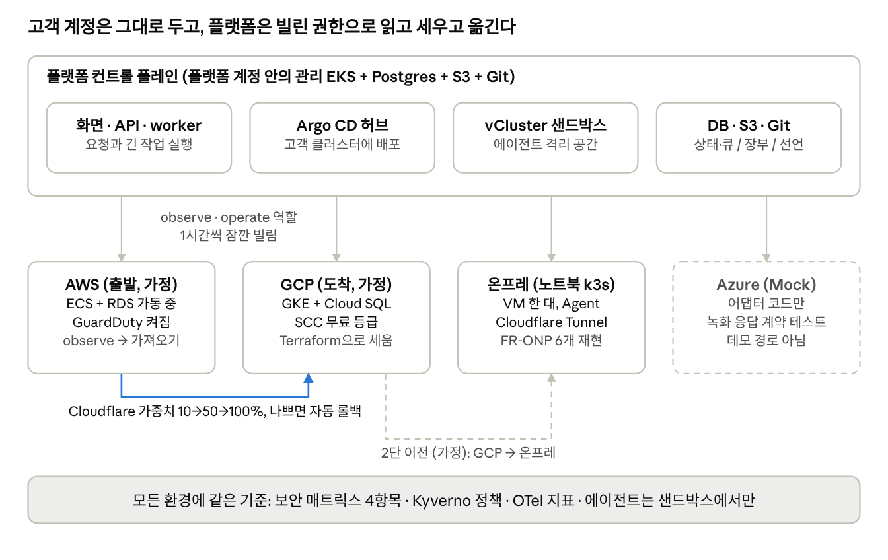
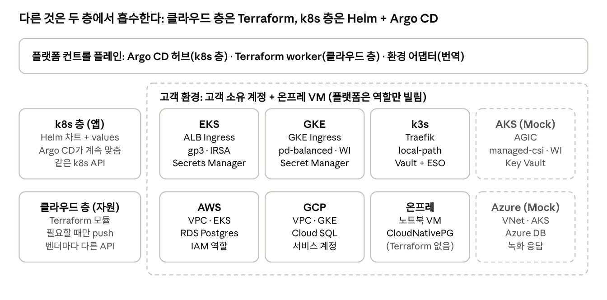
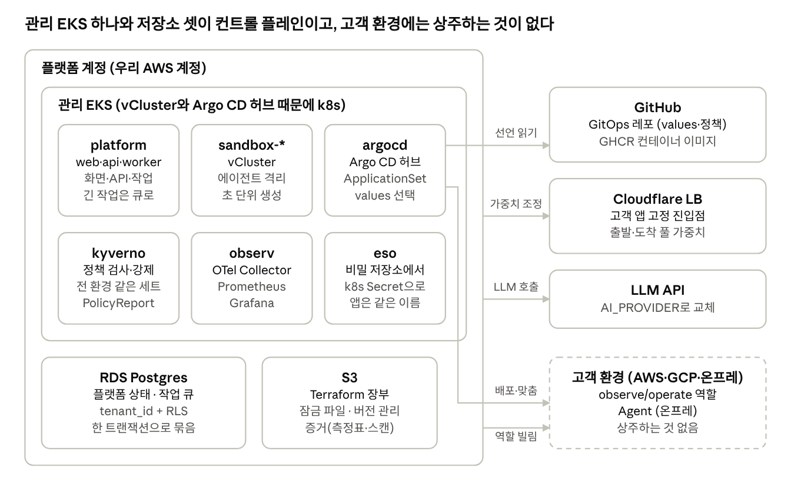
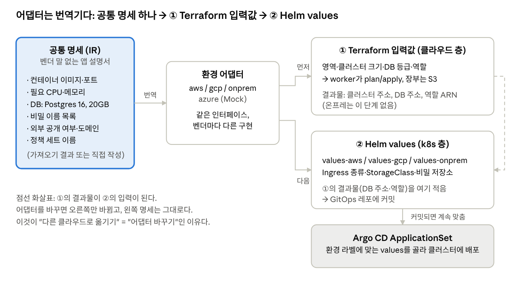
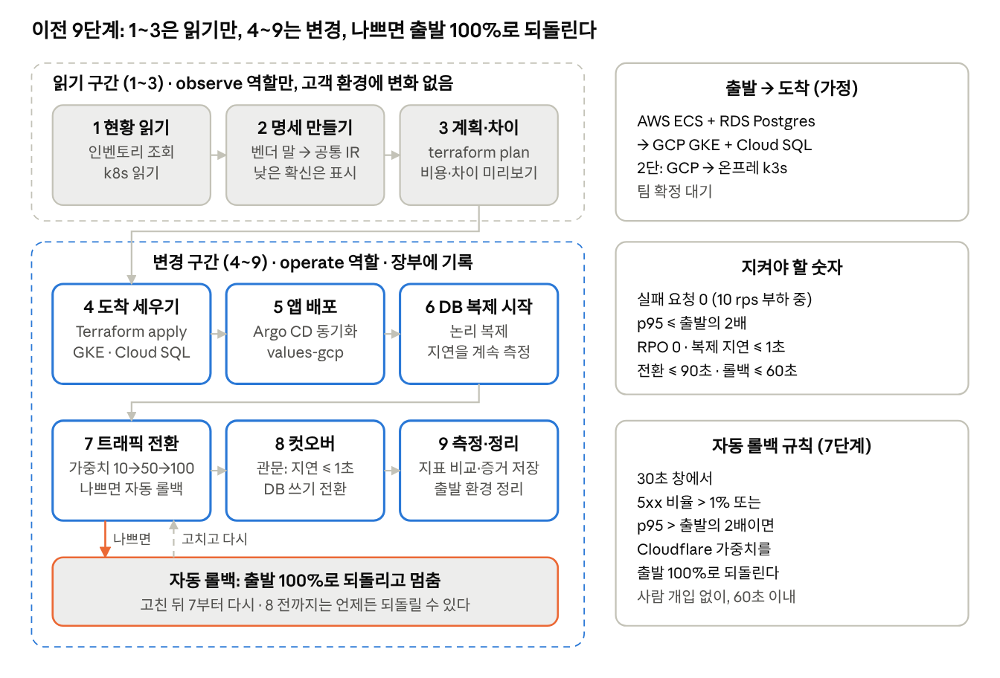
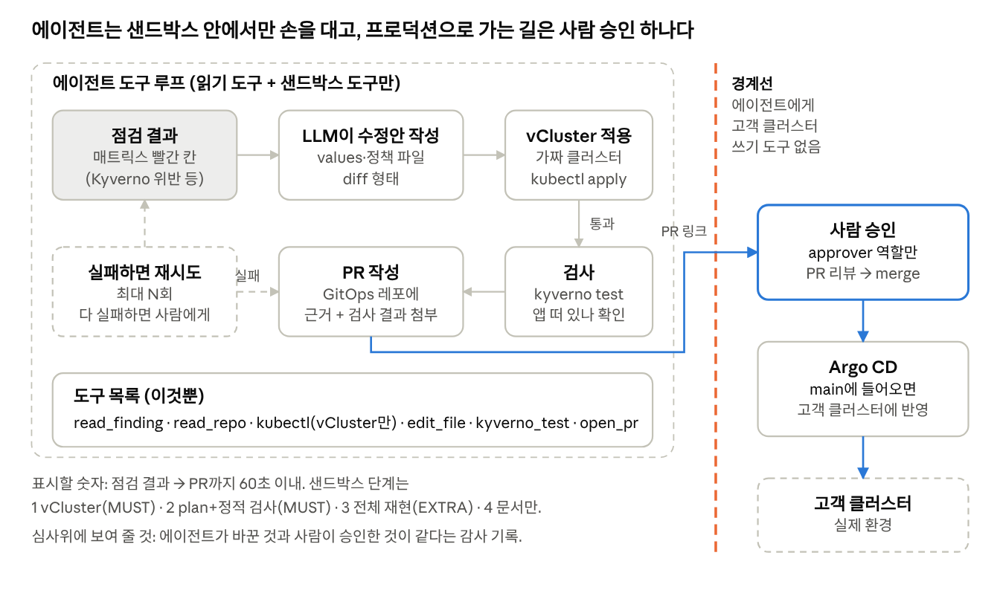

# 본선 플랫폼 아키텍처 가이드 (팀 공유용)

> 원본은 Claude Doc이다: https://claude.ai/artifact/FHQx1MRPzK4Mgzru8s3mez (댓글·편집은 거기서). 이 파일은 2026-10-30 기준 Markdown 복사본이고, 그림은 `img/`에 PNG로 넣었다. 바탕 자료: `decisions/2026-10-30.md`, `notes/research/11-finals-requirements.md`, `notes/research/10-finals-kickoff-brief.md`.

## 0. 이 문서를 읽는 법

이 문서를 끝까지 읽으면 우리 플랫폼이 **무엇을**(가동 중인 앱을 멈추지 않고 다른 클라우드로 옮기고 지킨다), **어떤 부품으로**, **어떤 순서로** 하는지 그림 한 장으로 떠올릴 수 있다. 10/30 킥오프 뒤에 정리한 설계 인터뷰 결과를 팀원이 빠르게 따라잡도록 쓴 문서다. 인프라 경험이 없어도 읽을 수 있게 썼고, 아직 팀이 정하지 않은 것은 "팀 확정 대기"로 표시했다.

**읽는 순서.** 위에서 아래로 한 번 읽는 것을 전제로 썼다. 1장은 대회가 요구하는 것, 2장은 전체 그림, 3장부터 12장까지는 부품을 하나씩, 13장은 지금까지의 결정과 오늘 밤 팀이 정할 것이다. 급하면 2장, 7장(이전 흐름 9단계), 13장만 읽어도 뼈대는 잡힌다.

**용어.** 처음 나오는 용어는 그 단락 바로 아래 "용어" 상자에서 설명한다. 문장 안에 괄호로 끼워 넣지 않았으니, 본문은 본문대로 읽고 모르는 말이 나오면 바로 아래를 보면 된다.

> **용어** · **컨트롤 플레인(control plane)**: 사용자 요청을 받아 "무엇을 어떻게 할지" 결정하고 명령을 내리는 쪽. 실제 앱이 돌아가는 곳(데이터 플레인)과 구분해 부른다. 이 문서에서는 우리 플랫폼 자체를 가리킨다. · **IaC(Infrastructure as Code)**: 서버·네트워크·DB 같은 인프라를 콘솔 클릭이 아니라 코드 파일로 적어 두고, 도구가 그 파일대로 만들게 하는 방식. Terraform이 대표적이다.

**표기 규칙.**

| 표시 | 뜻 |
| --- | --- |
| 【사실】 | 킥오프 자료나 공식 문서에 적혀 있는 것. 쪽수나 출처를 같이 적었다 |
| 【추정】 | 자료에 없고 우리가 해석하거나 제안한 것. 틀릴 수 있다 |
| 【미확인】 | 아직 확인하지 못한 것. 운영이나 팀에 물어야 한다 |
| MUST | 없으면 필수 데모나 심사 기준을 못 채우는 것 |
| EXTRA | 여유가 있으면 하는 것. 설계 문서에는 적되 코드는 나중 |
| Mock | 실제 계정 없이 녹화한 응답으로만 동작하는 부분. 화면에도 Mock이라고 표시한다 |
| 팀 확정 대기 | Jeong의 제안은 있으나 팀 회의에서 정할 것 |

**한 줄 요약.** 고객의 클라우드 계정은 고객 것으로 둔 채, 우리 플랫폼이 잠깐 빌린 권한으로 지금 돌아가는 것을 읽어 들이고(가져오기), 어느 클라우드에서나 통하는 공통 명세로 바꾼 뒤, 목적지에 같은 구조를 세우고, 트래픽을 10% → 50% → 100%로 옮기며, 나빠지면 자동으로 되돌린다. 그동안 보안 상태는 모든 환경을 같은 기준으로 한 화면에 보여 주고, AI 에이전트는 격리된 샌드박스에서만 점검·수정하며 사람이 승인해야 반영된다.

위가 플랫폼 컨트롤 플레인, 아래가 고객이 소유한 환경 네 곳이다. 세로 화살표는 플랫폼이 잠깐 빌리는 역할이고, 아래쪽 화살표가 이전 경로다. Azure는 점선(Mock)이다.

**다 읽고 나면 답할 수 있어야 하는 질문.** 아래 다섯 개에 답할 수 있으면 전체 구조가 머리에 잡힌 것이다.

1. 고객 계정의 비밀 키를 우리 플랫폼이 받는가? (4장)
2. Terraform과 Helm은 각각 무엇을 만들고, 왜 둘로 나뉘는가? (6장)
3. 이전 9단계 중 어디까지는 읽기만 하고, 어디부터 고객 환경을 바꾸는가? (7장)
4. 자동 롤백은 무엇을 보고 결정하며, DB 복제 지연은 왜 롤백 기준이 아닌가? (7장)
5. AI 에이전트의 샌드박스는 어디에 있고, 프로덕션에 손댈 수 없는 이유는 무엇인가? (9장)

## 1. 주제와 보여 줄 것

본선 주제는 "Beyond Lock-In: Frictionless Cloud Management Across Platforms"이고, 핵심 질문은 "이미 프로덕션에서 가동 중인 시스템을 **멈추지 않고 안전하게 옮기고, 지킬 수 있는가**"다 【사실】(킥오프 p14). 예선이 "로컬 앱을 클라우드에 올리기"였다면 본선은 출발점이 "이미 돌아가고 있는 시스템"으로 바뀐다. 그래서 우리 플랫폼은 배포 도구가 아니라 **이전·보호·관찰을 하는 관리 플랫폼**이다.

> **용어** · **Lock-In(락인)**: 한 클라우드의 고유 기능에 묶여서 다른 곳으로 옮기기 어려워진 상태. · **프로덕션**: 실제 사용자가 쓰고 있는 환경. 실험용(개발·스테이징)과 구분한다.

**데모에서 반드시 보여야 하는 장면 3개** 【사실】(p20).

| 장면 | 보여야 하는 것 | 이 문서에서 |
| --- | --- | --- |
| D1 무중단 이전 | 가동 중인 앱이 클라우드 A에서 B로 옮겨 가는 동안 요청이 실패하지 않는 것 | 7장 |
| D2 보안·거버넌스 시각화 | 여러 환경의 권한·암호화·감사·정책 위반 상태를 같은 기준으로 한 화면에 | 8장 |
| D3 AI 에이전트 × 샌드박스 | 에이전트가 격리된 곳에서 점검·수정하고, 사람이 승인해야 반영되는 것 | 9장 |

평가 대상은 앱이 아니라 **플랫폼**이다 【사실】(p20, p22). 관리 대상 앱은 단순해도 되지만 실제로 가동 중이어야 한다.

**심사 배점** 【사실】(p40).

| 배점 | 항목 | 본선 문구의 핵심 |
| --- | --- | --- |
| 30 | 완성도·데모 | 플랫폼이 실제로 동작하고, 이전·보안 시각화를 그 자리에서 시연 |
| 30 | 클라우드 활용 | 여러 환경을 묶는 관리면의 추상화·설계. 프로덕션 운영 상정(무중단 이전·롤백·권한 관리) |
| 10 | 독창성 | 대응 환경의 폭, UX 등 |
| 10 | AI 활용 | 에이전트가 샌드박스에서 점검·코드 변경 |
| 20 | 팀 개발 | 설계 문서화 + 대안·논의 과정·고찰 |

60점이 "그 자리에서 동작"과 "무중단·롤백·권한·추상화"에 걸려 있다. 이 문서의 결정 대부분은 이 네 단어에 맞춰 내려졌다. 평가는 최종 발표만이 아니라 개발 중과 중간 보고도 본다 【사실】(p40, p43).

> **용어** · **관리면(management plane)**: 여러 환경을 한 곳에서 다루는 층. 심사 문구의 "관리면 추상화"는 "AWS든 GCP든 같은 화면·같은 명세로 다룰 수 있는가"를 묻는 말이다.

**발표 형식과 일정** 【사실】(p28\~p37, p51).

| 언제 | 무엇 |
| --- | --- |
| 11/7(토) 10:00 | 코드·설계 문서·발표 자료 링크 제출 (미완성 OK) |
| 11/7 14:00\~17:00 | 중간 보고 7분 (발표 3분 + Q&A 4분). 설계 자료와 아키텍처 그림으로 |
| 11/8(일) 13:00 | 발표 언어 + 통역용 토크 스크립트(Notion) 제출 |
| 11/8 14:00\~16:00 | 최종 발표 5분. 슬라이드 금지, 설계 문서 + 데모 |

슬라이드가 금지라서 **설계 문서와 데모가 곧 발표**다. 목업이 있으면 목업이라고 밝혀야 한다 【사실】(p36). 지원금은 팀당 ₩500,000(인프라 + AI 요금)이고 초과분은 자비다 【사실】(p25).

## 2. 큰 그림

플랫폼의 뼈대는 세 가지 결정으로 요약된다. ① 고객의 클라우드 계정은 고객 것으로 두고 우리는 역할만 빌린다(운영 모델 A). ② 실제로 켜는 환경은 AWS·GCP·온프레 세 곳이고, Azure는 어댑터 코드와 Mock까지만 한다. ③ 환경마다 다른 것을 흡수하는 층을 둘로 나눈다. 클라우드 자원은 Terraform, 그 위의 앱은 Helm + Argo CD.

왼쪽 두 상자가 층 이름과 담당 도구이고, 오른쪽 점선 안이 고객 소유 환경이다. 같은 행은 같은 도구가 다루고, 칸마다 값만 다르다.

### 2.1 운영 모델 A: 고객 계정은 고객 것, 우리는 역할만 빌린다

고객은 자기 AWS·GCP 계정을 그대로 가진다. 우리 플랫폼은 그 계정 안에 고객이 직접 만들어 준 **역할** 두 개(observe = 읽기만, operate = 바꾸기)를 필요할 때만 잠깐 빌려 쓴다. 비밀 키를 받지 않고, 빌린 권한은 1시간이면 만료되며, 무엇을 했는지는 고객 계정의 감사 로그에 남는다. 대안이었던 모델 B(플랫폼이 계정을 만들어 소유)는 비용과 책임이 플랫폼에 몰리고 그 자체가 새로운 락인이라 버렸다.

> **용어** · **역할(IAM role)**: 클라우드 계정 안에서 "이런 일을 할 수 있다"는 권한 묶음. 사람 계정과 달리 비밀번호가 없고, 허락된 상대가 잠깐 "맡아서" 쓴다. · **감사 로그(audit log)**: 누가 언제 무엇을 했는지 자동으로 남는 기록. AWS에서는 CloudTrail이 맡는다.

### 2.2 실환경 3곳 + Azure Mock

| 환경 | 상태 | 역할 |
| --- | --- | --- |
| AWS | 실제 계정 | 데모 출발지(가정). 기존 앱이 ECS + RDS로 돌아가는 곳 |
| GCP | 실제 계정 | 데모 도착지(가정). GKE + Cloud SQL |
| 온프레 (노트북 VM의 k3s) | 실제 | 세 번째 실환경. "클라우드 기능의 온프레 재현" 기둥 담당 (12장) |
| Azure | 어댑터 코드 + Mock | 실계정 없음. 녹화한 응답으로 계약 테스트만. 화면에 Mock 표시, 데모 경로 아님 |

설계와 공통 명세, 어댑터 인터페이스는 네 환경이 대칭이다. 실제로 켜는 곳만 셋으로 줄였다. 이유는 Azure 계정·Lighthouse·유료 보안 플랜의 비용과 시간, 그리고 온프레가 주제의 기둥 하나("클라우드에서 당연하던 기능을 온프레에서 재현")를 직접 맡기 때문이다 【사실】(p16).

> **용어** · **k3s**: 쿠버네티스를 작게 만든 배포판. 노트북 VM 한 대에서도 돈다. · **Mock / 계약 테스트**: 실제 Azure 대신 "이렇게 물으면 이렇게 답한다"를 녹화해 두고, 우리 어댑터 코드가 그 답을 올바르게 다루는지 검사하는 것. 코드는 진짜지만 상대는 가짜다.

### 2.3 두 층: 클라우드 층과 k8s 층

환경이 다르면 다른 것이 두 종류 있다. 하나는 **클라우드 자원**이다. 네트워크(VPC), 클러스터, 관리형 DB, 권한(IAM)처럼 벤더 API로 만들어야 하고, 한번 만들면 잘 안 바뀐다. 다른 하나는 **그 위에서 도는 앱**이다. 컨테이너 이미지, 설정, 비밀, 인그레스처럼 자주 바뀌고, 쿠버네티스 안에서는 어느 클라우드든 거의 같은 YAML로 적을 수 있다.

그래서 층을 둘로 나눈다. 클라우드 층은 **Terraform**이 만들고(우리가 필요할 때 실행), k8s 층은 **Helm 차트 + Argo CD**가 맡는다(Argo CD가 계속 실제 상태를 선언과 맞춘다). 둘 사이는 "환경 어댑터"가 잇는다. 공통 명세 하나에서 Terraform 입력값과 Helm values를 각각 뽑아낸다(6장).

> **용어** · **Terraform**: IaC 도구. "VPC 하나, 클러스터 하나, DB 하나"를 파일로 적으면 벤더 API를 불러 만들어 주고, 만든 결과를 장부(state)에 기록한다. · **Helm**: 쿠버네티스 앱 설치 패키지 도구. 차트(템플릿) + values(환경별 값)를 합쳐 YAML을 만든다. · **Argo CD**: Git에 적힌 YAML과 클러스터의 실제 상태를 계속 비교해서 맞추는 도구(GitOps). · **인그레스(Ingress)**: 바깥에서 들어오는 HTTP 요청을 클러스터 안 서비스로 보내 주는 입구.

### 2.4 전체를 한 문장으로

고객이 원클릭으로 역할을 만들어 주면(4장) → 플랫폼이 지금 돌아가는 것을 읽어 공통 명세를 만들고(5장) → 어댑터가 목적지용 Terraform 입력값과 Helm values로 번역하고(6장) → 9단계 흐름으로 기반 생성·배포·DB 복제·트래픽 전환·컷오버를 밟으며(7장) → 그동안 보안 매트릭스는 모든 환경을 같은 기준으로 보여 주고(8장) → 에이전트는 샌드박스에서만 손을 댄다(9장). 이 모든 것이 여러 고객을 섞이지 않게 다루는 컨트롤 플레인(3장, 10장) 위에서 돈다.

## 3. 컨트롤 플레인 구성

컨트롤 플레인은 플랫폼 계정 안의 관리용 EKS 한 개와 그 옆의 저장소 셋(Postgres, S3, GitHub)으로 이루어진다. 고객 환경에는 아무것도 상주시키지 않는다(온프레만 예외로 Agent 하나).

왼쪽 큰 상자가 플랫폼 계정이고, 그 안의 관리 EKS에 네임스페이스 6개가 있다. 오른쪽으로 나가는 화살표는 Argo CD가 선언을 읽고 배포하는 길(위·아래)과 worker가 Cloudflare 가중치·LLM·고객 역할을 쓰는 길이다. 고객 환경에는 Agent(온프레) 말고는 아무것도 상주하지 않는다.

| 부품 | 어디에 | 하는 일 | 왜 이것인가 |
| --- | --- | --- | --- |
| web / api / worker | 관리 EKS, platform 네임스페이스 | 화면, API, 긴 작업(가져오기·Terraform·전환) 실행 | 컨테이너면 충분. k8s 위에 올린 이유는 아래 부품들과 한곳에 두기 위해 |
| Argo CD 허브 + ApplicationSet | 관리 EKS, argocd 네임스페이스 | 고객 환경 클러스터(EKS·GKE·k3s)에 앱을 배포하고 계속 맞춤 | 멀티 클러스터 GitOps의 표준. 예선 PoC 경험 |
| vCluster 샌드박스 | 관리 EKS, sandbox-\* 네임스페이스 | 에이전트가 손대는 격리된 가짜 클러스터 | 네임스페이스 하나에 완전한 k8s API를 띄워 줌. 초 단위 생성 |
| Kyverno | 관리 EKS + 고객 클러스터 | 정책 검사·강제(예: 루트 컨테이너 금지) | YAML로 정책을 쓰고 Argo CD로 전 환경에 같은 세트 배포 |
| ESO (External Secrets Operator) | 관리 EKS + 고객 클러스터 | 비밀 값을 각 환경의 비밀 저장소에서 가져와 k8s Secret으로 | 비밀은 코드·이미지 밖에 두고 런타임 주입 |
| observ (OTel Collector·Prometheus·Grafana) | 관리 EKS | 모든 환경의 지표를 한 그래프에 | 무중단 증명(실패 요청 0, p95)의 근거 |
| RDS Postgres | 플랫폼 계정 | 플랫폼 상태(테넌트·환경·이전 기록) + 작업 큐(pg-boss) | 상태 변경과 "다음 작업 넣기"를 한 트랜잭션으로 |
| S3 | 플랫폼 계정 | Terraform 장부(`tfstate/<tenant>/<env>`), 증거 파일(측정표·스캔 결과) | 버전 관리 + 잠금 파일로 동시 실행 방지 |
| GitHub GitOps 레포 + GHCR | GitHub | 배포 선언(Helm values)과 컨테이너 이미지 | Argo CD가 보는 곳. PR이 곧 승인 흐름 |
| Cloudflare Load Balancer | Cloudflare | 고객 앱의 고정 진입점. 출발·도착 풀에 가중치 | DNS TTL 없이 즉시 전환·롤백 |
| LLM API | 외부 | 에이전트의 두뇌. AI\_PROVIDER 한 곳에서 교체 | 제공자 종속 없음 |

> **용어** · **EKS / GKE**: AWS와 GCP의 관리형 쿠버네티스. 마스터 노드를 벤더가 운영해 준다. · **네임스페이스(namespace)**: 한 클러스터 안을 칸막이로 나눈 것. 이름·권한·자원 한도를 따로 둘 수 있다. · **작업 큐(job queue)**: "이 작업을 해 달라"를 줄 세워 두는 곳. worker가 하나씩 꺼내 처리한다. 가져오기나 Terraform 실행처럼 몇 분 걸리는 일은 API 요청 안에서 끝낼 수 없어서 큐에 넣는다. · **pg-boss**: Postgres 테이블을 큐로 쓰는 라이브러리. · **GitOps**: 원하는 상태를 Git에 적고, 도구가 그대로 맞추게 하는 운영 방식. 변경 이력 = Git 이력.

### 3.1 왜 관리 EKS인가

web·api·worker만이라면 컨테이너 서비스 하나로 충분하다. 쿠버네티스가 꼭 필요한 부품은 두 개다. vCluster 샌드박스(k8s 안에서만 만들 수 있다)와 Argo CD 허브(여러 클러스터를 관리하는 도구 자체가 k8s 위에서 돈다). 이 둘 때문에 관리 클러스터가 필요하고, 그렇다면 나머지도 같은 곳에 올리는 편이 운영이 단순하다. 데모에서는 EKS 대신 VM 1대의 k3s로 시작해도 같은 매니페스트가 돈다(팀 확정 대기).

### 3.2 왜 Postgres에 큐까지 두나

큐에 들어가는 것은 사용자 요청이 아니라 "몇 분짜리 작업"이다. 어림잡아 고객 1,000곳이 하루 5번 이전하고 이전마다 20단계라면 초당 1.2건 수준이다 【추정】. 이 정도면 Postgres로 충분하고, 더 중요한 장점은 **상태 바꾸기와 다음 작업 넣기를 한 트랜잭션으로 묶을 수 있다**는 것이다. SQS 같은 별도 큐를 쓰면 "DB에는 바뀌었는데 큐에는 안 들어감" 같은 틈이 생겨 아웃박스 패턴이 추가로 필요하다. 큐는 enqueue/consume 인터페이스 뒤에 숨겨 두고, 부하 테스트로 한계를 재서 초당 100건이 지속되면 Temporal로 바꾼다.

> **용어** · **트랜잭션**: 여러 DB 변경을 "전부 되거나 전부 안 되거나"로 묶는 것. · **SKIP LOCKED**: Postgres에서 여러 worker가 같은 줄을 동시에 집지 않도록, 이미 잡힌 줄은 건너뛰고 다음 줄을 가져오는 문법. pg-boss가 이걸 쓴다. · **아웃박스 패턴**: 보낼 메시지를 일단 DB 테이블에 같이 적어 두고 나중에 큐로 옮기는 기법. 큐가 바깥에 있을 때 필요하다. · **Temporal**: 긴 작업 흐름(재시도·타이머·단계)을 전문으로 다루는 워크플로 엔진. 강하지만 부품이 늘어난다.

### 3.3 Terraform 장부(state)는 왜 S3에 두나

Terraform은 "코드에 적은 것"과 "실제 클라우드"를 바로 비교하지 않는다. 자기가 만든 자원의 ID를 적어 둔 **장부(state)** 를 사이에 둔다. 흐름은 "코드 → 장부와 비교 → 차이만 클라우드에 적용 → 장부 갱신"이다. 장부가 로컬 파일이면 worker가 여러 개일 때 서로 다른 장부를 보게 되므로, S3 한 곳에 두고 잠금 파일(use\_lockfile)로 동시에 두 실행이 못 돌게 한다. 버전 관리를 켜 두면 잘못된 장부로부터 되돌릴 수도 있다. Terraform에는 루프가 없다. 우리가 실행할 때만 비교·적용하고, 반면 Argo CD는 계속 돈다. 이 차이가 6장의 "두 도구" 설명의 핵심이다.

## 4. 고객 환경 연결

연결은 고객이 링크 하나를 눌러 자기 계정에 역할 두 개를 만들어 주는 것으로 끝난다. 플랫폼은 비밀 키를 받지 않고, 역할을 빌릴 때마다 1시간짜리 임시 자격증명을 받는다.

### 4.1 원클릭 템플릿이 하는 일 (AWS 기준)

1. 고객이 플랫폼 화면에서 "AWS 연결"을 누른다. 플랫폼은 이 고객(테넌트)만의 **ExternalId**를 발급하고, 그 값이 미리 채워진 CloudFormation 빠른 생성 링크를 만든다.
2. 고객 관리자가 링크를 누르면 AWS 콘솔이 열리고, 템플릿 내용(역할 2개와 권한)이 보인다. 고객은 내용을 보고 "생성"을 누른다. 이때 고객은 이미 브라우저에서 AWS에 로그인해 있어야 한다.
3. CloudFormation이 고객 계정 안에 역할 두 개를 만든다. `observe`는 읽기 전용, `operate`는 변경 권한. 두 역할 모두 "플랫폼 계정이, 이 ExternalId를 가지고 올 때만 맡길 수 있다"는 신뢰 조건이 붙는다.
4. 플랫폼은 `verifyConnection(tenant)`로 역할을 실제로 한 번 맡아 보고(AssumeRole), 돌아온 계정 ID가 고객이 등록한 것과 같은지 확인한다. 이 확인은 시간마다 재사용한다.
5. 이후 worker는 작업할 때마다 AssumeRole로 1시간짜리 임시 자격증명을 받아 쓴다. 호출 기록은 고객 계정의 CloudTrail에 남는다.

> **용어** · **CloudFormation**: AWS의 IaC 서비스. 템플릿(YAML)을 주면 자원을 만들어 준다. "빠른 생성 링크"는 템플릿 주소와 값을 URL에 담아 클릭 한 번으로 콘솔의 생성 화면까지 가게 한 것. · **AssumeRole**: "저 역할을 지금부터 잠깐 맡겠다"고 AWS에 요청하는 호출. 성공하면 임시 자격증명(키 3개)을 돌려준다. · **STS(Security Token Service)**: 그 임시 자격증명을 발급하는 AWS 서비스. · **ExternalId**: 역할을 맡을 때 같이 내야 하는 비밀 번호표. 아래 4.2.

### 4.2 ExternalId와 "혼동된 대리인"

우리 플랫폼은 고객 여러 곳의 역할을 맡는다. 만약 역할 신뢰 조건이 "플랫폼 계정이면 OK"뿐이라면, 악의적인 사용자가 **남의 계정 역할 ARN**을 우리 플랫폼에 등록해서 플랫폼이 대신 그 계정을 건드리게 만들 수 있다. 플랫폼은 권한이 있고 누가 시켰는지 혼동하므로 "혼동된 대리인(confused deputy)" 문제라고 부른다. ExternalId는 이걸 막는다. 플랫폼이 고객마다 다른 값을 발급하고, 역할은 그 값을 같이 낼 때만 맡겨진다. 남의 역할 ARN을 등록해도 그 역할의 ExternalId를 모르니 실패한다. 고객은 이 값을 바꿀 수 없고, 유출되면 플랫폼이 재발급한다.

> **용어** · **ARN**: AWS 자원 하나를 가리키는 전체 주소. 역할도 ARN이 있다.

### 4.3 observe 역할의 권한은 어디까지

읽기 전용이라고 AWS 관리형 정책 `ReadOnlyAccess`를 붙이면 안 된다. 거기엔 S3 객체 내용 읽기(s3:GetObject)가 들어 있어서 고객 데이터 파일을 읽을 수 있게 된다. 대신 `ViewOnlyAccess`(목록·설명만)나 우리가 필요한 describe/list 호출만 담은 자체 정책을 쓴다. 가져오기(5장)에 필요한 것은 "무엇이 있는지"이지 "안에 뭐가 들었는지"가 아니다. 비밀 값과 DB 데이터는 절대 읽지 않는다.

### 4.4 환경별 연결 방식

| 환경 | 고객이 하는 일 | 플랫폼이 빌리는 방식 | 상태 |
| --- | --- | --- | --- |
| AWS | CloudFormation 빠른 생성 링크 클릭 → 역할 2개 생성 | AssumeRole + ExternalId → STS 임시 자격증명 1시간 | MUST |
| GCP | Cloud Shell에서 스크립트 한 줄 실행 → 서비스 계정 2개 + 플랫폼이 가장할 권한 | 서비스 계정 가장(impersonation), 단기 토큰 | MUST |
| 온프레 | VM에서 Agent 설치 한 줄 | Agent가 Cloudflare Tunnel로 밖으로 연결(인바운드 포트 0) | MUST |
| Azure | ARM 템플릿 → Lighthouse 위임 | 플랫폼 테넌트가 위임받은 권한으로 | 어댑터 코드 + Mock |

> **용어** · **서비스 계정 가장(impersonation)**: GCP에서 "이 서비스 계정인 척 토큰을 달라"고 요청하는 방식. AWS의 AssumeRole에 해당. · **Cloud Shell**: GCP 콘솔 안에서 바로 여는 터미널. 고객이 이미 로그인한 권한으로 스크립트가 돈다. · **Cloudflare Tunnel**: 온프레 VM이 **바깥으로** Cloudflare에 접속을 열어 두고, 플랫폼은 그 터널을 통해 들어가는 방식. 방화벽에 인바운드 포트를 열 필요가 없다. · **Azure Lighthouse**: 다른 Azure 테넌트의 구독을 관리할 권한을 위임받는 Azure 기능.

### 4.5 엣지 케이스는 어떻게 다루나

연결에는 막히는 경우가 여럿 있다. 로그인 안 된 브라우저, 엉뚱한 계정에 로그인, 권한 부족, 조직 정책(SCP)으로 역할 생성 금지, IaC만 허용하는 회사, 재연결, 역할 삭제, ExternalId 유출, GCP 프로젝트 여러 개. 이 중 코드로 막는 것은 둘뿐이다. **계정 ID 검증**(엉뚱한 계정)과 **주기적 verifyConnection**(역할 삭제·권한 변경 감지). 나머지는 화면 안내문과 설계 문서의 표로 다룬다. 대안이던 "임시 관리자 키를 받아 플랫폼이 대신 실행"(모델 B)도 같은 엣지 케이스를 그대로 가지면서 키를 받는 위험만 더해져서 버렸다.

> **용어** · **SCP(Service Control Policy)**: AWS 조직 전체에 걸리는 상위 정책. 계정 관리자가 허락해도 조직 정책이 막으면 안 된다.

## 5. 가져오기(import)

가져오기는 고객 계정에서 "지금 무엇이 돌아가고 있는지"를 observe 역할로 읽어 공통 명세 초안을 만드는 단계다. 본선 출발점이 "이미 가동 중인 시스템"이라서 이 단계가 없으면 "원래 너희가 배포한 앱만 옮기는 것 아니냐"는 질문에 약해진다. 예선 분석기가 "소스 코드 → 명세"였다면 본선은 "돌고 있는 환경 → 명세"로 확장하는 이야기가 된다(FR-BASE-01).

### 5.1 순서

1. **인벤토리.** 벤더가 제공하는 "내 계정 자원 목록" 서비스를 한 번 호출해 무엇이 있는지 목록을 얻는다. 자원 하나하나를 찾아다니는 게 아니다.
2. **상세 조회(describe).** 목록에서 우리 범위(컨테이너 서비스, k8s, 그에 붙은 LB·DB·비밀 이름)에 해당하는 것만 골라 상세 설정을 읽는다. 예: ECS 태스크 정의의 이미지·CPU·환경변수 이름, ALB 리스너, RDS 엔진·버전.
3. **k8s는 네임스페이스 통째로.** 출발지가 EKS·GKE면 k8s API로 네임스페이스의 Deployment·Service·Ingress·ConfigMap을 그대로 읽는다. 원클릭 템플릿에 클러스터 읽기 권한(EKS Access Entry, GKE Viewer, AKS RBAC Reader)을 미리 넣어 둔다.
4. **보안 서비스 상태.** GuardDuty·Security Hub·SCC 같은 보안 서비스가 켜져 있는지도 읽는다(8장의 "이전 시 보안 서비스 규칙"에 쓰인다).
5. **공통 명세로 변환.** 읽은 것을 환경과 무관한 공통 명세(IR)로 바꾼다. 서비스 이름, 이미지, 포트, 복제 수, 환경변수 이름, 비밀 이름, DB 종류·버전, 인그레스 경로.
6. **AI가 확신 낮은 칸 표시.** 벤더 설정에서 공통 명세로 1:1로 안 떨어지는 칸(예: ECS의 특정 네트워크 모드가 k8s에서 무엇에 해당하나)은 AI가 추정값을 넣고 "확신 낮음"으로 표시한다.
7. **사람이 확인.** 사용자가 표시된 칸을 보고 고치거나 승인한다. 승인된 명세가 이전 계획의 입력이 된다.

> **용어** · **인벤토리 서비스**: AWS Resource Explorer(또는 AWS Config), GCP Cloud Asset Inventory, Azure Resource Graph. 계정 전체 자원을 한 번에 목록으로 주는 서비스. · **describe**: 클라우드 API에서 "이 자원의 설정을 알려 줘"에 해당하는 호출 종류. · **공통 명세 / IR(Intermediate Representation)**: 어느 환경에서 왔든, 어느 환경으로 가든 같은 형식으로 적은 앱 구조. · **ECS / Cloud Run / Container Apps**: AWS·GCP·Azure의 쿠버네티스 없는 컨테이너 실행 서비스. · **태스크 정의(task definition)**: ECS에서 "어떤 이미지를 얼마의 CPU·메모리로 어떤 환경변수로 돌릴지" 적은 설정. k8s의 Deployment에 해당.

### 5.2 환경별로 읽는 곳

| 환경 | 목록 | 상세 | k8s 읽기 | 보안 서비스 상태 |
| --- | --- | --- | --- | --- |
| AWS | Resource Explorer 또는 AWS Config | ECS·ALB·RDS·Secrets Manager describe | EKS Access Entry (읽기) | GuardDuty·Security Hub 켜짐 여부 |
| GCP | Cloud Asset Inventory | Cloud Run·Cloud SQL·Secret Manager | GKE Viewer 역할 | SCC 등급 |
| 온프레 | Agent가 k3s API 조회 | 같은 k8s 읽기 | Agent | 없음 (Prowler·kube-bench가 채움) |
| Azure (Mock) | Resource Graph | Container Apps·AKS | AKS RBAC Reader | Defender (녹화 응답) |

### 5.3 범위와 못 가져오는 것

범위는 **컨테이너 서비스 + k8s**다. k8s는 이미 YAML이라 Helm values로 거의 그대로 옮겨져 쉽고, 컨테이너 서비스는 태스크 정의가 사실상 같은 정보를 담고 있다. 가져오지 않는 것은 다음과 같다.

- **비밀 값과 DB 데이터.** 이름만 읽는다. 값은 이전 단계에서 고객의 비밀 저장소 간에 직접 옮기거나 고객이 넣는다.
- **Terraform 장부(state).** 장부는 GitHub가 아니라 고객의 S3 버킷에 있어 추가 권한이 필요하고, Terraform을 안 쓰는 고객에겐 의미가 없다. 그래서 MUST가 아니라 **확장 지점**이다. 가져오기 소스를 어댑터 인터페이스(인벤토리 / k8s / Agent / tfstate)로 두어, 고객이 버킷을 알려 주면 힌트로 더 읽을 수 있게 열어 둔다.
- **프라이빗 클러스터.** API 엔드포인트가 밖에서 안 보이면 온프레처럼 클러스터 안에 Agent를 둔다.
- **서비스 디스커버리 기반 탐색.** 주소만 알려 주고 설정은 못 주므로 의존 관계 힌트로만(EXTRA).

측정값은 가져오기 1회 소요 시간과 **필드 채움률**(사람이 고치지 않고 맞은 칸 / 전체 칸)이다.

> **용어** · **서비스 디스커버리**: 서비스들이 서로의 주소를 찾게 해 주는 장치(Cloud Map, k8s DNS 등). "누가 어디 있나"는 알려 주지만 "어떻게 설정됐나"는 모른다.

## 6. 환경 추상화: 어댑터가 두 가지를 번역한다

공통 명세 하나를 받아 환경마다 다른 두 종류의 출력을 만드는 코드가 **환경 어댑터**다. 출력 ①은 Terraform 입력값(클라우드 층), 출력 ②는 Helm values(k8s 층)다. 새 환경을 추가하는 비용은 어댑터 1개 + Terraform 모듈 1개 + values 파일 1개다(NFR-15).

왼쪽이 벤더 말이 없는 공통 명세이고, 가운데 어댑터가 그걸 오른쪽 두 가지로 번역한다. ①이 먼저 돌고 그 결과(DB 주소, 역할)가 ②에 들어간다. ②이 GitOps 레포에 커밋되면 Argo CD가 알아서 배포한다.

### 6.1 출력 ①: Terraform 입력값 (클라우드 층)

공통 명세에 "Postgres 15, 디스크 20GB, 복제 2"라고 적혀 있으면 AWS 어댑터는 그것을 RDS 모듈의 변수(engine\_version, allocated\_storage, multi\_az)로, GCP 어댑터는 Cloud SQL 모듈의 변수(database\_version, disk\_size, availability\_type)로 바꾼다. 네트워크, 클러스터, DB, IAM(Pod가 클라우드 API를 부를 권한)이 여기 속한다. Terraform은 우리가 필요한 때(기반 생성 단계, 변경 승인 뒤)에만 실행하고, 결과값(DB 주소, 서비스 계정 이름)을 돌려준다.

> **용어** · **Terraform 모듈**: "RDS 하나 만들기" 같은 자원 묶음을 변수만 받는 함수처럼 포장한 것. · **출력값(output)**: 모듈이 만든 뒤 돌려주는 값. DB 엔드포인트 주소가 대표적이다.

### 6.2 출력 ②: Helm values (k8s 층)

앱 자체는 환경과 무관한 Helm 차트 하나로 적는다. 환경마다 다른 값만 values 파일로 뻐다. ①에서 나온 DB 주소와 서비스 계정 이름이 여기로 흐러 들어간다. Argo CD의 ApplicationSet이 "환경 = aws면 values-aws.yaml, gcp면 values-gcp.yaml"처럼 골라 각 클러스터에 배포하고, 그 뒤로는 계속 실제 상태를 선언과 맞춘다.

| 항목 | AWS | GCP | 온프레 (k3s) | Azure (Mock) |
| --- | --- | --- | --- | --- |
| Ingress 종류 | ALB Ingress Controller | GKE Ingress / Gateway | Traefik (k3s 기본) | AGIC |
| 디스크(StorageClass) | gp3 | pd-balanced | local-path | managed-csi |
| Pod의 클라우드 권한 | IRSA / Pod Identity | Workload Identity | 없음 (k8s RBAC만) | Workload Identity |
| 비밀 저장소 (ESO가 읽는 곳) | Secrets Manager | Secret Manager | Vault | Key Vault |
| DB 주소 | RDS 엔드포인트 (①의 출력) | Cloud SQL (①의 출력) | CloudNativePG 서비스 | Azure DB (녹화값) |
| 외부 노출 | ALB → Cloudflare 풀 | GCLB → Cloudflare 풀 | Cloudflare Tunnel | — |

> **용어** · **values 파일**: Helm 차트의 빈칸을 채우는 설정 파일. 같은 차트에 다른 values를 넣으면 다른 환경용 YAML이 나온다. · **ApplicationSet**: Argo CD에서 "클러스터 목록 × 앱 목록"을 한 번에 만들어 주는 기능. 환경이 늘어도 선언 하나만 추가. · **StorageClass**: k8s에서 "디스크를 어디서 어떻게 만들지"를 정한 이름. 벤더마다 다르다. · **IRSA / Workload Identity**: Pod에 클라우드 권한을 주는 방식. 키 파일 없이 "이 Pod는 이 역할"로 묶는다. · **ESO(External Secrets Operator)**: 각 벤더의 비밀 저장소에서 값을 가져와 k8s Secret으로 만들어 주는 부품. 앱은 어느 환경에서든 같은 이름의 Secret만 본다.

### 6.3 왜 Terraform과 Helm 둘로 나누나

하나로 합치는 길도 있었다. Terraform이 앱까지 배포하거나(helm/kubernetes provider), 거꾸로 쿠버네티스가 클라우드 자원까지 만들거나(Crossplane). 둘로 나눈 이유는 네 가지 차이 때문이다.

| 차이 | 클라우드 층 (Terraform) | k8s 층 (Helm + Argo CD) |
| --- | --- | --- |
| 대상 API | 벤더마다 전혀 다른 API (RDS vs Cloud SQL) | 어느 벤더든 같은 k8s API |
| 변경 빈도 | 드물 (처음 한 번, 가끔 크기 변경) | 잦음 (이미지 태그, 설정, 복제 수) |
| 실행 방식 | 우리가 트리거할 때 push (루프 없음) | Argo CD가 계속 reconcile (드리프트 자동 복구) |
| 순서 | 먼저 (클러스터가 있어야 앱을 올림) | 나중 |

Terraform이 앱까지 맡으면 자기 복구(self-heal)와 Rollouts 같은 k8s 생태계 도구를 못 쓰고 장부에 앱 상태까지 섞인다. Crossplane은 가장 강한 대안이지만 첫 클러스터는 어차피 따로 만들어야 하고, 3사 프로바이더 성숙도와 학습 비용이 5일에 맞지 않아 버렸다. 업계에서도 이 조합이 가장 흔하다.

> **용어** · **reconcile(조정)**: "원하는 상태"와 "실제 상태"를 비교해 차이를 메우는 반복 동작. Argo CD와 k8s 컨트롤러의 기본 원리. · **드리프트(drift)**: 누군가 손으로 바꿔서 선언과 실제가 어긋난 상태. · **Crossplane**: k8s 안에서 YAML로 클라우드 자원(DB·버킷)을 만들게 해 주는 도구. · **Argo Rollouts**: k8s 안에서 새 버전을 조금씩 내보내고(카나리) 문제 시 되돌리는 도구. 한 클러스터 안의 전환이라 클러스터 간 전환은 Cloudflare가 맡는다.

## 7. 이전 흐름 9단계

이전은 9단계로 진행하고, 1\~3단계는 읽기만 하며, 4단계부터 고객 환경을 바꾼다. 트래픽은 Cloudflare 가중치로 10 → 50 → 100%로 옮기고, 도착 쪽이 나빠지면 30초 창 판정으로 자동 롤백한다.

위 점선 상자가 읽기 구간(1\~3), 아래 상자가 변경 구간(4\~9)이다. 7단계에서 숫자가 나쁘면 아래 롤백 상자로 내려갔다가 고친 뒤 7로 돌아온다. 오른쪽 세 상자는 가정한 경로, 지켜야 할 숫자, 롤백 규칙이다.

| # | 단계 | 하는 일 | 쓰는 것 | 고객 환경 변경 | 측정 |
| --- | --- | --- | --- | --- | --- |
| 1 | 연결 | 원클릭 템플릿으로 역할 생성, verifyConnection | observe | 없음 | 클릭 수, 검증 시간 |
| 2 | 가져오기 | 인벤토리 → describe → 공통 명세 → 사람 확인 | observe | 없음 | 소요 시간, 채움률 |
| 3 | 계획·점검 | 목적지 어댑터로 번역, Terraform plan, 정적 검사, 보안 서비스 대응표, 에이전트 사전 점검(샌드박스), 승인 | observe + 샌드박스 | 없음 | 경고 수, 검증 ≤ 60초 |
| 4 | 기반 생성 | 목적지에 VPC·클러스터·DB·IAM 생성 | Terraform (operate) | 목적지 생성 | 소요 시간 |
| 5 | 배포 | Helm values 생성 → PR → Kyverno 검사 → Argo CD가 목적지 클러스터에 배포, 헬스체크 | Argo CD | 목적지 | 헬스체크 통과 시각 |
| 6 | DB 복제 | 출발 DB → 도착 DB 논리 복제 시작, 지연 0까지 대기 | Postgres logical replication | 출발 DB에 publication | 복제 지연 |
| 7 | 트래픽 전환 | Cloudflare 가중치 10 → 50 → 100%, 단계마다 지표 확인 | Cloudflare LB API | 트래픽만 | 실패 요청 수, p95 |
| 8 | 컷오버 | 쓰기를 도착 DB로 전환 (7.2) | worker | 출발 DB 읽기 전용 | 읽기 전용 창 초, 손실 0 |
| 9 | 정리 | 출발 자원 정리 또는 유지 선택, operate 역할 세션 종료, 측정표 생성 | — | 선택 | 자동 측정표 |

> **용어** · **헬스체크**: "살아 있니?"를 주기적으로 묻는 요청. 통과해야 트래픽을 보낸다. · **p95**: 요청 100개 중 느린 쪽 5개를 뻜 나머지의 최대 응답 시간. 평균보다 "느린 사용자"를 잘 보여 준다. · **5xx**: 서버 쪽 오류 응답 코드. · **컷오버(cutover)**: 쓰기를 포함해 모든 것을 새 환경으로 최종 전환하는 순간.

### 7.1 트래픽 전환: Cloudflare Load Balancing 가중치

사용자가 쓰는 주소는 Cloudflare에 두고, 그 뒤에 출발 풀과 도착 풀을 둔다. worker가 API로 가중치를 10 → 50 → 100%로 올린다. 프록시 방식이라 DNS 캐시(TTL)를 기다릴 필요가 없어 초 단위로 바뀝고, 되돌리기도 같은 API 한 번이다. 헬스체크에 실패한 풀은 자동으로 빠진다. 어느 클라우드에도 속하지 않아 주제와 맞고, 예선에서 쓴 경험이 있다. 대안이던 DNS 가중치(TTL 캐시 때문에 느림), 벤더 글로벌 LB(종속), 자체 프록시(단일 장애점)는 버렸다. 유료 부가 기능 월 요금은 확인 필요 【미확인】.

> **용어** · **오리진 풀(origin pool)**: 로드밸런서 뒤에 있는 실제 서버 묶음. 우리는 출발 환경 풀과 도착 환경 풀 두 개. · **DNS TTL**: DNS 답을 얼마나 오래 캐시해도 되는지 정한 시간. DNS로 전환하면 이 시간만큼 예전 주소로 가는 사용자가 남는다.

### 7.2 DB 복제와 컷오버

출발 Postgres에서 도착 Postgres로 **논리 복제**를 건다. 출발 DB의 변경이 생기는 대로 도착 DB에 따라 적히고, 둘의 차이를 "복제 지연"이라 부른다. 앱은 트래픽 전환 중에도 출발 DB에만 쓴다(도착 클러스터의 앱도 출발 DB를 본다). 컷오버는 다섯 단계다.

1. 출발 DB를 읽기 전용으로 바꾼다(새 쓰기가 들어오지 않게).
2. 복제 지연이 0이 될 때까지 기다린다.
3. 시퀀스(자동 증가 번호)를 도착 DB에서 출발과 같은 값으로 맞춘다.
4. 앱의 DB 주소를 도착 DB로 바꾼다(values 변경 → Argo CD 반영 또는 Secret 교체).
5. 쓰기를 재개한다.

1\~5 사이가 "읽기 전용 창"이고, 이 길이를 초 단위로 측정해 정직하게 보여 준다. 목표는 수 초다 【추정】. 복제 지연은 **롤백 기준이 아니라 컷오버 전 관문**이다. 지연이 0이 아니면 쓰기 전환을 금지한다. 아직 열린 것 세 가지: 읽기 전용 창에 들어온 쓰기를 어떻게 할지(재시도 / 오류 / 큐), 출발·도착 DB 사이 네트워크 경로(공개 IP + TLS + 허용 목록 / VPN), 롤백용 역방향 복제를 걸지.

> **용어** · **논리 복제(logical replication)**: Postgres가 "이 테이블들의 변경을 구독자에게 보내라"(publication/subscription)로 다른 DB에 변경을 전달하는 기능. 버전이나 클라우드가 달라도 된다. · **시퀀스**: id 같은 자동 증가 번호를 내는 카운터. 복제로 데이터는 옮겨도 카운터는 안 옮겨져서 따로 맞춘다. · **RPO**: 잃어도 되는 데이터의 양. 우리 목표는 0.

### 7.3 자동 롤백 판정

도착 쪽에서 **5xx 비율이 1%를 넘거나, p95가 출발 쪽의 2배를 넘는 상태가 30초 창에서 지속**되면 가중치를 출발 100%로 되돌린다. 비교 기준을 절대값이 아니라 출발 대비로 둔 이유는 원래 느린 앱에서도 공정하기 위해서다. 30초인 이유는 10 rps 부하에서 약 300건 표본이 모여 오탐이 줄고, 창 30초 + 가중치 복귀 시간이 롤백 목표 60초 안에 들어오기 때문이다. 15초 창(표본 150건, 오탐)과 60초 창(목표 초과)을 버렸다. 숫자는 리허설에서 조정한다. 수동 롤백 버튼과 절차서(runbook)는 별도로 둔다 【사실】(p16 "切り戻しの手順").

> **용어** · **rps**: 초당 요청 수. · **오탐(false positive)**: 사실 멀정한데 나쁘다고 판정해 불필요하게 되돌리는 것. · **runbook**: 누가 무엇을 어떤 순서로 하는지 적은 운영 절차서.

### 7.4 데모 경로 (팀 확정 대기)

Jeong의 제안은 **AWS(ECS + RDS) → GCP(GKE + Cloud SQL) → 온프레(k3s)** 2단 이전이다. 최종 5분에는 AWS → GCP 라이브, 중간 보고 Q&A에서 GCP → 온프레 라이브를 추천한다. 이전 한 번의 목표가 90초 이내라 5분 안에 두 번은 빠듯하고, 온프레 구간은 현장 네트워크와 노트북 메모리 위험이 있다. 데모 앱은 플랫폼 없이 Terraform으로 AWS에 먼저 띄워 두고, 플랫폼은 가져오기부터 시작한다.

## 8. 보안·거버넌스 매트릭스

매트릭스는 환경(행) × 항목 4개(열: 권한·암호화·감사 로그·정책 위반)이고, 목표는 **빈칸 0**이다 【사실】(p18, FR-SEC-02). 칸을 누르면 근거(어느 도구가 무엇을 검사해 어떤 결과를 냈는지)가 보인다.

### 8.1 두 종류의 재료: 점검과 위협

| 종류 | 무엇 | 도구 | 어느 환경 |
| --- | --- | --- | --- |
| 점검(설정 검사) | "설정이 기준에 맞나"를 주기적으로 검사. 결과는 통제 ID별 pass/fail | Prowler(클라우드 계정 설정), Kyverno(k8s 정책), Trivy(이미지·설정 취약점), kube-bench(k8s 노드 설정, 온프레) | 모든 환경. 고객 설정과 무관하게 플랫폼이 깔아서 돌림 |
| 위협(탐지 서비스) | "지금 수상한 일이 일어나고 있나"를 벤더 서비스가 알려 줌 | AWS GuardDuty, GCP Security Command Center | 데모 경로 2곳만 실제로 켜. GuardDuty 30일 체험, SCC는 무료 등급 범위 |

두 재료를 **OCSF** 공통 스키마(심각도·자원·규칙·시각)로 바꿔 한 표에 넣는다(FR-SEC-01 Must). Falco(커널 수준 런타임 위협 탐지)는 요구사항의 4항목에 없어 EXTRA다.

> **용어** · **Prowler**: AWS·GCP·Azure·k8s 설정을 CIS 같은 기준으로 수백 개 검사하는 오픈소스. · **Kyverno**: k8s 안에서 "이런 YAML은 금지/수정"을 정책으로 적용하는 도구. 8.3. · **Trivy**: 컨테이너 이미지와 설정 파일의 취약점 스캐너. · **kube-bench**: k8s 노드가 CIS 벤치마크를 지키는지 검사. 관리형(EKS·GKE)은 벤더가 노드를 관리해 온프레에서만 의미가 크다. · **GuardDuty / SCC**: AWS·GCP의 위협 탐지 서비스. 이상한 API 호출, 악성 IP 접속 등을 알려 준다. · **OCSF(Open Cybersecurity Schema Framework)**: 보안 finding의 공통 형식. AWS Security Hub가 표준으로 채택. · **CIS 벤치마크**: 보안 설정의 업계 표준 체크리스트.

### 8.2 항목 4개 × 환경

| 항목 | 통제 (예) | AWS | GCP | 온프레 | Azure (Mock) |
| --- | --- | --- | --- | --- | --- |
| 권한 | 루트/소유자 계정 MFA, 최소 권한 역할, k8s RBAC 과다 권한 없음 | Prowler | Prowler | Kyverno + RBAC 검사 | 녹화 |
| 암호화 | 저장 암호화(DB·디스크), 전송 TLS, 비밀이 코드·이미지에 없음 | Prowler + Trivy | Prowler + Trivy | Trivy + Vault 확인 | 녹화 |
| 감사 로그 | 클라우드 감사 로그 켜짐, k8s audit log 켜짐, 플랫폼 조작 기록 | CloudTrail 확인 | Cloud Audit Logs 확인 | k8s audit 정책 파일 | 녹화 |
| 정책 위반 | 루트 컨테이너 금지, 리소스 제한 필수, 공개 버킷 없음 | Kyverno + Prowler | Kyverno + Prowler | Kyverno | 녹화 |

통제 ID 12개의 정확한 목록은 구현 때 Prowler·Kyverno 규칙 ID로 고정한다(항목당 3개씩). 이전 전후 비교표(출발 vs 도착 통제 12개 pass 수)가 "이전 후에도 같은 수준으로 지켜진다"(FR-SEC-06)의 근거가 된다.

### 8.3 Kyverno가 하는 일

Kyverno는 k8s에 들어오는 YAML을 정책으로 검사·수정·거부한다. 우리는 다섯 역할로 쓴다. ① 금지(루트로 도는 컨테이너 거부), ② 필수(리소스 제한 없으면 거부), ③ 자동 수정(라벨 자동 추가), ④ 보고(위반을 PolicyReport로 남겨 매트릭스 재료), ⑤ 샌드박스 검증(`kyverno test`로 에이전트의 수정안을 반영 전에 검사). 같은 정책 세트를 Argo CD로 모든 클러스터에 배포하므로 "같은 기준으로 보호"(FR-SEC-03)가 문자 그대로 성립한다.

> **용어** · **어드미션 컨트롤러(admission controller)**: k8s API가 YAML을 저장하기 직전에 끼어들어 검사·수정하는 장치. Kyverno가 이 자리에 앞는다. · **PolicyReport**: Kyverno가 클러스터 안 위반 현황을 적어 두는 k8s 자원.

### 8.4 이전 시 보안 서비스 규칙 (제품 규칙)

가져오기에서 출발 환경의 보안 서비스가 켜져 있는지(GuardDuty·Security Hub·SCC·Defender)를 읽는다. 계획 단계에서 대응표를 보여 준다. 켜져 있던 것은 "도착에서 대응 서비스를 켤까요?"라고 묻고(기능 차이·권한 한계 표시, 예: SCC 위협 탐지는 조직 단위 Premium), 꺼져 있던 것은 그대로 두고 권장만 표시한다. 승인하면 operate 역할로 적용한다. 고객이 쓰던 보안 수준을 이전 뒤에도 유지하는 것이 "안전하게 옮긴다"의 핵심이고, 묻는 단계를 계획 승인에 붙이면 화면이 늘지 않는다. 데모에서는 "출발 AWS에 GuardDuty 켜짐 → 도착 GCP에 SCC 켤까요?"를 실제로 보여 준다.

## 9. AI 에이전트와 샌드박스

에이전트는 우리가 정한 좁은 도구 4\~5개만 쓰는 자체 도구 루프이고, 손대는 곳은 플랫폼이 소유한 샌드박스뿐이다. 프로덕션에 쓰는 도구는 목록에 아예 없어서, 권한 경계가 코드로 증명된다.

왼쪽 점선 안이 에이전트가 도는 루프다. 점검 결과를 받아 수정안을 만들고, vCluster에 적용해 보고, 검사를 통과하면 PR을 연다. 세로 경계선 오른쪽으로 가는 길은 PR 링크 하나뿐이고, 그 다음은 사람이 merge하고 Argo CD가 반영한다.

### 9.1 자체 도구 루프

LLM API의 도구 호출 기능을 쓰되, 도구는 우리가 정의한다.

| 도구 | 하는 일 | 닿는 곳 |
| --- | --- | --- |
| kubectl get / apply (샌드박스) | vCluster 안 상태 조회·변경 | 샌드박스만 |
| GitOps 파일 읽기·수정 | Helm values·매니페스트 수정 | 브랜치 (main 아님) |
| kyverno test | 수정안이 정책을 통과하는지 | 로컬 검사 |
| PR 생성 | 수정안을 사람에게 제출 | GitHub PR |
| (선택) 점검 결과 조회 | Prowler·Trivy 결과 읽기 | 읽기 전용 |

루프는 "점검 결과 읽기 → 수정안 작성 → 샌드박스에 적용 → kyverno test → 통과하면 PR"을 60초 안에 돈다(NFR-19). 실패 1건은 차단되고 성공 1건은 반영되는 것을 둘 다 기록해 데모에 쓴다(FR-AGT-03). LLM 제공자는 AI\_PROVIDER 한 곳에서 Anthropic 직접 / Bedrock 등으로 바꾼다(예선 방식). Claude Agent SDK(넓은 기본 도구를 막는 설정 필요)와 LangGraph(학습 비용)를 버린 이유는 도구 목록 자체가 권한 경계여야 하기 때문이다.

> **용어** · **도구 호출(tool use)**: LLM이 "이 함수를 이 인자로 불러 줘"라고 답하면 우리 코드가 실행하고 결과를 다시 넣어 주는 방식. · **도구 루프**: 그걸 답이 나올 때까지 반복하는 것. · **PR(Pull Request)**: Git에서 "이 변경을 main에 넣어 달라"는 요청. 사람이 보고 승인한다. · **브랜치**: Git에서 main과 분리된 작업 줄기. 여기 적은 것은 병합 전까지 실제 배포에 영향이 없다.

### 9.2 vCluster: 네임스페이스 하나에 가짜 클러스터

vCluster는 관리 EKS의 네임스페이스 하나 안에 **완전한 k8s API 서버**를 띄운다. 에이전트 입장에서는 진짜 클러스터와 똑같이 kubectl이 되지만, 실제 Pod는 그 네임스페이스 안에서만 돈다. 초 단위로 만들고 지울 수 있어 에이전트 실행마다 깨끗한 샌드박스를 줄 수 있다. 고객 환경에는 아무것도 만들지 않는다. 화면에는 샌드박스 식별자(예: sandbox-tenantA-run42)가 보여서 "변경이 거기서만 일어났다"를 심사위원이 확인할 수 있다(FR-AGT-02).

### 9.3 샌드박스 단계안

| 단계 | 재현하는 것 | 우선 |
| --- | --- | --- |
| 1 | k8s 층: 출발 앱의 매니페스트를 vCluster에 올려 정책·설정 검사 | MUST |
| 2 | 클라우드 층: 목적지 Terraform plan + 정적 검사(tflint·Checkov 등)만. 적용 안 함 | MUST |
| 3 | 데모 도착 클라우드 1곳 전체 재현: 이전용 Terraform 모듈을 플랫폼 샌드박스 계정에 재사용 | EXTRA |
| 4 | 3사 전체 재현 | 설계 문서만 |

전체 재현을 MUST로 하지 않은 이유는 관리형 DB·클러스터 생성이 수 분\~15분 걸려【추정】 "에이전트 1회 ≤ 60초"와 충돌하고, 예산·공수가 크기 때문이다. 출발 앱이 ECS·Cloud Run이면 vCluster로 감싸지 못하므로 2단계의 plan·정적 검사가 그 틈을 메운다. 고객 계정에는 plan만 하고, 적용은 승인 뒤 operate로만 한다.

> **용어** · **terraform plan**: 실제로 만들지 않고 "무엇이 바뀔지"만 계산해 보여 주는 명령. · **정적 검사**: 실행하지 않고 파일만 읽어 문제를 찾는 검사. tflint는 Terraform 문법·관례, Checkov는 보안 설정을 본다.

### 9.4 승인 흐름과 권한 경계

에이전트 → PR → 사람(approver 역할)이 승인 → main 병합 → Argo CD가 반영. 에이전트에게는 프로덕션 쓰기 도구가 없고, 플랫폼 조직 역할에서도 반영 권한은 approver뿐이다(10장). 승인 화면에는 근거·diff·테스트 결과가 한 번에 보인다(FR-AGT-08). 에이전트가 프로덕션을 직접 바꾸려는 시도는 도구가 없어 불가능하고, 그 사실 자체를 데모에서 보여 준다(FR-AGT-06). SoftBank 자체 원칙("에이전트는 최소 권한 RBAC, 모든 변경은 GitOps PR로 사람이 검토")과 같은 모양이라 발표에서 연결해 말할 수 있다 【사실】(요구사항 명세 3.6).

> **용어** · **diff**: 바뀜 전과 후의 차이를 줄 단위로 보여 주는 형식. · **RBAC(Role-Based Access Control)**: 역할별로 할 수 있는 일을 정하는 권한 모델. k8s와 우리 플랫폼 둘 다 이 방식.

## 10. 멀티 테넌트 격리

운영 모델 A는 한 플랫폼이 여러 고객 계정을 다루므로, 고객이 섞이면 바로 사고다. 그래서 멀티 테넌트 격리는 MUST다. 데모 한 컷은 "A 조직으로 로그인하면 B 조직의 환경이 안 보인다"이다.

| 층 | 격리 수단 | 설명 | 우선 |
| --- | --- | --- | --- |
| 데이터 | 모든 테이블에 tenant\_id + Postgres RLS | 쿼리에 WHERE를 빼먹어도 DB가 다른 테넌트 행을 안 보여 줌 | MUST |
| 사용자·권한 | 사용자는 조직 소속, 역할(admin / approver / viewer)은 조직 안에서만 | 이전·롤백·반영은 approver만. 권한 없는 계정의 이전 요청 → 거부 + 기록 | MUST |
| 고객 계정 접근 | 고객별 ExternalId + 세션 이름에 테넌트·작업 ID | 혼동된 대리인 차단 + CloudTrail에서 추적 | MUST |
| 작업 큐 | 테넌트별 동시 실행 상한 | 한 고객의 대량 작업이 다른 고객을 괶기지 않게 | MUST |
| 배포 | 테넌트별 Argo CD AppProject | 한 테넌트의 앱이 다른 테넌트 클러스터로 못 감 | MUST |
| 장부·증거 | `tfstate/<tenant>/<env>`, 증거 경로도 테넌트별 | 섞이지 않는 경로 | MUST |
| 사고 반경 | worker는 작업에 적힌 테넌트의 역할만 빌림, 세션 1시간 | worker 하나가 모든 고객 역할을 쥐는 상황을 막음 | MUST |
| 셀 구조·고객별 KMS·과금 | 테넌트 묶음마다 플랫폼 분리, 고객별 암호화 키 | 설계 문서에만 | EXTRA |

> **용어** · **테넌트(tenant)**: 플랫폼을 쓰는 고객 조직 하나. · **RLS(Row Level Security)**: Postgres가 행 단위로 "이 세션은 이 행만 볼 수 있다"를 강제하는 기능. 앱 코드가 아니라 DB가 막는다. · **AppProject**: Argo CD에서 앱이 어느 레포·어느 클러스터·어느 네임스페이스로 갈 수 있는지 제한하는 단위. · **사고 반경(blast radius)**: 한 부품이 붤리거나 고장 났을 때 피해가 퍼지는 범위. · **KMS**: 클라우드의 암호화 키 관리 서비스. · **셀(cell) 구조**: 고객을 몇 묶음으로 나눠 묶음마다 플랫폼 복사본을 두는 설계. 한 복사본이 죽어도 다른 묶음은 살아 있다.

격리 테스트는 "다른 테넌트 자원 조회 시도 → 0건 또는 403"을 자동 테스트로 둔다. 대안이던 "코드의 WHERE tenant\_id만으로 구분"은 실수 한 번에 붤리고, "테넌트마다 플랫폼 통째 분리"는 비용과 운영이 안 맞아 버렸다. 심사 문구의 "권한 관리"(클라우드 30)에 직접 닿는 부분이다.

## 11. 관측과 측정

무중단은 말이 아니라 숫자로 증명한다. 모든 환경의 지표를 같은 수집기(OpenTelemetry → Prometheus → Grafana)로 모아 한 그래프에 그리고, 이전 1회마다 측정표를 자동으로 만든다. 아래 숫자는 전부 우리가 정한 목표다 【추정】. 킥오프 자료에는 숫자가 하나도 없다.

| 지표 | 목표 | 어디서 재나 | 근거 |
| --- | --- | --- | --- |
| 이전 중 실패 요청 | 0건 (10 rps 지속 부하 아래) | 부하 발생기(k6) 집계 | NFR-01 |
| p95 지연 | 평소의 2배 이내 | OTel / k6 | NFR-02 |
| 데이터 손실 | 0건, 컷오버 시 복제 지연 ≤ 1초 | 순번 붙인 쓰기 N건 → 도착에서 N건 확인 | NFR-03 |
| 이전 전체 시간 | 동기화 시작 → 100% 전환 90초 이내 | 단계 타임스탬프 | NFR-04 |
| 롤백 시간 | 이상 감지 → 출발 100% 복귀 60초 이내 | 장애 주입 시각 \~ 복귀 시각 | NFR-05 |
| 보안 매트릭스 | 빈칸 0, 정보 5분 이내 최신 | 매트릭스 화면 | NFR-09·10 |
| 에이전트 1회 | 점검 → 수정안 → 검증 60초 이내 | 실행 로그 | NFR-19 |
| 읽기 전용 창 | 수 초, 정직하게 표시 | 컷오버 1·5단계 타임스탬프 | NFR-01 폴백 |
| 가져오기 | 소요 시간, 필드 채움률 | 가져오기 로그 | 결정 로그 |

> **용어** · **OpenTelemetry(OTel)**: 지표·로그·트레이스를 같은 형식으로 모으는 표준. 환경이 달라도 한 그래프에 그릴 수 있다. · **Prometheus / Grafana**: 지표 저장소와 그래프 화면. · **k6**: 부하 발생 도구. 초당 N요청을 계속 보내고 실패 수와 지연을 집계한다. · **타임스탬프**: 어떤 일이 일어난 정확한 시각 기록.

수집 경로는 각 클러스터의 OTel Collector(온프레 포함) → 관리 EKS의 Prometheus → Grafana다. 이전 worker는 단계마다 타임스탬프와 지표를 Postgres에 기록하고, 끝나면 측정표를 S3 증거 폴더에 저장해 설계 문서에 붙인다(FR-OBS-04). 플랫폼 조작(이전·롤백·권한 변경·에이전트 반영)은 전부 감사 로그로 남긴다(FR-BASE-07). 부하 발생기는 회장 네트워크와 무관하게 하려면 클라우드 VM에 둔다 【추정】. 데모 앱과 부하 발생기의 세부는 아직 열려 있다(13장).

## 12. 온프레(k3s): 클라우드 기능 6개를 재현한다

온프레는 노트북 VM의 k3s 한 대이고, FR-ONP 6개를 모두 MUST로 재현한다. 여섯 개 모두 k8s 표준 부품이라 클라우드 환경과 같은 매니페스트·정책을 재사용한다. 온프레를 실환경으로 넣은 이상 "클라우드 기능의 온프레 재현"(킥오프 p16)을 반쪽으로 보이면 오히려 약점이 된다.

| FR-ONP | 클라우드에서 당연하던 것 | 온프레 부품 | 합격 기준 |
| --- | --- | --- | --- |
| 01 IAM | 역할·최소 권한 | k8s RBAC + 플랫폼 조직 역할 | 권한 없는 접근 거부 1건 |
| 02 시크릿 | 비밀 저장소 + 런타임 주입 | Vault + ESO (클라우드와 같은 Secret 이름) | 레포·이미지에 시크릿 0건, 앱이 주입된 비밀로 DB 접속 |
| 03 감사 로그 | CloudTrail | k8s audit log (정책 파일로 켜기) → 플랫폼 감사 저장소 | 온프레 이벤트가 플랫폼 화면에 |
| 04 모니터링 | CloudWatch | 같은 OTel Collector + Prometheus | 그래프에 온프레 선 |
| 05 백업·복구 | RDS 스냅샷 | CloudNativePG 백업 → 삭제 → 복구 | 1회 성공, 소요 시간 기록 |
| 06 시각화 | 보안 서비스 화면 | 매트릭스 온프레 행 (Kyverno + kube-bench) | 행 빈칸 0 |

> **용어** · **Vault**: HashiCorp의 비밀 저장소. 온프레에서 Secrets Manager 역할. · **k8s audit log**: API 서버에 들어온 모든 요청을 기록하는 기능. 정책 파일로 무엇을 얼마나 남길지 정한다. · **CloudNativePG**: k8s 안에서 Postgres를 운영(복제·백업·복구)해 주는 오퍼레이터. · **오퍼레이터(operator)**: 특정 소프트웨어의 운영 지식을 k8s 컨트롤러로 만든 것. "Postgres 클러스터 하나"라고 선언하면 알아서 세우고 지킨다.

연결은 Agent 설치 한 줄 + Cloudflare Tunnel(인바운드 0)이다. 위험은 둘이다. 회장 네트워크(터널이 나가는 길이 막히면 끝)와 노트북 메모리(k3s + 앱 + Postgres + 수집기). 플랜 B는 모바일 핫스팟과, 온프레 구간을 중간 보고 Q&A로 옮기는 것이다. 회장 네트워크 조건은 운영에 묻는다 【미확인】.

## 13. 결정 요약과 팀이 정할 것

지금까지의 결정 14개는 레포의 decisions/2026-10-30.md에 선택·대안·이유·측정값·심사 항목 열로 기록되어 있다. 아래는 요약이고, 팀이 오늘 밤 정할 것은 3개다. 모두 Jeong이 혼자 검토해 내린 제안이므로 팀원이 뒤집어도 된다. 뒤집을 때는 "무엇을 버렸고 왜"를 같은 표에 남기면 팀 개발 20점의 재료가 된다.

| 결정 | 선택 | 버린 대안 | 한 줄 이유 |
| --- | --- | --- | --- |
| 가져오기 단계 | 플랫폼에 넣음 | 플랫폼이 배포한 앱만 이전 | 본선 출발점이 "이미 가동 중" |
| 실환경 | AWS·GCP·온프레 + Azure Mock | 3사 실계정 / 온프레 EXTRA | 비용·시간, 온프레는 주제 기둥 |
| 샌드박스 | 플랫폼 소유, 단계별 (vCluster·plan MUST) | 전체 재현 / 고객 계정 안 | 60초 목표, 예산 |
| 멀티 테넌트 | MUST (RLS 등 7층) | 단일 고객 / WHERE만 | 섞이면 사고 |
| 작업 큐 | Postgres pg-boss + 교체 인터페이스 | SQS / Redis / Temporal 지금 | 한 트랜잭션, 초당 1.2건 |
| 고객 연결 | 원클릭 템플릿 (A) | 임시 관리자 키 (B) | 키 안 받음, 최소 권한 |
| 가져오기 범위 | 컨테이너 + k8s, TF 장부는 확장 지점 | TF 장부 MUST / 컨테이너만 | 권한·고객 조건 |
| 트래픽 전환 | Cloudflare LB 가중치 | DNS 가중치 / 벤더 LB / 자체 프록시 | 즉시 전환, 벤더 중립 |
| 자동 롤백 | 5xx>1% 또는 p95>출발 2배, 30초 창 | 에러율만·60초 / 15초 창 | 표본 300건, 60초 안 복귀 |
| 보안 서비스 규칙 | 출발 상태 읽고 계획에서 묻기 | 항상 전부 켜기 / 안 건드림 | 보안 수준 유지 |
| 데모 보안 서비스 | GuardDuty + SCC 2곳 실제 | OSS만 / 3사 모두 | FR-SEC-01 Must, 비용 |
| AI 에이전트 | 자체 도구 루프 | Agent SDK / LangGraph | 도구 목록 = 권한 경계 |
| 온프레 FR-ONP | 6개 모두 MUST | 일부만 / 문서만 | 반쪽이면 약점 |
| 환경 어댑터 | Terraform 입력값 + Helm values | TF가 앱까지 / Crossplane | 대상·빈도·실행 방식 차이 |

**팀이 오늘 밤 정할 것 3개.**

| # | 질문 | Jeong 입장 | 대안 |
| --- | --- | --- | --- |
| 1 | 확장 베이스: 예선 시스템 중 무엇을 토대로 하나 (FR-BASE-01) | camellia 설계만 가져오고 엔진은 새로 (추천) | 팀원 중 가장 완성도 높은 시스템 하나 / 부품 단위로 합침 |
| 2 | k8s를 쓸지 | 쓴다. 플랫폼 계정에 관리 EKS + vCluster + Argo CD 허브 | 컨테이너 서비스만 + 샌드박스는 다른 방식 (v0.1 그림) |
| 3 | 데모 이전 경로 | AWS → GCP → 온프레 2단 (최종 5분은 AWS→GCP, Q&A에서 GCP→온프레) | AWS → Azure AKS / GCP → AWS / AWS → 온프레만 |

**아직 열린 질문.** 컷오버 중 들어온 쓰기 처리, DB 복제 네트워크 경로, 역방향 복제 여부(7.2), Cloudflare LB 요금(7.1), 데모 앱과 부하 발생기 위치(11장), ₩500,000 안의 비용표, 회장 네트워크 조건(12장).

## 14. 더 읽을 거리

| 자료 | 어디 | 무엇 |
| --- | --- | --- |
| 요구사항 명세 v2 | [레포 notes/research/11](https://github.com/Pionia5375/Softbank_Study_1/blob/main/notes/research/11-finals-requirements.md) · [Google Doc](https://docs.google.com/document/d/1-5eYxFLZIEuPxv8F2Xpx4NGOcoKivKFwDJPCVFEwzDY/edit) | FR·NFR·CON ID 전체, 데모 3분 동선, 미확정 질문 15개, 작업 패키지 |
| 킥오프 분석 브리프 | [레포 notes/research/10](https://github.com/Pionia5375/Softbank_Study_1/blob/main/notes/research/10-finals-kickoff-brief.md) | 주제·배점·일정의 원문 쪽수, SoftBank 사업과의 연결 |
| 결정 로그 | [레포 decisions/2026-10-30.md](https://github.com/Pionia5375/Softbank_Study_1/blob/main/decisions/2026-10-30.md) | 결정 14개의 선택·대안·이유·측정값·심사 항목 |
| 아키텍처 그림 v0.3 (k8s) | https://claude.ai/artifact/7YKb66BRg16akXJ3m1WLgV | 이 문서 그림의 원본. 확정 표시 포함 |
| 아키텍처 그림 v0.1 (k8s 없는 안) | https://claude.ai/artifact/AcnpuBvv2GXSQc8oK7uN2W | k8s 여부 결정용 비교 |
| 예선 레포 조사 | [레포 notes/research/12](https://github.com/Pionia5375/Softbank_Study_1/tree/main/notes/research) | 7팀 비교. 교차 환경 전환은 camellia만 |
| 컨트롤 플레인 스택 검토 | [레포 notes/research/15](https://github.com/Pionia5375/Softbank_Study_1/tree/main/notes/research) | Fastify·Zod·pg-boss, Temporal 대안 |
| 레포 전체 | https://github.com/Pionia5375/Softbank\_Study\_1 | PoC 폴더 poc/01\~07, 아키텍처 생성 스크립트 notes/architecture/ |

이 문서의 Markdown 복사본은 레포 notes/guide/finals-architecture-guide.md에 두고 업데이트한다. 문서에 대한 질문은 이 페이지에 댓글로 달아 주면 된다.
